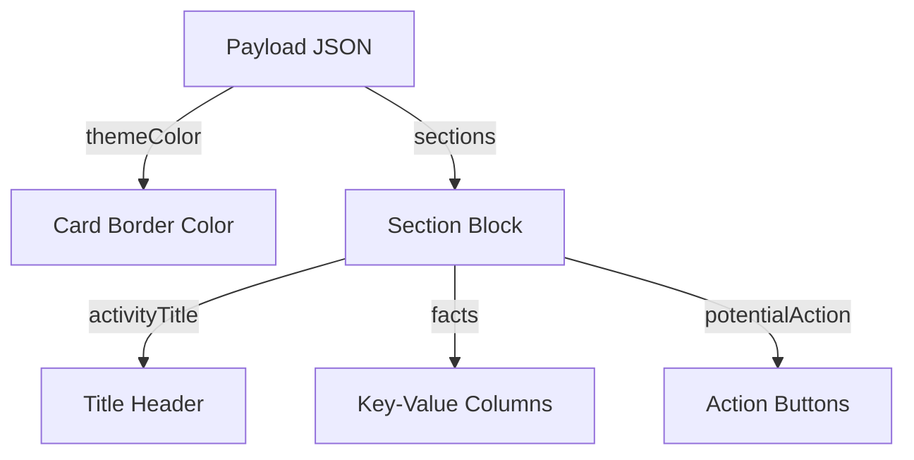

# Microsoft Teams Notifications: Message Cards and Webhooks

In addition to Slack, corporate enterprises frequently use **Microsoft Teams** as their collaboration platform. To notify your team of CI/CD build completions, system resource checks, or database backup statuses, you can post messages directly to a Teams channel.

In this guide, we will connect to Microsoft Teams Incoming Webhooks, examine the **Office 365 MessageCard** JSON schema, and write a Python script to send structured alert cards containing metric facts and action buttons.

---

## Teams Webhook Configuration

1. Open Microsoft Teams and navigate to the channel where you want to receive alerts.
2. Click the three dots (...) next to the channel name and select **Workflows** (or Connectors).
3. Search for the **Post to a channel when a webhook request is received** workflow (or **Incoming Webhook** connector) and add it.
4. Name the webhook, select the target channel, and copy the generated Webhook URL.

---

## MessageCard JSON Schema

Microsoft Teams uses a layout schema called **MessageCard** (also known as Office 365 Connector Cards). It supports:
* **`themeColor`**: Hexadecimal color code for the card border highlight.
* **`sections`**: Multi-block layout collections.
* **`facts`**: List of key-value tuples displayed in columns.
* **`potentialAction`**: Array of action targets (like links to open in a browser).



---

## 1. Sending Structured Teams Message Cards

Here is a Python function that formats and sends a structured MessageCard to Microsoft Teams:

```python
import os
import requests

def send_teams_message_card(title, status, details, facts_dict=None, action_url=None):
    webhook_url = os.environ.get("TEAMS_WEBHOOK_URL")
    if not webhook_url:
        print("Error: TEAMS_WEBHOOK_URL environment variable is not set.")
        return False

    # Define color scheme based on status
    status_colors = {
        "SUCCESS": "36a64f", # Green
        "WARNING": "ff9900", # Orange
        "FAILURE": "ff0000"  # Red
    }
    color = status_colors.get(status.upper(), "808080")

    # Format dictionary into facts list
    facts = []
    if facts_dict:
        for key, value in facts_dict.items():
            facts.append({"name": key, "value": str(value)})

    # Construct MessageCard payload
    payload = {
        "@type": "MessageCard",
        "@context": "http://schema.org/extensions",
        "themeColor": color,
        "summary": title,
        "sections": [
            {
                "activityTitle": f"🔔 {title}",
                "activitySubtitle": f"Status: **{status.upper()}**",
                "text": details,
                "facts": facts,
                "markdown": True
            }
        ]
    }

    # Attach action link buttons if a URL is provided
    if action_url:
        payload["sections"][0]["potentialAction"] = [
            {
                "@type": "OpenUri",
                "name": "🔗 View Details",
                "targets": [
                    {"os": "default", "uri": action_url}
                ]
            }
        ]

    try:
        response = requests.post(webhook_url, json=payload, timeout=5)
        
        # Teams API returns HTTP 200 and text content '1' on successful post
        if response.status_code == 200 and response.text == "1":
            print("✅ Teams message card sent successfully.")
            return True
        else:
            print(f"❌ Teams API returned error: {response.status_code} - {response.text}")
            return False
            
    except requests.RequestException as e:
        print(f"Failed to connect to Microsoft Teams: {e}")
        return False
```

---

## 2. Testing the Teams Alert Integration

Here is how you use the function inside a script to notify the team of a backup failure:

```python
# Save as teams_notifier.py
# (Requires the function defined above)

def notify_backup_failure():
    metadata = {
        "Host": "database-prod-01",
        "Backup Type": "Daily PG Dump",
        "Duration": "184 seconds",
        "Error Code": "ERR_DISK_FULL"
    }
    
    send_teams_message_card(
        title="Backup Script Execution Failure",
        status="FAILURE",
        details="The daily database backup script aborted before completion due to insufficient disk space.",
        facts_dict=metadata,
        action_url="https://monitoring.company.com/logs/backup-04"
    )

# if __name__ == "__main__":
#     notify_backup_failure()
```

---

## Summary

Microsoft Teams message cards provide a clean layout to deliver formatted alerts and logs directly to corporate workspaces. In the next section, we will build a unified **Alert Manager** that routes messages to Slack, Email, PagerDuty, and Teams.
