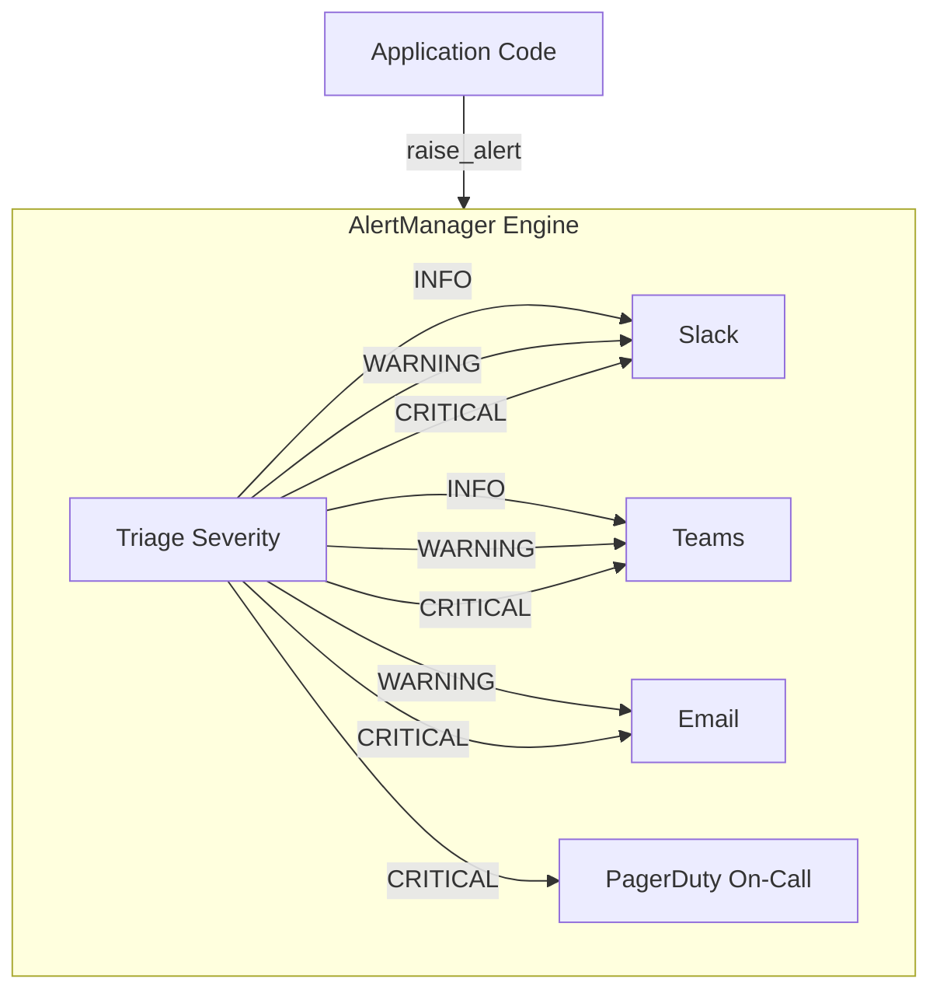

# Building an Alert Manager: Unified Severity-Based Routing

In large-scale cloud applications, hardcoding alert destinations (e.g. calling a Slack function directly from an API file) is an anti-pattern. If you need to add Microsoft Teams, change email targets, or adjust paging rules, you have to search and update multiple files across the codebase.

A better pattern is to design a unified, centralized **Alert Manager**. The Alert Manager acts as an abstraction layer: your application code raises an alert with a severity level (e.g. `INFO`, `WARNING`, `CRITICAL`), and the Alert Manager handles routing the message to the appropriate channels based on configuration.

In this guide, we will implement an object-oriented Python `AlertManager` class that integrates Slack, Email, PagerDuty, and Microsoft Teams notifications and routes them based on severity rules.

---

## Alert Manager Architecture



---

## 1. Unified Alert Manager Implementation

This implementation coordinates connection parameters from environment variables and encapsulates alert dispatching logic inside separate private channels. It includes error trapping so that if one channel fails (e.g. SMTP server timeout), other alerts are still delivered.

```python
import os
import requests
import smtplib
from email.mime.text import MIMEText
from email.mime.multipart import MIMEMultipart

class AlertManager:
    def __init__(self):
        # Load credentials from environment
        self.slack_url = os.environ.get("SLACK_WEBHOOK_URL")
        self.teams_url = os.environ.get("TEAMS_WEBHOOK_URL")
        self.pd_routing_key = os.environ.get("PAGERDUTY_ROUTING_KEY")
        
        self.smtp_server = os.environ.get("SMTP_SERVER")
        self.smtp_port = int(os.environ.get("SMTP_PORT", 587))
        self.sender_email = os.environ.get("SENDER_EMAIL")
        self.sender_pass = os.environ.get("SENDER_PASSWORD")
        self.recipient_email = os.environ.get("RECIPIENT_EMAIL")

    def _send_slack(self, title, severity, message):
        if not self.slack_url:
            return
        emoji = "🚨" if severity == "CRITICAL" else "⚠️" if severity == "WARNING" else "ℹ️"
        payload = {"text": f"{emoji} *[{severity}] {title}*\n{message}"}
        try:
            requests.post(self.slack_url, json=payload, timeout=5)
        except Exception as e:
            print(f"[AlertManager] Slack failed: {e}")

    def _send_teams(self, title, severity, message):
        if not self.teams_url:
            return
        colors = {"CRITICAL": "ff0000", "WARNING": "ff9900", "INFO": "36a64f"}
        color = colors.get(severity, "808080")
        
        payload = {
            "@type": "MessageCard",
            "@context": "http://schema.org/extensions",
            "themeColor": color,
            "summary": title,
            "sections": [{
                "activityTitle": f"[{severity}] {title}",
                "text": message,
                "markdown": True
            }]
        }
        try:
            requests.post(self.teams_url, json=payload, timeout=5)
        except Exception as e:
            print(f"[AlertManager] Teams failed: {e}")

    def _send_email(self, title, severity, message):
        if not all([self.smtp_server, self.sender_email, self.sender_pass, self.recipient_email]):
            return
        msg = MIMEMultipart()
        msg["Subject"] = f"[{severity}] {title}"
        msg["From"] = self.sender_email
        msg["To"] = self.recipient_email
        msg.attach(MIMEText(message, "plain"))
        
        try:
            with smtplib.SMTP(self.smtp_server, self.smtp_port) as server:
                server.starttls()
                server.login(self.sender_email, self.sender_pass)
                server.send_message(msg)
        except Exception as e:
            print(f"[AlertManager] Email failed: {e}")

    def _send_pagerduty(self, title, severity, message):
        if not self.pd_routing_key or severity != "CRITICAL":
            return
        payload = {
            "routing_key": self.pd_routing_key,
            "event_action": "trigger",
            "dedup_key": title.lower().replace(" ", "-"),
            "payload": {
                "summary": f"{title}: {message}",
                "source": "alert-manager",
                "severity": "critical"
            }
        }
        try:
            requests.post("https://events.pagerduty.com/v2/enqueue", json=payload, timeout=5)
        except Exception as e:
            print(f"[AlertManager] PagerDuty failed: {e}")

    def raise_alert(self, title, severity, message):
        """
        Main entry point. Routes alert to targets based on severity.
        """
        severity = severity.upper()
        print(f"🔔 Processing alert: {title} ({severity})")
        
        # 1. INFO alerts go to Slack and Teams
        if severity == "INFO":
            self._send_slack(title, severity, message)
            self._send_teams(title, severity, message)
            
        # 2. WARNING alerts go to Slack, Teams, and Email
        elif severity == "WARNING":
            self._send_slack(title, severity, message)
            self._send_teams(title, severity, message)
            self._send_email(title, severity, message)
            
        # 3. CRITICAL alerts go to all channels (including PagerDuty paging)
        elif severity == "CRITICAL":
            self._send_slack(title, severity, message)
            self._send_teams(title, severity, message)
            self._send_email(title, severity, message)
            self._send_pagerduty(title, severity, message)
            
        else:
            print(f"[AlertManager] Unknown severity level: {severity}")
```

---

## 2. Using the Alert Manager in Your Applications

```python
# Instantiate the Alert Manager
alert_manager = AlertManager()

# Example 1: Non-blocking warning (goes to Slack, Teams, and Email)
alert_manager.raise_alert(
    title="Disk Storage Warning",
    severity="WARNING",
    message="Storage partition `/dev/xvda` is at 88% capacity. Run cleanup soon."
)

# Example 2: Critical database outage (goes to all, including PagerDuty)
alert_manager.raise_alert(
    title="Database Connection Failure",
    severity="CRITICAL",
    message="SQL Database unreachable. Connection pool connection timed out after 5 retries."
)
```

---

## Summary

Building a centralized Alert Manager decouples application logic from transport mechanisms. This clean design makes your codebase modular, easy to test, and ready to adapt to new notification tools as your organization grows. This completes **Chapter 40 - Alerting and Notifications**. In the next chapter, we will cover **Log Analysis**.
