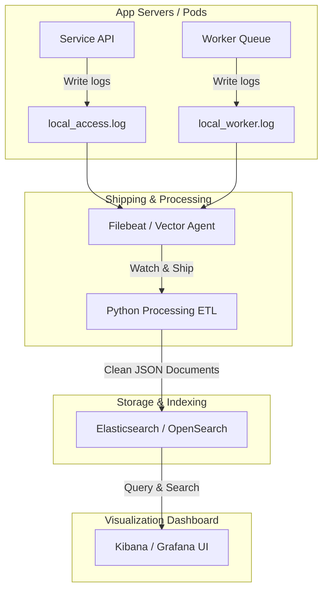

# Log Aggregation: Centralized Collection, Scrubbing, and Enrichment

In a modern distributed architecture, applications run across dozens of virtual machines, Kubernetes pods, or cloud regions. If a transaction fails, logging into individual nodes to search local files is impossible.

**Log Aggregation** is the process of collecting logs from all running nodes, shipping them to a centralized storage engine, and indexing them so they can be queried from a single dashboard interface.

While agents (like Filebeat, Fluentd, or Vector) handle the network transport of files, Python is highly useful for **log processing**. Before logs leave your servers, a Python pre-processor can scrub sensitive data (like credentials or credit card numbers) to maintain compliance and enrich logs with metadata (like resolving user IDs or IP geolocations) to make troubleshooting easier.

In this guide, we will examine the components of a log aggregation pipeline, design a log scrubbing filter in Python, and build a log enrichment processor.

---

## Log Aggregation Architecture

A production-ready log aggregation architecture is divided into four main layers:



1. **Log Shipper**: A lightweight daemon running on every node that watches local log files and streams updates. (e.g. **Filebeat**, **Vector**, **Fluent Bit**).
2. **Log Processor (ETL)**: Cleanses, filters, and formats raw strings into structured JSON. This is where your Python pre-processors run.
3. **Log Storage (Indexer)**: A search database designed for high-performance indexing of text documents (e.g. **Elasticsearch**, **OpenSearch**, **Grafana Loki**).
4. **Log Visualization**: The dashboard interface where engineers run queries and build graphs (e.g. **Kibana**, **Grafana**).

---

## 1. Log Scrubbing (GDPR and PCI Compliance)

Before shipping logs to a centralized database, your scripts must scrub sensitive data like credit card numbers or passwords to prevent credential leaks.

```python
import re

# Match patterns resembling credit cards: 4 groups of 4 digits separated by spaces or hyphens
CREDIT_CARD_PATTERN = re.compile(r"\b(?:\d[ -]*?){13,16}\b")
# Match patterns resembling passwords in configs or APIs
PASSWORD_PATTERN = re.compile(r"(password|secret|auth_token)\s*[:=]\s*['\"]?\w+['\"]?", re.IGNORECASE)

def scrub_sensitive_fields(log_message):
    """
    Identifies and redacts credit cards and passwords from raw logs.
    """
    # 1. Redact credit card patterns
    scrubbed = CREDIT_CARD_PATTERN.sub("[REDACTED_CREDIT_CARD]", log_message)
    
    # 2. Redact password patterns
    scrubbed = PASSWORD_PATTERN.sub(r"\1=******", scrubbed)
    
    return scrubbed
```

---

## 2. Log Enrichment (Adding GeoIP and Context Metadata)

Flat access logs record client IP addresses. To make security audits easier, you can resolve these IP addresses to geographical locations (country/city) and append this metadata to the log document before indexing.

```python
def mock_geoip_resolve(ip_address):
    """
    Simulated GeoIP lookup (in production, use geoip2 library with MaxMind DB).
    """
    if ip_address.startswith("192.168.") or ip_address.startswith("10."):
        return {"country": "Private Network", "city": "LAN"}
        
    # Return mock lookup results
    return {
        "country": "United States",
        "city": "San Francisco",
        "timezone": "America/Los_Angeles"
    }

def enrich_log_document(parsed_log):
    """
    Appends location and system environment metadata to a log document.
    """
    ip = parsed_log.get("client_ip")
    if ip:
        # Resolve location details
        geo_data = mock_geoip_resolve(ip)
        parsed_log["location"] = geo_data
        
    # Add environment details
    parsed_log["environment"] = "production"
    parsed_log["collector_agent"] = "python-etl-v1"
    
    return parsed_log
```

---

## Complete Log Processing ETL Pipeline

Here is a complete script that reads raw access logs, scrubs sensitive data, parses fields, enriches the records with metadata, and formats the output as structured JSON:

```python
import json
from datetime import datetime

# (Requires the helper functions defined in previous sections)

def run_log_processing_etl(raw_log_line):
    # Step 1: Scrub sensitive credentials
    clean_message = scrub_sensitive_fields(raw_log_line)
    
    # Step 2: Parse raw string into fields (Simulating basic split)
    # Expected format: "IP - [TIME] MESSAGE"
    try:
        parts = clean_message.split(" - ")
        ip = parts[0]
        message_part = parts[1]
        
        log_document = {
            "timestamp": datetime.utcnow().isoformat() + "Z",
            "client_ip": ip,
            "raw_message": message_part
        }
        
        # Step 3: Enrich the document
        enriched_document = enrich_log_document(log_document)
        
        # Step 4: Serialize to JSON for indexer ingestion
        json_output = json.dumps(enriched_document)
        return json_output
        
    except IndexError:
        # Handle malformed log lines
        return None

# Test the ETL pipeline
# raw_input = "8.8.8.8 - Failed login for admin with password=SecretPassword. Card used: 4111-2222-3333-4444"
# json_document = run_log_processing_etl(raw_input)
# print(json.dumps(json.loads(json_document), indent=2))
```

---

## Summary

Log aggregation is the standard approach for monitoring distributed architectures. By using Python to build ETL pre-processors, you can scrub sensitive data for compliance and enrich logs with geolocation metadata before indexing. In the next section, we will cover **Regex for Log Parsing**.
