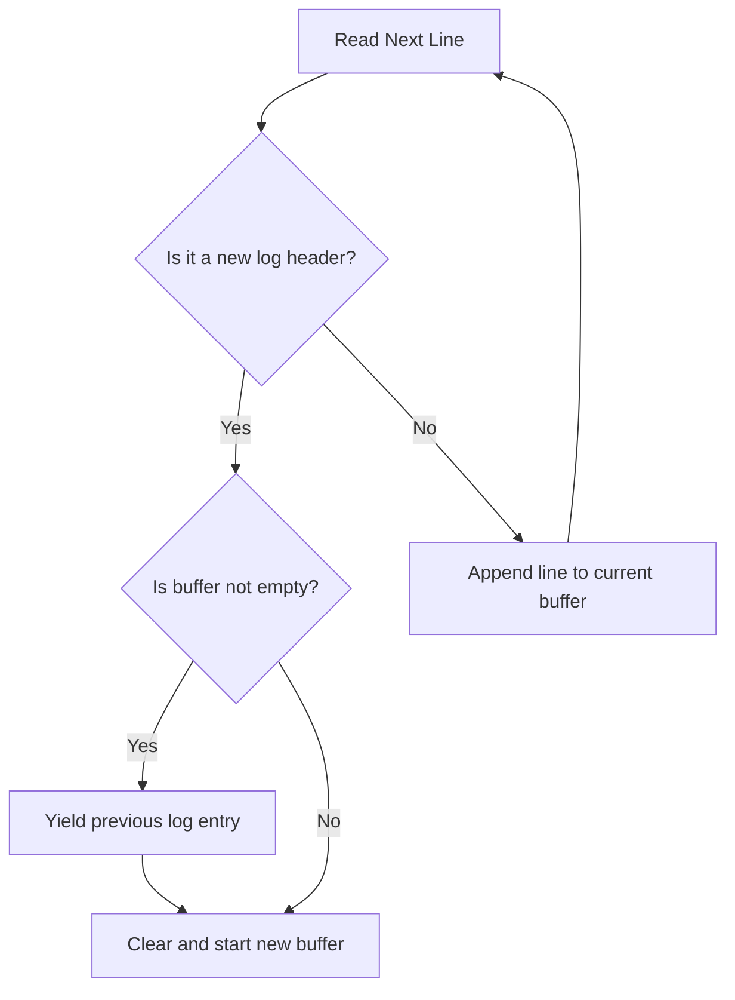

# Analyzing Application Logs: Stateful Multi-Line Log Ingestion

Unlike web servers that log standard one-line HTTP requests, application runtimes generate complex logs. When an error occurs, the application outputs a **multi-line traceback** (an exception stack trace) indicating the line number and function execution chain of the crash.

If you read a multi-line log file line-by-line using a standard parser, you will fail. The traceback lines will be treated as separate logs, separating the stack trace details from the initial error message.

In this guide, we will write a stateful Python parser that identifies log headers, reconstructs multi-line tracebacks into single log documents, and compiles statistics on application exception types.

---

## Stateful Multi-line Parsing Algorithm



A log line is a **header** if it starts with a standard pattern (like an ISO timestamp). If a line does not start with a timestamp, it is a continuation of the previous log entry (a stack trace line or long description block).

---

## 1. Stateful Multi-line Parser Implementation

Here is a Python class that reads a log file containing tracebacks, groups related lines, and yields complete log documents:

```python
import re

class ApplicationLogParser:
    def __init__(self, filepath):
        self.filepath = filepath
        # Regex to identify log headers: matches lines starting with 'YYYY-MM-DD HH:MM:SS'
        self.header_pattern = re.compile(
            r"^(?P<timestamp>\d{4}-\d{2}-\d{2} \d{2}:\d{2}:\d{2})\s+"
            r"\[(?P<level>[A-Z]+)\]\s+"
            r"(?P<message>.+)$"
        )

    def parse_log_file(self):
        """
        Stateful generator that yields complete multiline log records.
        """
        current_entry = []
        current_metadata = {}

        with open(self.filepath, "r", encoding="utf-8") as f:
            for line in f:
                match = self.header_pattern.match(line)
                
                if match:
                    # 1. If we have a buffered log, yield it before starting the next one
                    if current_entry:
                        yield {
                            "timestamp": current_metadata.get("timestamp"),
                            "level": current_metadata.get("level"),
                            "content": "".join(current_entry)
                        }
                    
                    # 2. Reset buffer for the new entry
                    current_entry = [line]
                    current_metadata = match.groupdict()
                else:
                    # 3. Not a header, must be a continuation (e.g. stack trace line)
                    # Append it to the active buffer
                    if current_entry:
                        current_entry.append(line)
                        
            # Yield the final log record at the end of the file
            if current_entry:
                yield {
                    "timestamp": current_metadata.get("timestamp"),
                    "level": current_metadata.get("level"),
                    "content": "".join(current_entry)
                }
```

---

## 2. Analyzing Exception Types in Multi-line Entries

Once log entries are grouped, your script can extract and analyze details within the tracebacks, such as compile exception names (e.g., `KeyError`, `ZeroDivisionError`, `ConnectionRefusedError`) to audit system errors.

```python
import re
from collections import Counter

# (Requires the ApplicationLogParser class defined in the previous section)

def compile_exception_statistics(log_path):
    parser = ApplicationLogParser(log_path)
    exception_counter = Counter()
    total_errors = 0

    print(f"Parsing exceptions from: {log_path}...")

    # Iterate through reconstructed multi-line logs
    for entry in parser.parse_log_file():
        if entry["level"] == "ERROR" or entry["level"] == "CRITICAL":
            total_errors += 1
            
            # Find the specific Exception class name inside the traceback string
            # In Python, exception class names end in 'Error' (e.g., FileNotFoundError)
            matches = re.findall(r"\b([A-Z]\w+Error)\b", entry["content"])
            
            # Increment count for each found exception type
            for exc in matches:
                exception_counter[exc] += 1

    # Print summary report
    print("\n==================================================")
    print("📋 ERROR AND EXCEPTION STATISTICS REPORT")
    print("==================================================")
    print(f"Total Errors Captured: {total_errors}")
    print("\nException Type Frequency:")
    for exc, count in exception_counter.most_common():
        print(f" - {exc:<25} : {count} occurrences")
    print("==================================================")

# Example usage:
# compile_exception_statistics("/var/log/application.log")
```

---

## Summary

Stateful parsing is required to analyze application logs containing multi-line tracebacks. By grouping related lines, your scripts can extract and analyze error types to identify issues in your codebase. In the next section, we will cover how to **send these logs to Elasticsearch**.
