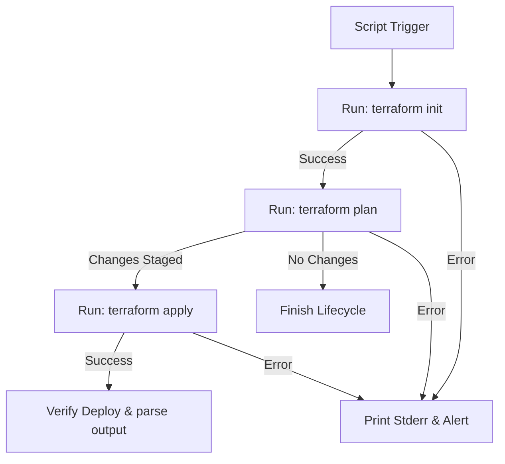

# Running Terraform from Python: Automating Infrastructure Provisioning

Infrastructure as Code (IaC) allows you to define virtual machines, network configurations, database instances, and DNS records in declarative configuration files. **Terraform** is the industry standard for cloud-agnostic IaC. 

While developers run Terraform from the CLI, DevOps automation often requires orchestration:
* Triggering infrastructure builds in response to API requests.
* Programmatically generating dynamic workspaces for sandbox environments.
* Destroying idle environments automatically after a lease period.

Using Python to run Terraform connects your business logic directly to your infrastructure lifecycle. In this guide, we will cover how to run Terraform subcommands (init, plan, apply, destroy) programmatically using Python's `subprocess` module, handle exit codes correctly (including Terraform's spec-compliant detail changes), and wrap operations in the `python-terraform` library.

---

## The Execution Workflow



---

## 1. Running Terraform using Python's `subprocess` Module

The most direct and dependency-free way to run Terraform is using Python's built-in `subprocess` module. We use `subprocess.run()` to execute commands and capture stdout and stderr for processing.

### Specifying Safe Arguments
To prevent command injection, always pass command arguments as lists of strings (e.g. `["terraform", "apply", "-auto-approve"]`) rather than passing raw command strings with `shell=True`.

Here is the implementation of a basic runner class:

```python
import os
import subprocess
import logging

logging.basicConfig(level=logging.INFO, format="%(asctime)s [%(levelname)s] %(message)s")
logger = logging.getLogger("terraform_runner")

class TerraformRunner:
    def __init__(self, working_dir):
        self.working_dir = working_dir
        # Ensure the target directory exists
        if not os.path.exists(working_dir):
            raise FileNotFoundError(f"Terraform directory not found at: {working_dir}")

    def _run_command(self, cmd_args):
        """
        Executes a raw shell command inside the configured working directory.
        """
        try:
            logger.info(f"Executing: {' '.join(cmd_args)}")
            result = subprocess.run(
                cmd_args,
                cwd=self.working_dir,
                capture_output=True,
                text=True,
                check=True # Raises exception if exit code is non-zero
            )
            return result.stdout
        except subprocess.CalledProcessError as e:
            logger.error(f"Command failed with exit code: {e.returncode}")
            logger.error(f"Stderr output:\n{e.stderr}")
            raise e

    def init(self):
        print("Initializing Terraform providers and backends...")
        return self._run_command(["terraform", "init"])

    def validate(self):
        print("Validating configuration files syntax...")
        return self._run_command(["terraform", "validate"])

    def apply(self):
        print("Applying infrastructure changes (auto-approving)...")
        # -auto-approve is required in automation to prevent the process
        # from waiting forever for human input on stdin
        return self._run_command(["terraform", "apply", "-auto-approve"])

    def destroy(self):
        print("Destroying all managed infrastructure resources...")
        return self._run_command(["terraform", "destroy", "-auto-approve"])
```

---

## 2. Advanced: Detailed Exit Codes during `plan`

By default, standard commands return `0` for success and non-zero for failures. However, when auditing changes, you want to distinguish if a plan contains changes, has no changes, or failed.

To do this, pass the **`-detailed-exitcode`** flag to the plan command. Under this mode, Terraform returns:
* **`0`**: Succeeded with empty plan (no changes to apply).
* **`1`**: Command failed due to error.
* **`2`**: Succeeded and found changes (modifications, additions, or destructions exist).

Here is how to handle these exit codes:

```python
# (Add this method inside the TerraformRunner class defined above)

def plan_detailed(self):
    print("Generating speculative execution plan...")
    cmd = ["terraform", "plan", "-detailed-exitcode"]
    
    try:
        # We do NOT use check=True because exit code 2 represents a successful check with modifications
        result = subprocess.run(
            cmd,
            cwd=self.working_dir,
            capture_output=True,
            text=True
        )
        
        exit_code = result.returncode
        
        if exit_code == 0:
            print("✅ Plan complete: No infrastructure changes detected.")
            return "NO_CHANGES", result.stdout
        elif exit_code == 2:
            print("⚠️ Plan complete: Infrastructure changes detected! Ready to apply.")
            return "CHANGES_STAGED", result.stdout
        else:
            print("❌ Plan execution failed.")
            print(f"Stderr:\n{result.stderr}")
            return "FAILED", result.stderr
            
    except Exception as e:
        print(f"Exception during plan: {e}")
        return "ERROR", str(e)
```

---

## 3. Wrapping Command executions in `python-terraform`

If you prefer an object-oriented Python wrapper that abstracts standard command-line flags, you can use the third-party **`python-terraform`** package.

Install the library:
```bash
pip install python-terraform
```

Here is how you use it to execute workflows:

```python
from python_terraform import Terraform, IsFlagged

def run_terraform_with_wrapper(working_directory):
    # Initialize wrapper pointing to working directory
    tf = Terraform(working_dir=working_directory)
    
    # 1. Initialize
    print("Running init...")
    return_code, stdout, stderr = tf.init()
    if return_code != 0:
        print(f"Init failed: {stderr}")
        return False
        
    # 2. Plan
    print("Running plan...")
    return_code, stdout, stderr = tf.plan(detailed_exitcode=True)
    if return_code == 2:
        print("Changes staged. Applying changes...")
        # 3. Apply changes (mapping -auto-approve as boolean)
        tf.apply(skip_plan=True, capture_output=False)
        print("✅ Apply execution completed.")
    else:
        print(f"No changes or plan failed: code={return_code}")

# Example:
# run_terraform_with_wrapper("./tf_infra")
```

---

## 4. Managing Workspaces Programmatically

Workspaces allow you to isolate multiple states within the same configuration folder (e.g. staging vs. production).

```python
# (Add this method inside the TerraformRunner class)

def switch_workspace(self, workspace_name):
    print(f"Switching to workspace: {workspace_name}")
    try:
        # Check if workspace already exists
        result_list = self._run_command(["terraform", "workspace", "list"])
        
        if workspace_name in result_list:
            self._run_command(["terraform", "workspace", "select", workspace_name])
        else:
            print(f"Workspace '{workspace_name}' not found. Creating it...")
            self._run_command(["terraform", "workspace", "new", workspace_name])
            
        print(f"✅ Successfully active on workspace: {workspace_name}")
        return True
    except Exception as e:
        print(f"Failed to switch workspace: {e}")
        return False
```

---

## Summary

Running Terraform from Python bridges your application logical flows to your hardware resources. By wrapping CLI commands securely using subprocess lists, checking detailed exit codes, and leveraging wrappers like python-terraform, you can automate infrastructure provisioning. In the next section, we will cover how to **parse Terraform output** in Python.
