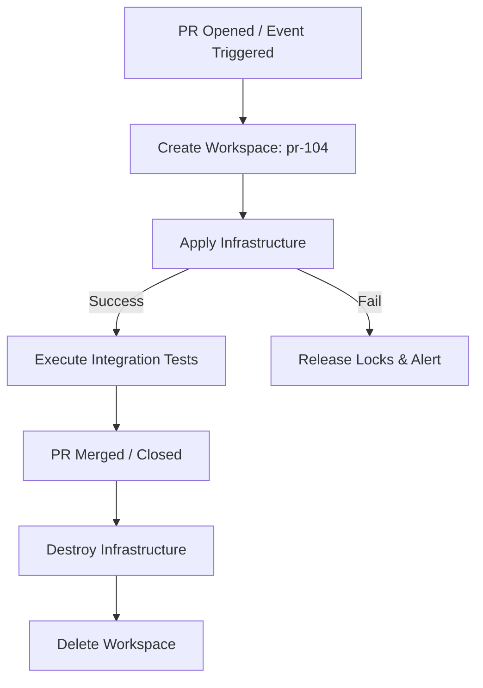

# Terraform Automation Scripts: Orchestrating Test Sandboxes

In modern development workflows, testing changes in isolation is critical. When a developer opens a Pull Request (PR), manually setting up test resources in the cloud is slow and expensive. A better approach is to automate the lifecycle of **Speculative Sandbox Environments** using Python and Terraform.

When a PR is opened, a Python script:
1. Creates a unique Terraform workspace named after the PR (e.g. `pr-1404`).
2. Deploys the infrastructure sandbox automatically.
3. Performs validation testing.
4. Destroys the workspace resources once the PR is merged or closed, keeping cloud costs minimal.

In this guide, we will write a complete Python automation script that handles this workflow, handles locks, and cleans up resources.

---

## Sandbox Lifecycle Architecture



---

## 1. Handling Terraform Lock Failures (`force-unlock`)

When Terraform runs, it locks the state backend (such as an AWS S3 bucket or Terraform Cloud database) to prevent multiple scripts from modifying the infrastructure concurrently. If a build crashes or loses connection during deployment, the lock remains active, blocking all future runs.

To handle locks programmatically, your script must:
1. Catch lock error indicators in `stderr`.
2. Extract the **Lock ID** from the error message.
3. Execute `terraform force-unlock <ID>` if configured to bypass locks safely.

---

## 2. Complete Automation Script: The Sandbox lifecycle Manager

Here is a complete, production-ready script that manages the creation and deletion of PR-specific test sandboxes:

```python
import os
import re
import subprocess
import logging

logging.basicConfig(level=logging.INFO, format="%(asctime)s [%(levelname)s] %(message)s")
logger = logging.getLogger("sandbox_manager")

class TerraformSandboxManager:
    def __init__(self, tf_dir):
        self.tf_dir = tf_dir
        if not os.path.exists(tf_dir):
            raise FileNotFoundError(f"Terraform folder missing: {tf_dir}")

    def _run_cmd(self, args):
        logger.info(f"Running command: {' '.join(args)}")
        result = subprocess.run(
            args,
            cwd=self.tf_dir,
            capture_output=True,
            text=True
        )
        return result

    def initialize(self):
        print("Initializing Terraform workspace providers...")
        res = self._run_cmd(["terraform", "init"])
        if res.returncode != 0:
            print(f"❌ Initialization failed:\n{res.stderr}")
            return False
        return True

    def create_sandbox_workspace(self, pr_id):
        workspace_name = f"pr-{pr_id}"
        print(f"Creating isolated sandbox workspace: {workspace_name}...")
        
        # Check if workspace exists
        list_res = self._run_cmd(["terraform", "workspace", "list"])
        
        if workspace_name in list_res.stdout:
            print(f"Workspace '{workspace_name}' already exists. Selecting it...")
            self._run_cmd(["terraform", "workspace", "select", workspace_name])
        else:
            create_res = self._run_cmd(["terraform", "workspace", "new", workspace_name])
            if create_res.returncode != 0:
                print(f"❌ Failed to create workspace:\n{create_res.stderr}")
                return False
                
        print(f"✅ Active workspace: {workspace_name}")
        return True

    def deploy_sandbox(self):
        print("Provisioning sandbox resources...")
        res = self._run_cmd(["terraform", "apply", "-auto-approve"])
        
        if res.returncode != 0:
            print("❌ Apply execution failed!")
            stderr = res.stderr
            print(stderr)
            
            # Check for State Lock error
            # Stderr contains: "Error: Error acquiring the state lock ... Lock Info: ID: <guid>"
            if "acquire the state lock" in stderr:
                lock_id_match = re.search(r"ID:\s+([a-f0-9\-]+)", stderr)
                if lock_id_match:
                    lock_id = lock_id_match.group(1)
                    print(f"⚠️ Lock detected. Lock ID: {lock_id}")
                    # In specialized pipelines, you can unlock using:
                    # self._run_cmd(["terraform", "force-unlock", "-force", lock_id])
            return False
            
        print("✅ Sandbox successfully deployed.")
        return True

    def destroy_sandbox(self, pr_id):
        workspace_name = f"pr-{pr_id}"
        print(f"Initiating destruction of sandbox workspace: {workspace_name}...")
        
        # 1. Select the workspace
        self._run_cmd(["terraform", "workspace", "select", workspace_name])
        
        # 2. Destroy resources
        destroy_res = self._run_cmd(["terraform", "destroy", "-auto-approve"])
        if destroy_res.returncode != 0:
            print(f"❌ Failed to destroy sandbox resources:\n{destroy_res.stderr}")
            return False
            
        # 3. Switch back to default workspace before deleting the temporary one
        self._run_cmd(["terraform", "workspace", "select", "default"])
        
        # 4. Delete the workspace pointer
        delete_res = self._run_cmd(["terraform", "workspace", "delete", workspace_name])
        if delete_res.returncode == 0:
            print(f"🗑️ Workspace '{workspace_name}' successfully removed.")
            return True
        else:
            print(f"❌ Failed to delete workspace reference: {delete_res.stderr}")
            return False
```

---

## 3. Sandbox Management Orchestrator

Here is how you would use the `TerraformSandboxManager` in a CI/CD pipeline script to orchestrate the sandbox lifecycle:

```python
# Save this file as scripts/run_pr_test.py
# (Requires the class definition from the previous section)

def run_pr_sandbox_test(pr_number):
    tf_directory = "./terraform_infrastructure"
    manager = TerraformSandboxManager(tf_directory)
    
    # 1. Initialize
    if not manager.initialize():
        return False
        
    # 2. Create PR workspace
    if not manager.create_sandbox_workspace(pr_number):
        return False
        
    # 3. Deploy sandbox
    deploy_ok = manager.deploy_sandbox()
    
    if deploy_ok:
        print("🧪 Infrastructure ready. Starting integration tests...")
        # Run test suites here (e.g. pytest tests/integration)
        
        # Destroy sandbox once tests are complete
        manager.destroy_sandbox(pr_number)
        return True
    else:
        # Clean up workspace if deploy failed midway
        manager.destroy_sandbox(pr_number)
        return False
```

---

## Summary

Terraform automation scripts enable you to manage infrastructure sandboxes programmatically. By isolating builds inside PR-specific workspaces and enforcing automated cleanup, you can optimize cloud budgets and speed up code reviews. In the next section, we will cover **generating tfvars files dynamically** in Python.
