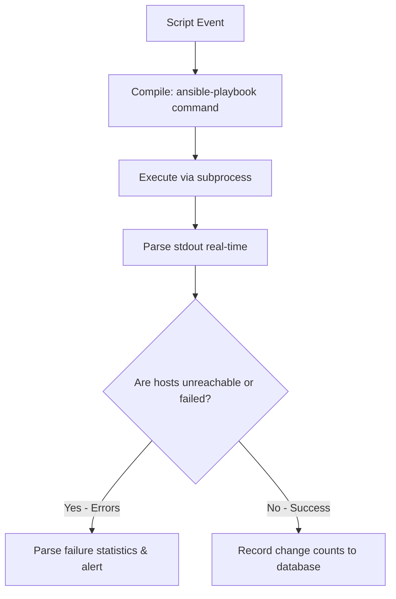

# Running Ansible from Python: Configuration Management Automation

While Terraform excels at provisioning infrastructure resources, **Ansible** is the industry standard for configuration management—installing software packages, configuring system services, managing user accounts, and deploying application configurations across groups of servers.

In advanced DevOps environments, configuration tasks must run dynamically. For example, when a security scan identifies an outdated package on a server group, a monitoring script should trigger an Ansible playbook to patch the servers immediately.

While running Ansible from the command line is standard, programmatically executing Ansible from Python allows you to integrate configuration management into your monitoring loops and automation pipelines. In this guide, we will cover how to run Ansible playbooks programmatically using Python's `subprocess` module, parse the stdout execution summary, and handle errors.

---

## Configuration Execution Workflow



---

## 1. Executing Playbooks via Python's `subprocess` Module

To run playbooks programmatically, we execute the `ansible-playbook` command-line utility. To prevent shell injection vulnerabilities, always pass the arguments as a list of strings rather than using a single command string with `shell=True`.

```python
import os
import subprocess
import logging

logging.basicConfig(level=logging.INFO, format="%(asctime)s [%(levelname)s] %(message)s")
logger = logging.getLogger("ansible_runner")

class AnsiblePlaybookRunner:
    def __init__(self, playbook_path, inventory_path=None):
        self.playbook_path = playbook_path
        self.inventory_path = inventory_path
        
        # Verify files exist
        if not os.path.exists(playbook_path):
            raise FileNotFoundError(f"Playbook file not found: {playbook_path}")
        if inventory_path and not os.path.exists(inventory_path):
            raise FileNotFoundError(f"Inventory file not found: {inventory_path}")

    def run_playbook(self, extra_vars=None):
        """
        Executes the configured Ansible playbook and captures execution streams.
        """
        # 1. Compile baseline command
        cmd = ["ansible-playbook", self.playbook_path]
        
        # Append inventory if specified
        if self.inventory_path:
            cmd.extend(["-i", self.inventory_path])
            
        # Append extra variables in JSON format if passed
        if extra_vars:
            # Pass dictionary as serialized JSON string to prevent argument escaping issues
            import json
            cmd.extend(["--extra-vars", json.dumps(extra_vars)])

        # 2. Execute command
        try:
            logger.info(f"Executing Ansible command: {' '.join(cmd)}")
            result = subprocess.run(
                cmd,
                capture_output=True,
                text=True,
                check=True # Throws exception if command exit code is non-zero
            )
            return True, result.stdout, result.stderr
        except subprocess.CalledProcessError as e:
            logger.error(f"Ansible playbook execution failed! Code: {e.returncode}")
            return False, e.stdout, e.stderr
```

---

## 2. Parsing the Playbook Execution Summary

At the end of every playbook run, Ansible prints a **PLAY RECAP** table summarizing host results:

```text
PLAY RECAP *********************************************************************
192.168.1.50               : ok=4    changed=2    unreachable=0    failed=0    skipped=0    rescued=0    ignored=0
```

To determine if hosts failed or were unreachable, your Python script should parse this recap section using regular expressions.

```python
import re

def parse_playbook_recap(stdout_text):
    """
    Parses the PLAY RECAP section of Ansible console logs.
    Returns a dictionary mapping hosts to execution statistics.
    """
    # Regex to capture host recap variables
    # Format: host : ok=X changed=Y unreachable=Z failed=W
    recap_pattern = re.compile(
        r"^(?P<host>\S+)\s*:\s*"
        r"ok=(?P<ok>\d+)\s+"
        r"changed=(?P<changed>\d+)\s+"
        r"unreachable=(?P<unreachable>\d+)\s+"
        r"failed=(?P<failed>\d+)"
    )

    recap_results = {}
    lines = stdout_text.splitlines()
    in_recap_section = False

    for line in lines:
        # Detect the start of the recap section
        if "PLAY RECAP" in line:
            in_recap_section = True
            continue
            
        if in_recap_section:
            # Look for matches
            match = recap_pattern.match(line.strip())
            if match:
                data = match.groupdict()
                host = data.pop("host")
                # Convert string metrics to integers
                recap_results[host] = {key: int(val) for key, val in data.items()}

    return recap_results
```

---

## 3. Playbook Orchestrator and Failure Alerter

Here is the integration wrapper that runs the playbook, parses the results, and triggers alerts if any servers were unreachable or failed configuration steps:

```python
# Save this file as scripts/execute_patch.py
# (Requires the runner and parser code defined in previous sections)

def execute_server_patching():
    playbook = "playbooks/update_packages.yml"
    inventory = "inventories/production.ini"
    
    runner = AnsiblePlaybookRunner(playbook, inventory)
    
    # Run playbook, passing dynamic patch packages as extra variables
    success, stdout, stderr = runner.run_playbook(extra_vars={"target_package": "nginx"})
    
    # Parse the output stats
    recap_data = parse_playbook_recap(stdout)
    
    print("\n--- Ansible Execution Summary ---")
    
    failures_detected = False
    
    for host, stats in recap_data.items():
        print(f"Host: {host}")
        print(f"  Changed:     {stats['changed']}")
        print(f"  Failed:      {stats['failed']}")
        print(f"  Unreachable: {stats['unreachable']}")
        
        # Check if the host encountered problems
        if stats["failed"] > 0 or stats["unreachable"] > 0:
            print(f"❌ Error: Host '{host}' encountered errors during execution!")
            failures_detected = True
            
    if failures_detected or not success:
        print("\n🚨 Patching pipeline failed on one or more hosts. Triggering alerts...")
        # Add notification logic here (e.g. send_slack_alert)
        return False
        
    print("\n🎉 Patching completed successfully across all nodes.")
    return True

# if __name__ == "__main__":
#     execute_server_patching()
```

---

## Summary

Executing Ansible from Python allows you to automate configuration management in response to monitoring alerts or pipeline events. By wrapping CLI commands using `subprocess` and parsing the play recap section, you can verify configuration states and handle failures programmatically. In the next section, we will cover the **ansible-runner** library.
