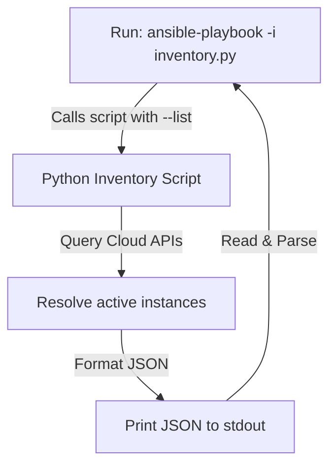

# Dynamic Inventory with Python: Custom Ingestion for Ansible

By default, Ansible reads its target server IPs from static text files (like `hosts.ini` or `hosts.yml`). While static inventories are simple, they fail in modern cloud environments where servers are launched, terminated, or autoscaled dynamically. 

To solve this, Ansible supports **Dynamic Inventories**. Instead of a static file, you provide a script (like a Python script) that queries your cloud providers, virtualization platforms, or CMDB (Configuration Management Database) and returns the host list as a structured JSON payload.

In this guide, we will examine the JSON schema required by Ansible, implement a Python dynamic inventory script supporting the `--list` and `--host` CLI flags, and parse metadata to inject host variables.

---

## Dynamic Inventory Schema Requirements

When Ansible runs a dynamic inventory script, it executes it and reads the console standard output. The script must support these command-line arguments:

1. **`--list`**: Returns a JSON dictionary containing all host groups, host lists, and group variables.
2. **`--host <hostname>`**: Returns a JSON dictionary containing host-specific variables (optional if `_meta` is used).



---

## The JSON Schema Structure

To be compliant, your script's output for `--list` must match this JSON structure:

```json
{
  "webservers": {
    "hosts": ["192.168.1.50", "192.168.1.51"],
    "vars": {
      "ansible_user": "ubuntu",
      "http_port": 80
    }
  },
  "databases": {
    "hosts": ["192.168.1.60"]
  },
  "_meta": {
    "hostvars": {
      "192.168.1.50": {
        "env": "production"
      },
      "192.168.1.51": {
        "env": "staging"
      }
    }
  }
}
```
*Note: The **`_meta`** block allows you to return all host-specific variables in a single call, preventing Ansible from making separate `--host` calls for every single IP in the list. This speeds up execution times.*

---

## 1. Python Dynamic Inventory Script Implementation

Here is a complete, executable Python script that generates an Ansible-compliant dynamic inventory. It simulates reading instances from a cloud API or CMDB database.

Save this file as `my_inventory.py` (and make it executable using `chmod +x`):

```python
#!/usr/bin/env python3
import sys
import json
import argparse

# Simulated database containing active cloud servers
# In production, replace this with calls to boto3 (AWS), google-api, or your local CMDB
MOCK_SERVER_DB = [
    {"ip": "192.168.1.10", "role": "web", "env": "production", "name": "web-prod-01"},
    {"ip": "192.168.1.11", "role": "web", "env": "staging", "name": "web-stage-01"},
    {"ip": "192.168.1.20", "role": "db", "env": "production", "name": "db-prod-01"}
]

class CustomDynamicInventory:
    def __init__(self):
        self.inventory = {}
        self.read_cli_args()

        # Route execution based on flags passed by Ansible
        if self.args.list:
            self.inventory = self.generate_inventory_list()
        elif self.args.host:
            # We use _meta in --list, so --host can return empty variables
            self.inventory = self.generate_host_vars(self.args.host)
        else:
            self.inventory = {"error": "Must pass --list or --host <name>"}

        # Print the final result to stdout as JSON
        print(json.dumps(self.inventory, indent=4))

    def read_cli_args(self):
        """
        Parses the standard CLI arguments passed by Ansible.
        """
        parser = argparse.ArgumentParser(description="Ansible Dynamic Inventory Script")
        group = parser.add_mutually_exclusive_group(required=True)
        group.add_argument("--list", action="store_true", help="List all hosts")
        group.add_argument("--host", help="Get variables for a specific host")
        self.args = parser.parse_args()

    def generate_inventory_list(self):
        """
        Generates the host groups and metadata payload.
        """
        # Baseline schema structure
        data = {
            "all": {
                "vars": {
                    "ansible_ssh_common_args": "-o StrictHostKeyChecking=no"
                }
            },
            "_meta": {
                "hostvars": {}
            }
        }

        # Populate groups dynamically based on roles
        for server in MOCK_SERVER_DB:
            role = server["role"]
            ip = server["ip"]
            name = server["name"]
            
            # 1. Ensure the group exists
            group_key = f"{role}servers" # e.g. webservers, dbservers
            if group_key not in data:
                data[group_key] = {"hosts": []}
                
            # Add host to group
            data[group_key]["hosts"].append(name)
            
            # 2. Add hostvars mapping
            data["_meta"]["hostvars"][name] = {
                "ansible_host": ip,
                "ansible_user": "ubuntu" if role == "web" else "postgres",
                "server_environment": server["env"]
            }

        return data

    def generate_host_vars(self, hostname):
        """
        Returns variables for a single host. 
        Included for compatibility, though variables are already returned in _meta.
        """
        return {}

if __name__ == "__main__":
    # Execute the class
    CustomDynamicInventory()
```

---

## 2. Using the Dynamic Inventory in Ansible

To verify the script is returning valid JSON, run it manually:
```bash
python my_inventory.py --list
```

To use it with Ansible, pass the path to the script instead of a static inventory file:

```bash
ansible-playbook -i my_inventory.py playbooks/deploy.yml
```

> [!IMPORTANT]
> Ensure the Python script has executable permissions (`chmod +x my_inventory.py`). If it does not, Ansible will treat the file as a static parser, fail to execute it, and throw syntax parsing errors.

---

## Summary

Dynamic inventories allow Ansible to adapt to scaling cloud environments. By formatting your Python script outputs to match Ansible's JSON schema and using the `_meta` block to bundle host variables, you can automate infrastructure configurations programmatically. In the next section, we will cover **Ansible automation patterns**.
