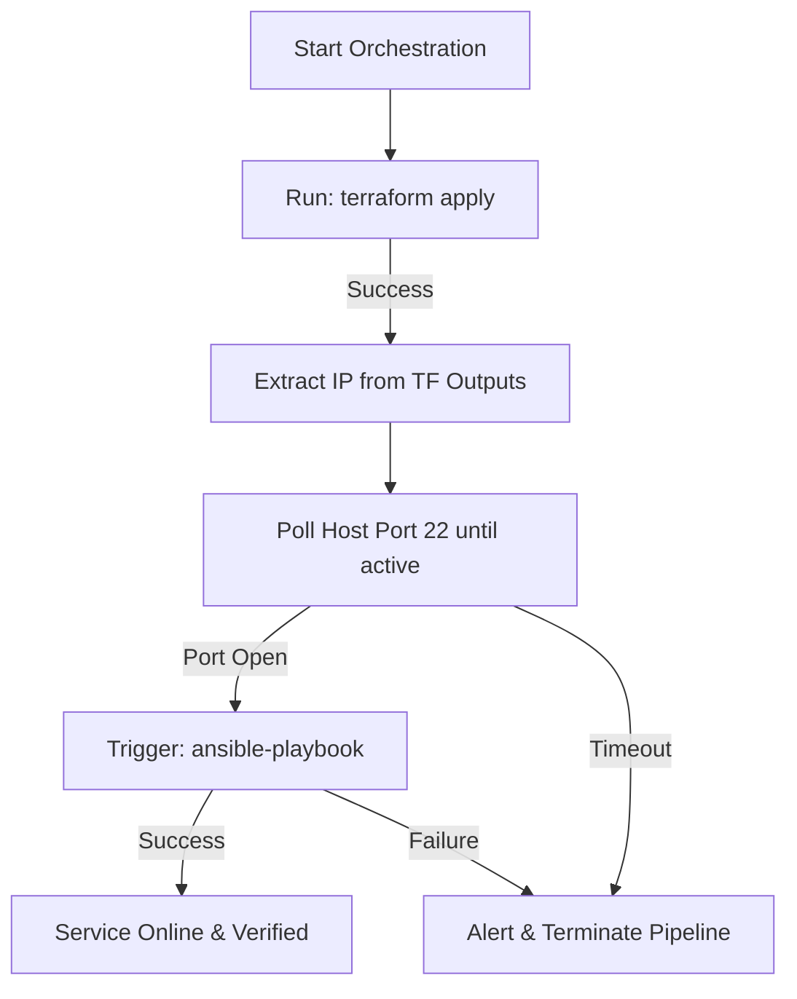

# Ansible Automation Patterns: Orchestrating the Provision-to-Configure Loop

In a mature Infrastructure-as-Code pipeline, provisioning and configuration management work together. **Terraform** provisions virtual hardware (instances, subnets, routers), and **Ansible** configures the operating systems and installs application code.

Connecting these stages manually is a bottleneck. Developers have to wait for Terraform to complete, copy the output IP addresses, paste them into an Ansible hosts file, and run the configuration commands.

To automate this workflow, you can use Python to build a unified orchestrator. In this guide, we will write a script that runs Terraform, extracts the generated server IP address, polls the server's SSH port (port 22) until it is ready, and triggers an Ansible playbook to configure the new server.

---

## The Provision-to-Configure Loop



---

## 1. Handling the SSH Initializer Bottleneck

When a cloud provider launches a virtual machine, the API returns a status of "Running" within seconds. However, the operating system is still performing startup tasks (such as running `cloud-init`, generating host keys, and starting the SSH daemon).

If your script immediately calls Ansible after Terraform returns, the execution will fail with an "Unreachable host" error.

To solve this, implement a **port availability check loop** in Python using the `socket` module. The loop pings port 22 until it successfully establishes a connection.

```python
import socket
import time

def wait_for_ssh(host, port=22, timeout_seconds=120, poll_interval=5):
    """
    Blocks execution until the remote SSH port becomes reachable.
    """
    print(f"Waiting for SSH daemon to initialize on {host}:{port}...")
    start_time = time.time()
    
    while time.time() - start_time < timeout_seconds:
        try:
            # Attempt to establish socket connection
            with socket.create_connection((host, port), timeout=3):
                print(f"✅ SSH port is reachable on {host}!")
                return True
        except (socket.timeout, ConnectionRefusedError, OSError):
            elapsed = int(time.time() - start_time)
            print(f"SSH unreachable... waiting (Elapsed: {elapsed}s)", end="\r")
            
        time.sleep(poll_interval)
        
    print(f"\n❌ Timeout: SSH daemon failed to initialize within {timeout_seconds}s.")
    return False
```

---

## 2. Complete Provision-to-Configure Script

Here is the complete orchestrator script. It uses our previous Terraform parser and Ansible playbook runner logic to provision and configure a server in one automated execution.

Save this file as `orchestrator.py`:

```python
import os
import time
import json
import subprocess

# (Requires the wait_for_ssh function defined above)

def run_command(args, working_dir=None):
    result = subprocess.run(
        args,
        cwd=working_dir,
        capture_output=True,
        text=True
    )
    return result

def run_provision_configure_pipeline():
    tf_dir = "./terraform"
    playbook_file = "./ansible/playbooks/site.yml"
    
    print("==================================================")
    print("🚀 STARTING PROVISION-TO-CONFIGURE PIPELINE")
    print("==================================================")

    # Step 1: Run Terraform Apply
    print("\n[Step 1/4] Provisioning virtual machine via Terraform...")
    tf_apply = run_command(["terraform", "apply", "-auto-approve"], working_dir=tf_dir)
    
    if tf_apply.returncode != 0:
        print(f"❌ Terraform Apply failed:\n{tf_apply.stderr}")
        return False
    print("Terraform Apply succeeded.")

    # Step 2: Extract the public IP address from output
    print("\n[Step 2/4] Parsing Terraform outputs...")
    tf_output = run_command(["terraform", "output", "-json"], working_dir=tf_dir)
    
    if tf_output.returncode != 0:
        print("❌ Failed to read Terraform outputs.")
        return False
        
    outputs = json.loads(tf_output.stdout)
    server_ip = outputs.get("public_ip", {}).get("value")
    
    if not server_ip:
        print("❌ Error: 'public_ip' output not found in Terraform state.")
        return False
    print(f"Server IP resolved: {server_ip}")

    # Step 3: Wait for SSH port availability
    # Prevents Ansible connection failures during OS boot
    print("\n[Step 3/4] Verifying SSH daemon state...")
    if not wait_for_ssh(server_ip, timeout_seconds=180):
        print("❌ Pipeline aborted: SSH connection timed out.")
        return False

    # Step 4: Execute Ansible playbook configuration
    print("\n[Step 4/4] Triggering Ansible configuration playbooks...")
    
    # We pass the dynamic IP inside extra variables and target a standard playbook
    ansible_cmd = [
        "ansible-playbook",
        playbook_file,
        "--inventory", f"{server_ip},", # Note the comma: forces inline host parsing
        "--extra-vars", json.dumps({"ansible_user": "ubuntu", "app_port": "8080"})
    ]
    
    print(f"Executing: {' '.join(ansible_cmd)}")
    ansible_run = run_command(ansible_cmd)
    
    if ansible_run.returncode == 0:
        print("\n==================================================")
        print("🎉 PIPELINE COMPLETED SUCCESSFULLY")
        print("==================================================")
        print(f"Host {server_ip} is configured and online.")
        return True
    else:
        print(f"\n❌ Ansible configuration failed:\n{ansible_run.stderr}")
        return False

# if __name__ == "__main__":
#     run_provision_configure_pipeline()
```

---

## Summary

Combining provisioning (Terraform) and configuration management (Ansible) into an automated Python pipeline coordinates your infrastructure setup. By implementing socket availability loops, you can ensure target hosts are reachable before starting configuration steps. This completes **Chapter 43 - Python with Ansible**. In the next chapter, we will explore **Pulumi with Python**.
