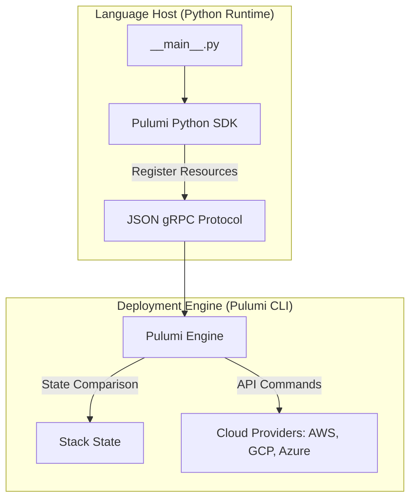

# Pulumi with Python Overview: Real Languages for IaC

Traditional Infrastructure-as-Code (IaC) tools use domain-specific languages (DSLs) like Terraform's HCL or Ansible's YAML. While these formats are simple, they have limitations. As infrastructure scales, developers must construct complex loops, condition maps, and string interpolations using language structures that lack standard programming features.

**Pulumi** solves this by allowing you to define cloud infrastructure using standard programming languages, including **Python**. 

By using Python for IaC, you gain access to standard language features:
* **Object-Oriented Programming (OOP)**: Define reusable classes to group resources.
* **Standard Python Packages**: Use libraries like `requests` to fetch database configurations or `math` to partition networks.
* **Standard Tooling**: Leverage IDE autocompletion, code linters (Flake8), type hint checking (mypy), and unit testing frameworks (pytest) directly on your infrastructure files.

In this guide, we will explore Pulumi's architecture, compare it to HCL/YAML tools, install the required packages, and examine the structure of a Pulumi Python project.

---

## Pulumi Architecture: Language Host and Engine

Pulumi is split into two primary components: the **Language Host** and the **Deployment Engine**.



1. **Language Host**: Runs your Python code (specifically `__main__.py`). It registers resource configurations (like virtual machines or S3 buckets) and compiles them into a language-neutral resource map.
2. **Deployment Engine**: Reads the resource map, compares it to the current state, and executes the necessary API calls to create, update, or delete cloud resources.

---

## Pulumi vs. HCL/YAML Tools

| Comparison Metric | HCL/YAML Tools (Terraform/Ansible) | Pulumi with Python |
| :--- | :--- | :--- |
| **Language Model** | Declarative configuration files | Imperative code declaring declarative resources |
| **Loops and Logic** | Custom HCL loops or YAML conditionals | Standard Python `for`, `while`, and `if` |
| **Code Sharing** | Modules published to custom registries | Standard packaging (`pip install your-package`) |
| **Testing** | Separate testing syntax | Standard unit testing using `pytest` |
| **IDE Support** | Requires language plugins | Full autocompletion, refactoring, and type checks |

---

## Installation & Project Configuration

To use Pulumi, install the Pulumi CLI and set up your Python project.

### 1. Install Pulumi CLI
* **macOS**: `brew install pulumi`
* **Windows (Chocolatey)**: `choco install pulumi`
* **Linux**: `curl -fsSL https://get.pulumi.com | sh`

### 2. Initialize a New Python Project
Navigate to an empty directory and execute:

```bash
pulumi new aws-python --dir my-pulumi-project
```
This command initializes a Python project structure:

```text
my-pulumi-project/
├── .venv/              # Virtual environment
├── Pulumi.yaml        # Project metadata configuration
├── Pulumi.dev.yaml    # Stack configuration values (dev environment)
├── requirements.txt   # Pip dependencies (pulumi and provider libraries)
└── __main__.py        # The main entry point execution script
```

---

## 3. Project Configuration Files Details

### Project Configuration (`Pulumi.yaml`)
Defines metadata about the project, including the programming language:

```yaml
name: billing-service
runtime: python
description: Infrastructure configuration for the billing microservice
```

### Dependency File (`requirements.txt`)
Contains the Python packages needed to interact with the target cloud provider:

```text
pulumi>=3.0.0,<4.0.0
pulumi-aws>=5.0.0,<6.0.0
```

### Main Code Script (`__main__.py`)
The main script where you write Python code to define your infrastructure:

```python
import pulumi
import pulumi_aws as aws

# 1. Create an AWS S3 Bucket
bucket = aws.s3.Bucket(
    "billing-records-bucket",
    acl="private",
    tags={
        "Environment": "Dev",
        "Project": "Billing"
    }
)

# 2. Export outputs (equivalent to Terraform output variables)
# This writes the resolved bucket name to the stack outputs
pulumi.export("bucket_name", bucket.id)
pulumi.export("bucket_endpoint", bucket.website_endpoint)
```

---

## Summary

Pulumi allows you to write Infrastructure as Code in Python, giving you access to standard programming features like loops, functions, and packaging. In the next section, we will cover **writing Pulumi configurations in Python** in detail.
