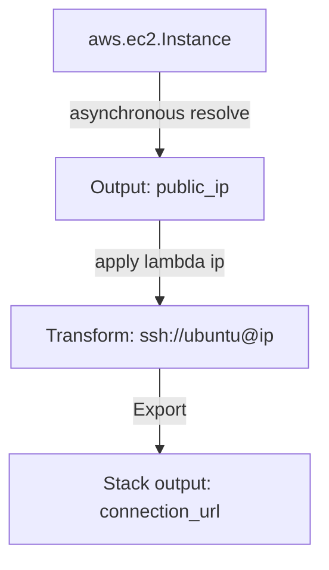

# Writing Pulumi in Python: Inputs, Outputs, and Component Resources

When writing infrastructure code in Python, you cannot treat cloud resource attributes like normal Python variables. For example, when you define an AWS EC2 instance, the public IP address is assigned asynchronously by AWS *during* deployment. 

In Pulumi, this is managed using **Inputs and Outputs**. Outputs are wrapper classes representing values that will be resolved in the future. Because of this asynchronous model, standard Python operations (like f-strings or string splits) cannot read these values directly. You must use specific methods like `.apply()` to transform them.

In this guide, we will cover the Input/Output model, write string transformation pipelines, and implement a custom reusable infrastructure package using **Component Resources**.

---

## The Input/Output Model

An **`Output[T]`** is similar to a Python Promise or Future. It contains the resolved value once the resource is deployed. 

If you attempt to concatenate an output using a standard string operation:
```python
# AVOID: This will print something like '<pulumi.output.Output object at 0x...>'
# and fail during deployment because the IP is not resolved yet.
connection_string = f"ssh://ubuntu@{server.public_ip}"
```

Instead, you use **`.apply()`** to register a callback function that runs once the value is resolved:

```python
# RECOMMENDED: Evaluates correctly when the IP is available
connection_string = server.public_ip.apply(lambda ip: f"ssh://ubuntu@{ip}")
```



---

## 1. Transforming Multiple Outputs with `Output.all()`

If you need to combine multiple outputs (like a hostname and a database name), use **`Output.all()`** to group them, then call `.apply()` to format the resulting tuple.

```python
import pulumi
import pulumi_aws as aws

# Define an RDS database instance
db = aws.rds.Instance(
    "postgres-db",
    instance_class="db.t3.micro",
    allocated_storage=20,
    engine="postgres",
    username="db_admin",
    password="my_secure_password"
)

# db.endpoint and db.name are Outputs
# We combine them using Output.all()
db_connection_url = pulumi.Output.all(db.endpoint, db.name).apply(
    lambda args: f"postgresql://db_admin:password@{args[0]}/{args[1]}"
)

# Export the formatted connection string
pulumi.export("database_url", db_connection_url)
```

---

## 2. Reusable Infrastructure: Custom Component Resources

A major advantage of using Python is the ability to write reusable infrastructure classes. By inheriting from **`pulumi.ComponentResource`**, you can group multiple raw resources (like a VM, security group, and disk volume) into a single, clean class that other team members can import.

Here is a complete implementation of a custom Web Server component:

```python
# Save this file as components/webserver.py
import pulumi
import pulumi_aws as aws

class SecureWebServer(pulumi.ComponentResource):
    """
    Custom component resource representing a secure EC2 web server instance.
    """
    def __init__(self, name: str, ami: str, instance_type: str, opts: pulumi.ResourceOptions = None):
        # 1. Initialize the parent ComponentResource class
        # This registers the custom resource type with the Pulumi engine
        super().__init__("custom:components:SecureWebServer", name, {}, opts)
        
        # 2. Create the Security Group associated with the component parent scope
        # We pass 'opts=pulumi.ResourceOptions(parent=self)' to establish the resource hierarchy
        self.sec_group = aws.ec2.SecurityGroup(
            f"{name}-security-group",
            description="Enable HTTP traffic",
            ingress=[
                {
                    "protocol": "tcp",
                    "from_port": 80,
                    "to_port": 80,
                    "cidr_blocks": ["0.0.0.0/0"]
                }
            ],
            opts=pulumi.ResourceOptions(parent=self)
        )
        
        # 3. Create the EC2 Instance
        self.instance = aws.ec2.Instance(
            f"{name}-instance",
            ami=ami,
            instance_type=instance_type,
            vpc_security_group_ids=[self.sec_group.id],
            opts=pulumi.ResourceOptions(parent=self)
        )
        
        # 4. Register outputs for the custom component
        self.register_outputs({
            "public_ip": self.instance.public_ip,
            "security_group_id": self.sec_group.id
        })
```

---

## 3. Instantiating the Component in `__main__.py`

```python
# Save this file as __main__.py
import pulumi
from components.webserver import SecureWebServer

# Deploy the custom web server component
my_web_server = SecureWebServer(
    name="production-web-host",
    ami="ami-0c55b159cbfafe1f0", # Ubuntu AMI
    instance_type="t3.micro"
)

# Export the resolved public IP from the nested component instance
pulumi.export("server_ip", my_web_server.instance.public_ip)
```

---

## Summary

In Pulumi, asynchronous resource attributes are represented as Outputs. By using `.apply()` to transform values and building reusable classes with `ComponentResource`, you can create modular, clean Infrastructure as Code. In the next section, we will cover **Pulumi stack management**.
