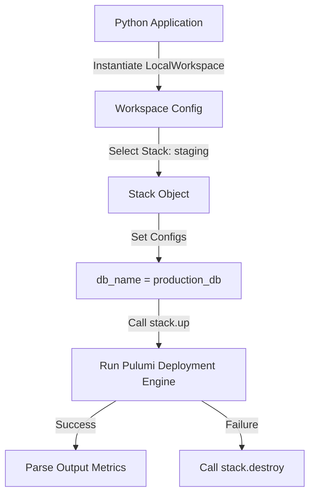

# Pulumi Stack Management and the Automation API

In Pulumi, a **Stack** represents an isolated instance of your infrastructure project (e.g. `development`, `staging`, `production`). Each stack maintains its own configuration values and state tracking record.

While managing stacks via the CLI (`pulumi stack select`, `pulumi up`) is standard, Pulumi provides a programmatic interface called the **Automation API**. The Automation API allows you to embed the Pulumi deployment engine directly inside your Python application code. 

Instead of running shell subprocess commands, you import `pulumi.automation` classes to dynamically create stacks, update configuration values, run deployment plans, and destroy environments programmatically.

In this guide, we will examine stack structures and write a Python script that uses the Automation API to orchestrate stack lifecycles.

---

## The Automation API Flow



---

## 1. Setting Up the Automation API

Ensure your project contains:
1. A valid `__main__.py` file describing your cloud resources.
2. A `Pulumi.yaml` file defining the project name.

Install the required SDK:
```bash
pip install pulumi
```

---

## 2. Dynamic Stack Orchestrator Script

Here is a Python script that uses the Automation API to dynamically create a sandbox stack, configure its settings, run the update, and catch errors programmatically:

```python
import os
import sys
from pulumi import automation as auto

# Define the target project name (must match Pulumi.yaml name)
PROJECT_NAME = "billing-service"
STACK_NAME = "dynamic-staging"
WORK_DIR = "./my-pulumi-project"

def execute_automation_deployment():
    print(f"Initializing stack '{STACK_NAME}' for project '{PROJECT_NAME}'...")
    
    # 1. Initialize local workspace pointing to the folder containing code
    try:
        # LocalWorkspace automatically detects __main__.py and configurations
        stack = auto.create_or_select_stack(
            stack_name=STACK_NAME,
            work_dir=WORK_DIR
        )
        print("✅ Workspace initialized.")
        
        # 2. Configure target cloud provider settings (e.g. AWS Region)
        # Equivalent to running 'pulumi config set aws:region us-west-2'
        print("Configuring stack environment variables...")
        stack.set_config("aws:region", auto.ConfigValue(value="us-west-2"))
        
        # 3. Execute the deployment (equivalent to running 'pulumi up --yes')
        print("Starting deployment update (this may take a few minutes)...")
        
        # We can stream output directly to stdout using on_output callback
        update_result = stack.up(on_output=print)
        
        print("\n==================================================")
        print("🎉 STACK DEPLOYED SUCCESSFULLY")
        print("==================================================")
        print(f"Deployment Status: {update_result.summary.result}")
        
        # 4. Parse output variables
        outputs = update_result.outputs
        bucket_name = outputs.get("bucket_name").value
        print(f"Created resources output: bucket_name = {bucket_name}")
        
        return True

    except auto.ConcurrentUpdateError:
        print("❌ Error: A deployment is already running on this stack.")
        return False
    except auto.CommandError as e:
        print(f"❌ Deployment failed due to command execution error:\n{e}")
        return False
    except Exception as e:
        print(f"❌ Unexpected failure: {e}")
        return False
```

---

## 3. Automated Stack Teardown (Cleanup)

If your workflow requires cleaning up resource stacks programmatically (e.g., destroying temporary sandbox stacks):

```python
def teardown_stack():
    print(f"Initiating teardown for stack: {STACK_NAME}...")
    try:
        # Select the existing stack
        stack = auto.select_stack(
            stack_name=STACK_NAME,
            work_dir=WORK_DIR
        )
        
        # Execute destroy command (equivalent to 'pulumi destroy --yes')
        print("Destroying all cloud resources associated with stack...")
        destroy_result = stack.destroy(on_output=print)
        print(f"Destroy completed. Result: {destroy_result.summary.result}")
        
        # Remove the stack definition metadata from workspace registry
        print("Removing stack from local registry...")
        stack.workspace.remove_stack(STACK_NAME)
        print("✅ Stack fully cleaned up.")
        return True
        
    except Exception as e:
        print(f"❌ Teardown failed: {e}")
        return False
```

---

## Summary

The Pulumi Automation API allows you to embed the deployment engine directly into your Python scripts. By dynamically creating workspaces, setting configurations, and executing updates, you can build integrated infrastructure management platforms. In the next section, we will **compare Pulumi and Terraform**.
