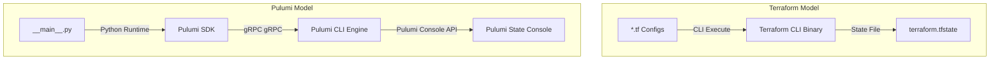

# Pulumi vs. Terraform: An In-Depth Python IaC Comparison

When designing a cloud infrastructure automation pipeline, DevOps engineers must select an Infrastructure-as-Code (IaC) tool. The two primary options for cloud-agnostic infrastructure provisioning are **Terraform** and **Pulumi**.

While both tools generate declarative configurations and track system resource states, they use different execution paths and language models:
* **Terraform** uses a custom Domain-Specific Language (**HCL**) designed specifically for resource declarations.
* **Pulumi** leverages standard programming languages (like **Python**) to compile resource specifications.

In this guide, we will compare the core architectures of both tools, analyze equivalent code examples for deploying identical AWS resources, and examine the tradeoffs of each approach.

---

## Architecture and State Management



### State Storage Backends
* **Terraform**: Requires you to manually configure a remote backend (such as an AWS S3 bucket with a DynamoDB table for locking, HashiCorp Consul, or Terraform Cloud) to store the state file safely.
* **Pulumi**: By default, Pulumi automatically manages state and locking using the free online **Pulumi Service console backend**. You can configure custom self-managed backends (such as AWS S3 or Google Cloud Storage) if you prefer to isolate state data.

---

## Side-by-Side Code Comparison

Let's deploy an identical AWS infrastructure stack containing a VPC, a public Subnet, and a single EC2 Instance in both formats.

### 1. Terraform HCL Implementation (`main.tf`)

```hcl
provider "aws" {
  region = "us-west-2"
}

# 1. Create VPC
resource "aws_vpc" "main" {
  cidr_block           = "10.0.0.0/16"
  enable_dns_hostnames = true
  
  tags = {
    Name = "terraform-vpc"
  }
}

# 2. Create Subnet
resource "aws_subnet" "public" {
  vpc_id            = aws_vpc.main.id
  cidr_block        = "10.0.1.0/24"
  availability_zone = "us-west-2a"
  
  tags = {
    Name = "terraform-subnet"
  }
}

# 3. Create Instance
resource "aws_instance" "web" {
  ami           = "ami-0c55b159cbfafe1f0"
  instance_type = "t2.micro"
  subnet_id     = aws_subnet.public.id
  
  tags = {
    Name = "terraform-web-server"
  }
}

output "instance_ip" {
  value = aws_instance.web.public_ip
}
```

---

### 2. Pulumi Python Implementation (`__main__.py`)

```python
import pulumi
import pulumi_aws as aws

# 1. Create VPC
vpc = aws.ec2.Vpc(
    "main-vpc",
    cidr_block="10.0.0.0/16",
    enable_dns_hostnames=True,
    tags={"Name": "pulumi-vpc"}
)

# 2. Create Subnet
subnet = aws.ec2.Subnet(
    "public-subnet",
    vpc_id=vpc.id, # Output reference resolves automatically
    cidr_block="10.0.1.0/24",
    availability_zone="us-west-2a",
    tags={"Name": "pulumi-subnet"}
)

# 3. Create Instance
web_server = aws.ec2.Instance(
    "web-server",
    ami="ami-0c55b159cbfafe1f0",
    instance_type="t2.micro",
    subnet_id=subnet.id,
    tags={"Name": "pulumi-web-server"}
)

# Export output variables
pulumi.export("instance_ip", web_server.public_ip)
```

---

## Tradeoffs and Selection Criteria

### When to Choose Terraform:
1. **Infrastructure Simplicity**: If your cloud footprint is static and changes rarely, HCL configuration files are easier to manage than full Python codebases.
2. **Community and Ecosystem**: Terraform has been in the industry longer, resulting in a larger community, more documentation, and a wider variety of pre-built community modules.
3. **Declarative Constraints**: HCL prevents developers from writing overly complex loops or external API calls directly in the infrastructure code, keeping configuration paths simple.

### When to Choose Pulumi:
1. **Dynamic scaling**: If you need to scale infrastructure dynamically based on databases, user inputs, or external API checks, standard Python handles this loop logic easily.
2. **Integrated Testing**: You can run standard unit tests on your infrastructure code using `pytest` and mock resources programmatically.
3. **Developer Familiarity**: If your engineering team is composed of Python developers who do not want to learn HCL, Pulumi allows them to write IaC using familiar tools.

---

## Summary

Terraform and Pulumi are both powerful tools for Infrastructure as Code. Terraform HCL is suited for static infrastructure profiles, while Pulumi Python is suited for dynamic, developer-focused pipelines. This completes **Module 11: Infrastructure as Code with Python**. In the next module, we will explore **Security Automation with Python**.
