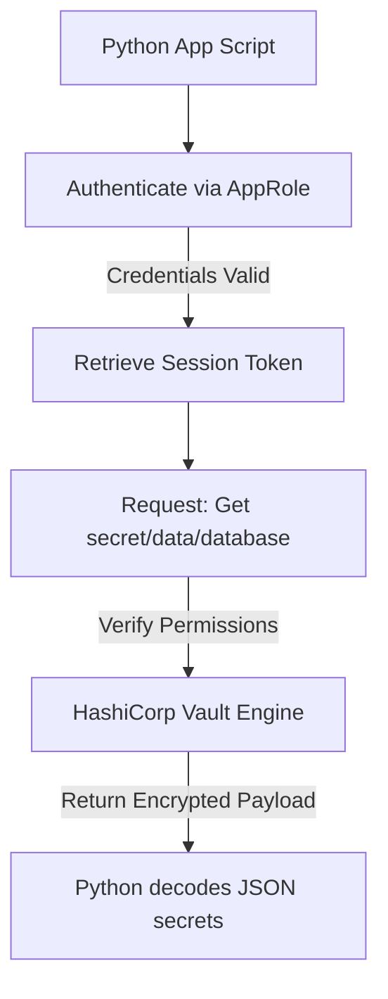

# HashiCorp Vault with Python: Programmatic Secrets Management

Hardcoding API tokens, database credentials, or SSH private keys directly inside your scripts is a critical security vulnerability. If code containing these secrets is pushed to a public git repository, attackers can compromise your systems.

**HashiCorp Vault** is the industry standard for secure secrets management, encryption as a service, and privilege access control. 

To interact with Vault programmatically using Python, we use the official **`hvac`** (HashiCorp Vault Client) library. In this guide, we will connect to a Vault server, authenticate using token and **AppRole** methods (the standard for automated scripts), write and read secrets using the Key-Value (KV) engine, and clean up entries securely.

---

## Secrets Ingestion Flow



---

## 1. Installation & Connecting to Vault

Install the client library:

```bash
pip install hvac
```

Ensure the library is available by checking the package:
```bash
python -c "import hvac; print('hvac loaded successfully')"
```

---

## 2. Authentication Methods: Tokens vs. AppRole

When testing locally, you can authenticate using a standard Vault root token. However, in production, scripts must authenticate using the **AppRole** backend. An AppRole uses a combination of a static **Role ID** and a dynamic **Secret ID** (similar to a client ID and secret) to acquire temporary session tokens automatically.

Here is the implementation of both connection wrappers:

```python
import os
import hvac

class VaultManager:
    def __init__(self, vault_url):
        self.vault_url = vault_url
        self.client = None

    def connect_with_token(self, token):
        """
        Authenticates using a static Vault Token (useful for local development).
        """
        print(f"Connecting to Vault at {self.vault_url} using Token...")
        self.client = hvac.Client(url=self.vault_url, token=token)
        
        # Verify token is valid
        if not self.client.is_authenticated():
            raise PermissionError("Vault authentication failed: Invalid token.")
        print("✅ Token authentication successful.")

    def connect_with_approle(self, role_id, secret_id):
        """
        Authenticates using AppRole credentials (recommended for production automation).
        """
        print(f"Connecting to Vault at {self.vault_url} using AppRole...")
        self.client = hvac.Client(url=self.vault_url)
        
        try:
            response = self.client.auth.approle.login(
                role_id=role_id,
                secret_id=secret_id
            )
            # The client automatically updates its session token on success
            print("✅ AppRole login successful. Token acquired.")
        except Exception as e:
            print(f"❌ AppRole authentication failed: {e}")
            raise e
```

---

## 3. Reading and Writing Key-Value (KV) Secrets

Vault supports KV version 1 (flat store) and KV version 2 (supports versioned history tracking). Most production environments use **KV Version 2**, which wraps data inside a `data` nested dictionary.

Here is how you write and read versioned secrets:

```python
# (Add these methods to the VaultManager class defined above)

def write_secret(self, secret_path, secret_data):
    """
    Writes a dictionary payload to Vault KV Version 2.
    """
    if not self.client or not self.client.is_authenticated():
        raise RuntimeError("Client is not authenticated.")
        
    print(f"Writing secret keys to path: {secret_path}...")
    try:
        # path is 'database' if storing under secret/data/database
        self.client.secrets.kv.v2.create_or_update_secret(
            path=secret_path,
            secret=secret_data
        )
        print("✅ Secret written successfully.")
        return True
    except Exception as e:
        print(f"❌ Failed to write secret: {e}")
        return False

def read_secret(self, secret_path):
    """
    Reads a secret payload from Vault KV Version 2.
    """
    if not self.client or not self.client.is_authenticated():
        raise RuntimeError("Client is not authenticated.")
        
    print(f"Retrieving secret from path: {secret_path}...")
    try:
        response = self.client.secrets.kv.v2.read_secret_version(path=secret_path)
        
        # Extract the data payload from KV v2 schema response
        data = response["data"]["data"]
        return data
    except hvac.exceptions.InvalidPath:
        print(f"❌ Error: Secret path '{secret_path}' does not exist.")
        return None
    except Exception as e:
        print(f"❌ Failed to read secret: {e}")
        return None
```

---

## 4. Script Example: Fetching DB Secrets Programmatically

Here is a script that logs in using AppRole, pulls DB credentials, and connects to a mock database:

```python
# Save this file as scripts/db_connect.py
# (Requires the VaultManager class defined above)

def connect_app_to_db():
    vault_url = os.environ.get("VAULT_ADDR", "http://127.0.0.1:8200")
    role_id = os.environ.get("VAULT_ROLE_ID")
    secret_id = os.environ.get("VAULT_SECRET_ID")
    
    if not all([role_id, secret_id]):
        print("Error: AppRole variables are missing from environment.")
        return False
        
    # 1. Connect to Vault
    manager = VaultManager(vault_url)
    try:
        manager.connect_with_approle(role_id, secret_id)
    except Exception:
        return False
        
    # 2. Retrieve credentials
    creds = manager.read_secret("database/prod")
    
    if creds:
        db_user = creds.get("username")
        db_pass = creds.get("password")
        print(f"✅ Successfully retrieved credentials for user: {db_user}")
        # Run database operations using db_user and db_pass...
        return True
    else:
        print("❌ Failed to retrieve credentials.")
        return False
```

---

## Summary

HashiCorp Vault allows you to secure application credentials programmatically. By using Python's `hvac` library with AppRole authentication, your scripts can fetch secrets dynamically from memory, keeping production credentials off your servers' disks. In the next section, we will cover **AWS Secrets Manager**.
