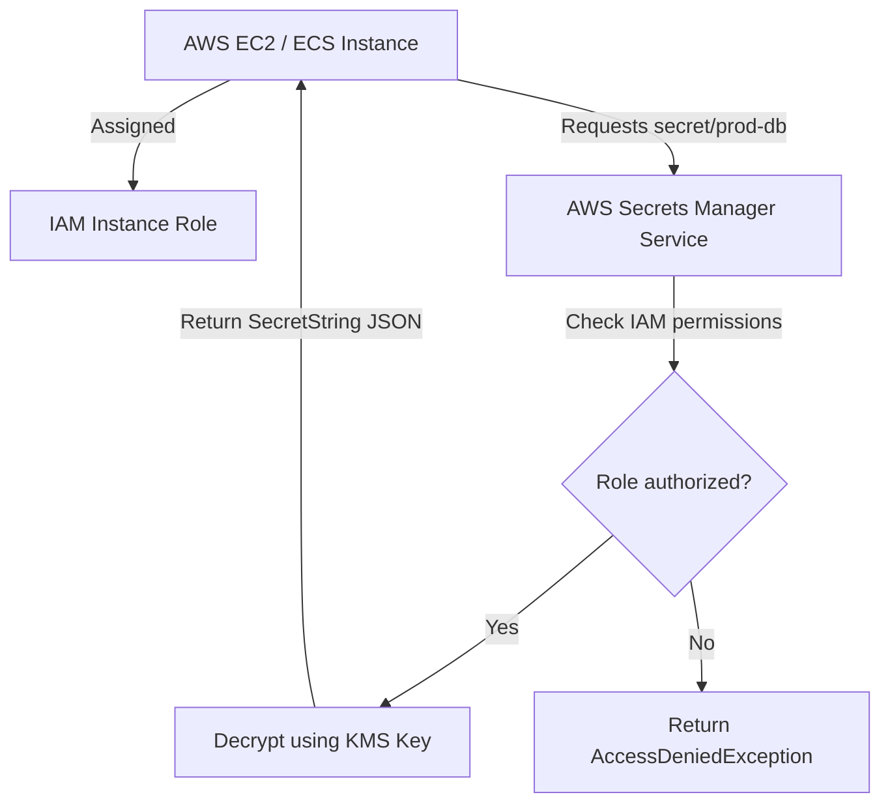

# AWS Secrets Manager with Python: AWS Integrations and Boto3

For applications deployed on Amazon Web Services (AWS), **AWS Secrets Manager** is the standard solution for managing secrets. It integrates directly with AWS Identity and Access Management (**IAM**) policies, allowing resources (such as EC2 instances or ECS tasks) to retrieve credentials securely without requiring hardcoded master keys.

Under the hood, AWS Secrets Manager stores secrets as text strings or binary objects. For structured data (like database hostnames, usernames, and passwords), it stores values as a serialized JSON string.

To interact with AWS Secrets Manager programmatically, we use the official AWS SDK for Python: **`boto3`**. In this guide, we will connect to the Secrets Manager client, parse JSON-based secret strings, handle AWS client exceptions, and retrieve credentials securely.

---

## AWS Secrets Manager Access Flow



---

## 1. Installation & Client Authentication

Install the official AWS SDK client library:

```bash
pip install boto3
```

Boto3 loads credentials automatically from standard locations (environment variables, `~/.aws/credentials` config files, or IAM instance metadata).

---

## 2. Ingesting and Decoding JSON Secrets

When you query Secrets Manager, the service returns a payload dictionary. The secret values are stored inside the **`SecretString`** field as a JSON string. You must parse this string using Python's `json` module.

Here is a Python utility class to manage AWS secrets retrieval:

```python
import json
import boto3
from botocore.exceptions import ClientError

class AWSSecretsManager:
    def __init__(self, region_name="us-west-2"):
        # Initialize the Secrets Manager client
        self.client = boto3.client("secretsmanager", region_name=region_name)

    def get_secret(self, secret_id):
        """
        Retrieves a secret. Decodes JSON formatted SecretStrings automatically.
        """
        try:
            print(f"Requesting secret '{secret_id}' from AWS Secrets Manager...")
            response = self.client.get_secret_value(SecretId=secret_id)
            
            # 1. Verify SecretString contains text
            if "SecretString" in response:
                secret_value = response["SecretString"]
                
                # 2. Attempt to parse JSON configurations
                try:
                    return json.loads(secret_value)
                except json.JSONDecodeError:
                    # Return raw string if not JSON structured
                    return secret_value
            else:
                # Handle binary secret payloads
                print("Warning: Secret payload is binary formatted.")
                return response.get("SecretBinary")
                
        except ClientError as e:
            error_code = e.response["Error"]["Code"]
            self._handle_client_error(error_code, secret_id)
            return None

    def _handle_client_error(self, error_code, secret_id):
        """
        Helper to print descriptive log messages based on AWS API errors.
        """
        if error_code == "ResourceNotFoundException":
            print(f"❌ Error: Secret '{secret_id}' was not found in this region.")
        elif error_code == "AccessDeniedException":
            print(f"❌ Error: IAM policy denied decryption access for secret '{secret_id}'.")
        elif error_code == "DecryptionFailure":
            print("❌ Error: Secrets Manager can't decrypt the protected payload using KMS key.")
        else:
            print(f"❌ AWS API Client Error: {error_code}")
```

---

## 3. Real-World API Integration Script

Here is an integration script that checks IAM authorization, retrieves API credentials, and handles connection failures:

```python
# Save this file as scripts/fetch_api_keys.py
# (Requires the AWSSecretsManager class defined above)

def configure_app_api():
    # Target secret path registered in AWS
    secret_path = "production/api/payment_keys"
    
    # Connect
    secrets_manager = AWSSecretsManager(region_name="us-east-1")
    
    # Retrieve
    keys = secrets_manager.get_secret(secret_path)
    
    if keys and isinstance(keys, dict):
        stripe_key = keys.get("stripe_secret_key")
        paypal_token = keys.get("paypal_access_token")
        
        if stripe_key and paypal_token:
            print("✅ Payment API credentials successfully resolved.")
            # Set runtime environment values in memory...
            return True
            
    print("❌ Failed to configure Payment API: Credentials not resolved.")
    return False

# if __name__ == "__main__":
#     configure_app_api()
```

---

## Summary

AWS Secrets Manager allows you to manage application secrets securely within the AWS ecosystem. By retrieving values dynamically using `boto3` and decoding the JSON-formatted `SecretString`, you can protect sensitive credentials and enforce IAM-based access control. In the next section, we will cover **Environment Variables Security**.
