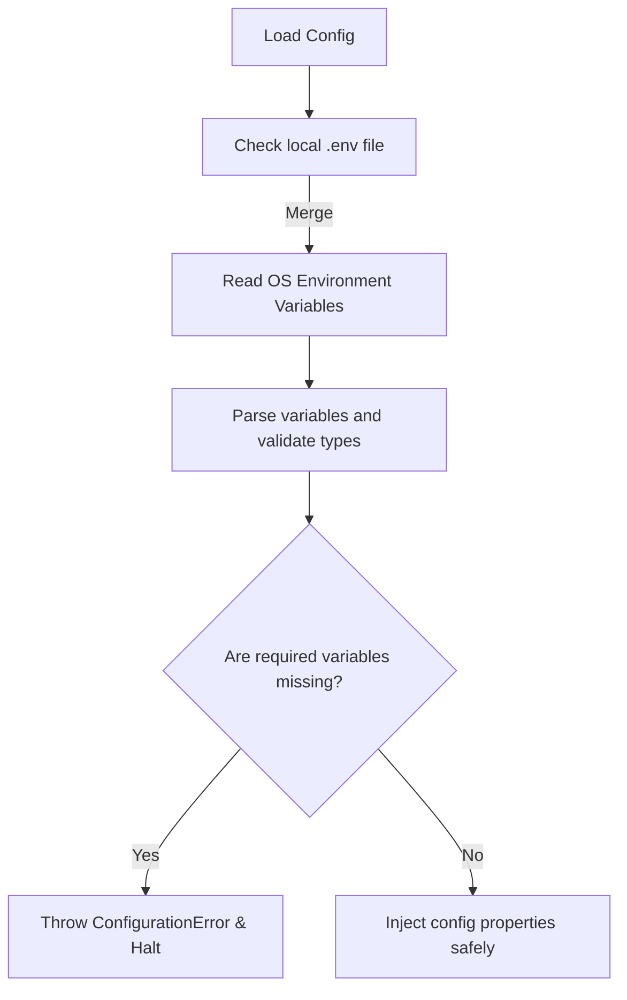

# Environment Variables Security: Managing Shell Variables and Dotenv

Passing configuration parameters using **Environment Variables** is a standard practice in cloud-native applications. Environment variables keep configuration separate from your code, aligning with Twelve-Factor App methodologies.

However, environment variables are not a secure storage engine. They can leak secrets in several ways:
1. **Docker Inspection**: Running `docker inspect <container>` prints all environment variables in plain text.
2. **Process Inspection**: On Linux, anyone with root or owner access can read the memory of your process by reading `/proc/<pid>/environ`.
3. **Shell History**: Declaring variables in a terminal (e.g., `export DB_PASS="secret"`) saves the secret to the shell's history file (`.bash_history`).

In this guide, we will cover the security limitations of environment variables, implement secure parsing using `python-dotenv` for local development, and write a type-safe configuration loader class in Python.

---

## Configuration Loading Pipeline



---

## 1. Local Development with `python-dotenv`

For local development, hardcoding variables in your terminal is slow. Instead, use a local `.env` file that is ignored by Git. You can use the `python-dotenv` library to load these values into Python's `os.environ` map dynamically when the script starts.

Install the library:
```bash
pip install python-dotenv
```

Add your variables to `.env`:
```text
DATABASE_URL=postgresql://localhost:5432/dev_db
MAX_WORKER_THREADS=8
DEBUG_MODE=True
```

---

## 2. Type-Safe Configuration Loader Implementation

Environment variables are always read as strings (e.g., `"8"` or `"True"`). To use them, you must convert them to the correct data types. A common bug is converting boolean strings: `bool("False")` evaluates to `True` in Python because `"False"` is a non-empty string.

Here is a Python configuration class that handles type conversion, manages defaults, and checks for required variables:

```python
import os
import logging
from dotenv import load_dotenv

logging.basicConfig(level=logging.INFO)
logger = logging.getLogger("config_loader")

class ConfigurationError(Exception):
    """Exception raised when required configurations are missing or invalid."""
    pass

class SecureConfigLoader:
    def __init__(self, env_path=None):
        # 1. Load local .env file if it exists
        if env_path and os.path.exists(env_path):
            load_dotenv(dotenv_path=env_path)
        else:
            load_dotenv() # Look for default .env in current CWD

    def get_string(self, key, default=None, required=False):
        val = os.environ.get(key, default)
        if required and not val:
            raise ConfigurationError(f"Missing required environment key: '{key}'")
        return val

    def get_int(self, key, default=None, required=False):
        val_str = self.get_string(key, default, required)
        if not val_str:
            return None
        try:
            return int(val_str)
        except ValueError:
            raise ConfigurationError(f"Invalid integer value for config key '{key}': '{val_str}'")

    def get_bool(self, key, default=False, required=False):
        val_str = self.get_string(key, str(default), required)
        if not val_str:
            return False
            
        # Standardize evaluation strings
        val_clean = val_str.strip().lower()
        if val_clean in ("true", "1", "yes", "on"):
            return True
        elif val_clean in ("false", "0", "no", "off"):
            return False
        else:
            raise ConfigurationError(f"Invalid boolean value for config key '{key}': '{val_str}'")
```

---

## 3. Script Integration Example

Here is how you use the configuration loader in your application:

```python
# Save this file as scripts/main_app.py
# (Requires the SecureConfigLoader defined above)

def initialize_application():
    # Instantiate configuration
    config = SecureConfigLoader()
    
    try:
        # Load string, integer, and boolean values
        db_url = config.get_string("DATABASE_URL", required=True)
        max_threads = config.get_int("MAX_WORKER_THREADS", default=4)
        debug_mode = config.get_bool("DEBUG_MODE", default=False)
        
        print("✅ Configurations loaded successfully:")
        print(f" - DB URL:      {db_url[:12]}*** (Masked)")
        print(f" - Max Threads: {max_threads}")
        print(f" - Debug Mode:  {debug_mode}")
        return True
        
    except ConfigurationError as e:
        print(f"❌ Configuration error: {e}")
        return False

# if __name__ == "__main__":
#     initialize_application()
```

---

## Summary

Environment variables are the standard way to configure cloud-native applications. By using `.env` files for local development and implementing a type-safe configuration loader, you can prevent runtime crashes and manage configuration values securely. In the next section, we will cover **Python Keyring**.
