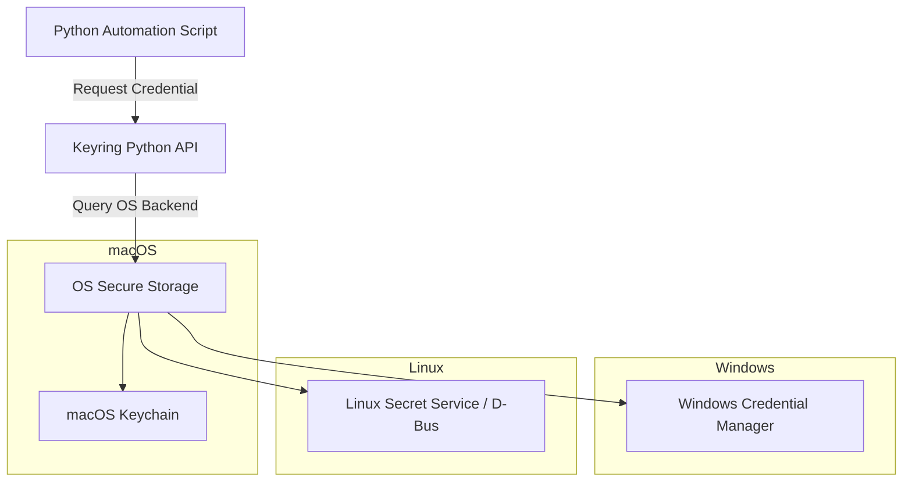

# Python Keyring: Utilizing Operating System Credential Stores

When developers run automation scripts locally, they often hardcode API keys or prompt for passwords repeatedly. While hardcoding credentials is a security risk, entering credentials on every run degrades the user experience.

The Python **`keyring`** library solves this by allowing scripts to store and retrieve credentials using the host operating system's built-in credential manager:
* **macOS**: Keychain Services.
* **Windows**: Windows Credential Manager.
* **Linux**: Freedesktop Secret Service (via D-Bus) or KWallet.

This ensures credentials are encrypted on disk and managed by the operating system. In this guide, we will connect to Keyring backends, save and retrieve passwords, manage headless fallback environments, and implement a credential verification wrapper.

---

## Operating System Keyring Access



---

## 1. Installation

Install the library using pip:

```bash
pip install keyring
```

Check the active keyring backend detected on your system:
```bash
keyring diagnostics
```

---

## 2. Managing Credentials with Keyring

The library uses a three-part configuration model:
1. **`service_name`**: The application name (acts as a group key).
2. **`username`**: The credential identifier (e.g. database username or email).
3. **`password`**: The secret value.

```python
import keyring

service = "my-deployment-app"
user = "deploy_admin"

# 1. Store a credential
# This opens the OS manager and writes the encrypted payload
keyring.set_password(service, user, "SuperSecretSecurePassword")
print("✅ Password successfully saved to OS credential store.")

# 2. Retrieve a credential
password = keyring.get_password(service, user)
print(f"✅ Password retrieved successfully (length: {len(password)})")

# 3. Delete a credential
# keyring.delete_password(service, user)
```

---

## 3. Handling Headless Environments (CI/CD Fallbacks)

In headless environments (such as Docker containers or CI/CD runners), there is no desktop environment or OS credential manager. By default, `keyring` will raise an exception or fall back to an unencrypted plain-text file.

To prevent this, you should catch exceptions and fall back to in-memory storage or environment variables in headless environments.

```python
import getpass
import keyring
from keyring.backends.fail import Keyring as FailKeyring

def get_secure_credential(service_name, username):
    """
    Retrieves a password from the OS keyring.
    If the keyring is unavailable (headless server), falls back to prompting the user.
    """
    try:
        # Check if the active backend is a mock/failure backend
        active_backend = keyring.get_keyring()
        if isinstance(active_backend, FailKeyring):
            print("⚠️ Warning: No OS Keyring backend detected. Falling back to memory prompt.")
            return getpass.getpass(f"Enter password for {username}: ")
            
        password = keyring.get_password(service_name, username)
        
        if not password:
            # Not set yet, prompt user and save it
            print(f"No password found for '{username}'. Initializing secure prompt...")
            password = getpass.getpass(f"Enter password for {username} to save in keyring: ")
            keyring.set_password(service_name, username, password)
            print("✅ Password saved to OS Keyring for future runs.")
            
        return password
        
    except Exception as e:
        print(f"⚠️ Keyring error: {e}. Falling back to standard input prompt...")
        return getpass.getpass(f"Enter password for {username}: ")
```

---

## 4. Local CLI Script Example

Here is a practical script showing how to use the credential wrapper to authenticate an API client:

```python
# Save this file as scripts/local_tool.py
# (Requires the get_secure_credential function defined above)

def run_local_task():
    service_id = "my-company-platform"
    developer_user = "patel"
    
    # 1. Fetch password (prompts once on first run, then loads from Keychain/Credentials Manager)
    api_token = get_secure_credential(service_id, developer_user)
    
    print("\nStarting automation operations...")
    # Initialize your API client using api_token...
    print("Authentication payload verified. Task completed.")

# if __name__ == "__main__":
#     run_local_task()
```

---

## Summary

The Python `keyring` library allows you to store credentials securely using the host operating system's built-in credential manager. By implementing fallback prompts for headless environments, you can write tools that run securely on both developer laptops and production servers. In the next section, we will cover **Secrets Rotation Automation**.
