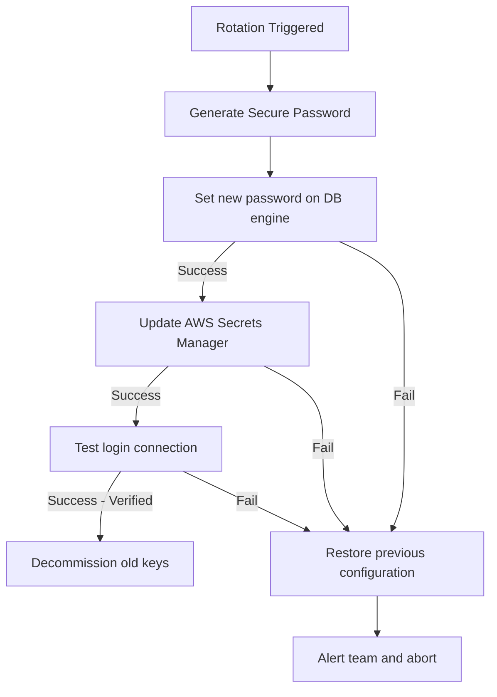

# Secrets Rotation Automation: Implementing Dynamic Credential Swaps

Keeping passwords active indefinitely increases security risks. If a database password is leaked, attackers can access your data until the leak is detected and the password is changed.

To address this, security standards require **Secrets Rotation**. Secrets rotation periodically updates credentials automatically.

Implementing secrets rotation programmatically requires coordinating multiple steps:
1. **Generate**: Create a secure new password.
2. **Update Database**: Set the new password on the database server.
3. **Update Store**: Save the new password to your secret store (e.g. AWS Secrets Manager).
4. **Validate**: Test the connection using the new credentials.
5. **Rollback (on failure)**: Revert changes if any step in the sequence fails.

In this guide, we will implement this secrets rotation workflow in Python, utilizing `boto3` to update AWS Secrets Manager and implementing database transaction safeguards.

---

## Secrets Rotation Transaction Workflow



---

## 1. Helper: Generating Cryptographically Secure Passwords

Never use Python's default `random` module to generate passwords. The `random` module uses pseudo-random algorithms that can be predicted by attackers.

Always use the **`secrets`** module, which generates cryptographically secure random values.

```python
import secrets
import string

def generate_secure_password(length=24):
    """
    Generates a secure password containing letters, digits, and special characters.
    """
    characters = string.ascii_letters + string.digits + "!@#$%^&*()-_=+"
    # Ensure password contains at least one digit and one special character
    while True:
        password = ''.join(secrets.choice(characters) for _ in range(length))
        if (any(c.isdigit() for c in password) 
                and any(c in "!@#$%^&*()-_=+" for c in password)):
            return password
```

---

## 2. Dynamic Secrets Rotation Script

Here is a complete Python program that orchestrates the rotation of a database password and updates AWS Secrets Manager:

```python
import secrets
import string
import boto3
from botocore.exceptions import ClientError

class DatabasePasswordRotator:
    def __init__(self, secret_id, region_name="us-west-2"):
        self.secret_id = secret_id
        self.sm_client = boto3.client("secretsmanager", region_name=region_name)

    def _execute_db_password_change(self, username, new_password):
        """
        Executes 'ALTER USER' queries on the database (simulated here).
        """
        print(f"Connecting to database to rotate password for user '{username}'...")
        # In a real environment, use psycopg2 or mysql-connector:
        # cursor.execute(f"ALTER USER {username} WITH PASSWORD '{new_password}'")
        time_simulated_delay = 1
        print("✅ Database user password altered successfully.")
        return True

    def _verify_db_login(self, username, password):
        """
        Validates the new database password.
        """
        print(f"Verifying database connection for '{username}' using the new password...")
        # Attempt a real database connection test here
        return True

    def rotate_secret(self):
        # 1. Fetch current credential metadata from Secrets Manager
        try:
            current_secret_payload = self.sm_client.get_secret_value(SecretId=self.secret_id)
            import json
            credentials = json.loads(current_secret_payload["SecretString"])
        except Exception as e:
            print(f"❌ Failed to fetch current credentials: {e}")
            return False

        username = credentials["username"]
        old_password = credentials["password"]
        
        # 2. Generate a secure new password
        new_password = generate_secure_password()
        
        # 3. Update the database server password
        if not self._execute_db_password_change(username, new_password):
            print("❌ Aborting: Database password update failed.")
            return False
            
        # 4. Save the new password to Secrets Manager
        credentials["password"] = new_password
        try:
            print("Saving new credentials to AWS Secrets Manager...")
            self.sm_client.put_secret_value(
                SecretId=self.secret_id,
                SecretString=json.dumps(credentials)
            )
            print("✅ Secrets Manager updated successfully.")
        except ClientError as e:
            print(f"❌ Failed to update Secrets Manager: {e}. Initiating database rollback...")
            # Rollback database changes to maintain consistency
            self._execute_db_password_change(username, old_password)
            return False

        # 5. Verify the new credentials work
        if self._verify_db_login(username, new_password):
            print("🎉 Secrets rotation completed and verified successfully!")
            return True
        else:
            print("❌ Critical: New password verification failed! Rolling back changes...")
            # Revert Secrets Manager and database to old password
            credentials["password"] = old_password
            self.sm_client.put_secret_value(SecretId=self.secret_id, SecretString=json.dumps(credentials))
            self._execute_db_password_change(username, old_password)
            return False
```

---

## Summary

Automated secrets rotation reduces the risk of credential exposure. By implementing a secure password generator, applying database updates, saving credentials to your secret store, and validating connections, you can maintain secure configurations automatically. This completes **Chapter 45 - Secrets Management**. In the next chapter, we will explore **Security Scanning**.
