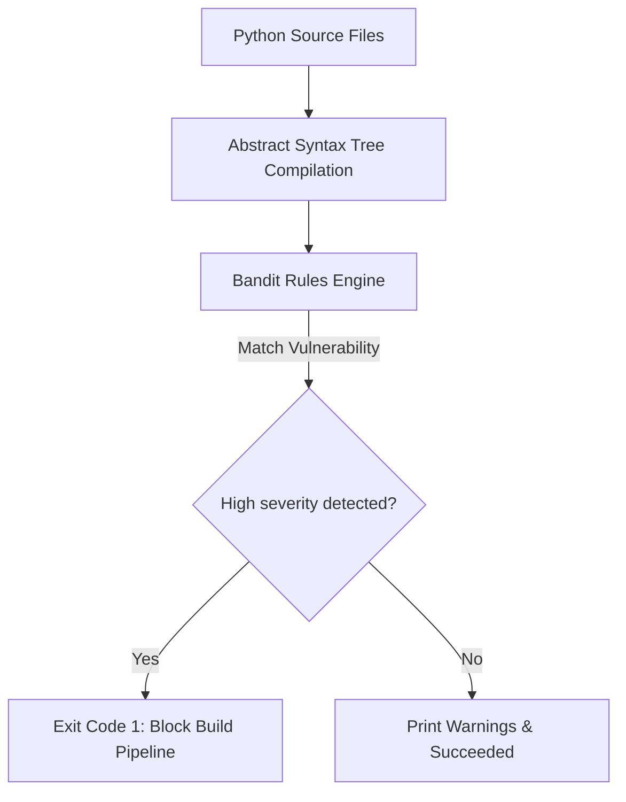

# Static Application Security Testing (SAST) with Bandit

Writing clean code is not enough; you must also write secure code. Developers occasionally introduce security vulnerabilities without realizing it, such as using unvalidated variables in shell commands, writing SQL queries using raw string concatenation, or utilizing weak encryption algorithms.

**Bandit** is the industry standard Static Application Security Testing (SAST) tool for Python. Instead of using basic text matches, Bandit parses Python code into an **Abstract Syntax Tree (AST)** to analyze structure and identify security issues.

In this guide, we will examine the vulnerabilities Bandit checks for, run scans programmatically, parse the resulting JSON reports, and write a script to enforce security checks in your pipelines.

---

## The SAST Scan Pipeline



---

## Vulnerabilities Bandit Detects

Bandit checks code files against a database of security rules, categorizing findings by severity (Low, Medium, High). Common vulnerabilities include:

### 1. Shell Injection (`B602`, `B607`)
Occurs when you run subprocess commands with `shell=True` and pass variables directly, allowing users to run arbitrary commands.

```python
# VULNERABLE: Bandit triggers high-severity warning (B602)
subprocess.run(f"ping {user_ip}", shell=True)
```

### 2. Hardcoded Passwords (`B105`, `B106`)
Occurs when variables names like `password` or `token` are assigned static string values.

```python
# VULNERABLE: Bandit triggers warning (B105)
db_password = "SuperSecretPassword123"
```

### 3. Insecure Cryptography / Randomness (`B311`, `B303`)
Using pseudo-random generators (like the default `random` module) for security keys or session variables, or utilizing outdated hashing algorithms like MD5.

---

## 1. Installation

Install Bandit using pip:

```bash
pip install bandit
```

Verify it is available in your shell:
```bash
bandit --version
```

---

## 2. Programmatically Running Bandit and Parsing JSON Reports

To run Bandit programmatically, execute the command with the JSON formatter flag (`-f json`). This outputs structured scan results that your scripts can parse easily.

```python
import json
import subprocess
import os

class BanditScanner:
    def __init__(self, target_dir):
        self.target_dir = target_dir
        if not os.path.exists(target_dir):
            raise FileNotFoundError(f"Target directory not found: {target_dir}")

    def execute_scan(self):
        """
        Runs Bandit against the target directory and outputs a JSON report.
        """
        # command: bandit -r <dir> -f json
        # -r triggers recursive folder parsing
        cmd = ["bandit", "-r", self.target_dir, "-f", "json"]
        print(f"Running Bandit scan against directory: {self.target_dir}...")
        
        result = subprocess.run(
            cmd,
            capture_output=True,
            text=True
        )
        
        # Bandit returns non-zero codes if vulnerabilities are found.
        # We parse the stdout JSON payload regardless of return code.
        try:
            return json.loads(result.stdout)
        except json.JSONDecodeError:
            print("❌ Failed to parse Bandit output. Stderr log details:")
            print(result.stderr)
            return None
```

---

## 3. Enforcing Security Compliance

Here is an automation script that runs the scanner class, analyzes the vulnerabilities found, and returns a non-zero exit code to fail the build pipeline if any **High Severity** vulnerabilities are detected:

```python
import sys

# (Requires the BanditScanner class defined above)

def run_security_gate():
    target_folder = "./src"
    scanner = BanditScanner(target_folder)
    
    report = scanner.execute_scan()
    if not report:
        print("Security scan aborted: No report generated.")
        sys.exit(1)
        
    metrics = report.get("metrics", {}).get("_all", {})
    results = report.get("results", [])
    
    print("\n==================================================")
    print("🛡️ BANDIT SECURITY REPORT SUMMARY")
    print("==================================================")
    print(f"Files Scanned:   {metrics.get('loc', 0)}")
    print(f"Issues Found:    {len(results)}")
    print(f"  - High Severity:   {metrics.get('SEVERITY.HIGH', 0)}")
    print(f"  - Medium Severity: {metrics.get('SEVERITY.MEDIUM', 0)}")
    print(f"  - Low Severity:    {metrics.get('SEVERITY.LOW', 0)}")
    print("==================================================")

    high_severity_issues = []
    for issue in results:
        if issue["issue_severity"] == "HIGH":
            high_severity_issues.append(issue)
            print(f"\n🚨 CRITICAL VULNERABILITY FOUND:")
            print(f"  - File:     {issue['filename']}:{issue['line_number']}")
            print(f"  - Test ID:  {issue['test_id']} ({issue['test_name']})")
            print(f"  - Details:  {issue['issue_text']}")
            print(f"  - Code:     {issue['code'].strip()}")

    # Enforce build gate criteria
    if len(high_severity_issues) > 0:
        print("\n❌ Build Failed: High-severity security issues detected!")
        sys.exit(1)
        
    print("\n✅ Security check passed. No critical vulnerabilities found.")
    sys.exit(0)

# if __name__ == "__main__":
#     run_security_gate()
```

---

## Summary

Static Application Security Testing (SAST) helps you catch vulnerabilities before they reach production. By running Bandit programmatically and parsing the JSON output, you can enforce security checks in your CI/CD pipelines. In the next section, we will cover **dependency vulnerability scanning with Safety**.
