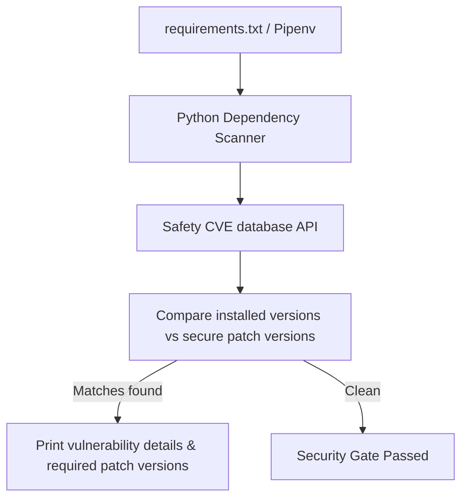

# Dependency Vulnerability Scanning with Safety (SCA)

Modern software development relies heavily on open-source libraries. A typical Python project imports multiple packages (such as `requests`, `Django`, or `cryptography`) which in turn load their own sub-dependencies.

This creates a security risk: if a third-party library has a known vulnerability (such as a remote code execution exploit or memory leak), your application is vulnerable. Monitoring these vulnerabilities is called **Software Composition Analysis (SCA)**.

**Safety** is the standard tool for dependency scanning in Python. It cross-references your installed packages against a curated database of known security vulnerabilities (Common Vulnerabilities and Exposures - **CVEs**).

In this guide, we will cover how to scan dependency configuration files (`requirements.txt`), run Safety programmatically, parse JSON reports, and audit dependency risk levels.

---

## Software Composition Analysis (SCA) Pipeline



---

## 1. Installation

Install Safety using pip:

```bash
pip install safety
```

Verify it is available in your shell:
```bash
safety --version
```

---

## 2. Programmatically Scanning `requirements.txt`

To run Safety programmatically, execute the command line tool and export the results to JSON (`safety check --json`). 

*Note: For production environments, register on the Safety portal to acquire an API key for real-time CVE database updates.*

```python
import json
import subprocess
import os

class DependencyScanner:
    def __init__(self, requirements_path):
        self.requirements_path = requirements_path
        if not os.path.exists(requirements_path):
            raise FileNotFoundError(f"Dependency file missing: {requirements_path}")

    def execute_scan(self):
        """
        Runs Safety check against requirements.txt and outputs JSON details.
        """
        # command: safety check -r <file> --json
        cmd = ["safety", "check", "-r", self.requirements_path, "--json"]
        print(f"Scanning dependency file: {self.requirements_path}...")
        
        # Execute sub-process
        result = subprocess.run(
            cmd,
            capture_output=True,
            text=True
        )
        
        try:
            return json.loads(result.stdout)
        except json.JSONDecodeError:
            print("❌ Failed to parse Safety JSON output. System output logs:")
            print(result.stdout)
            return None
```

---

## 3. Generating Compliance Reports

Here is an automation script that executes the `DependencyScanner` class, parses the CVE results, and compiles a remediation report mapping insecure packages to their recommended patch versions.

```python
import sys

# (Requires the DependencyScanner class defined above)

def run_dependency_gate():
    requirements_file = "requirements.txt"
    scanner = DependencyScanner(requirements_file)
    
    report = scanner.execute_scan()
    if report is None:
        print("Dependency audit failed: No scanner report generated.")
        sys.exit(1)
        
    # Safety JSON returns a list of vulnerability objects or a structured dict
    # depending on the Safety client version. We normalize evaluation:
    vulnerabilities = []
    if isinstance(report, dict):
        vulnerabilities = report.get("vulnerabilities", [])
    elif isinstance(report, list):
        vulnerabilities = report

    print("\n==================================================")
    print("📦 DEPENDENCY COMPLIANCE SCAN SUMMARY")
    print("==================================================")
    print(f"Issues Found: {len(vulnerabilities)}")
    print("==================================================")

    if not vulnerabilities:
        print("✅ Success: No vulnerable packages found.")
        sys.exit(0)

    # Output detailed remediation directives
    for vuln in vulnerabilities:
        # Resolve parameters based on standard safety JSON schema
        package = vuln.get("package_name")
        installed = vuln.get("installed_version")
        ignored = vuln.get("ignored")
        cve = vuln.get("cve") or "N/A"
        advisory = vuln.get("advisory", "No description available.")
        
        # Find secure version boundaries if listed
        remediation = vuln.get("remediation", {}).get("fixed_versions", ["N/A"])
        fixed_version_str = ", ".join(remediation) if isinstance(remediation, list) else str(remediation)
        
        print(f"\n🚨 Vulnerable Library: {package} (Installed: {installed})")
        print(f"  - CVE:          {cve}")
        print(f"  - Advisory:     {advisory}")
        print(f"  - Recommendation: Upgrade to {fixed_version_str}")

    print("\n❌ Build blocked due to dependency vulnerabilities.")
    sys.exit(1)

# if __name__ == "__main__":
#     run_dependency_gate()
```

---

## Summary

Dependency vulnerability scanning checks that third-party packages are free of known vulnerabilities. By running Safety programmatically and parsing the JSON output, you can identify obsolete packages and upgrade them to secure versions. In the next section, we will cover **scanning Docker images**.
