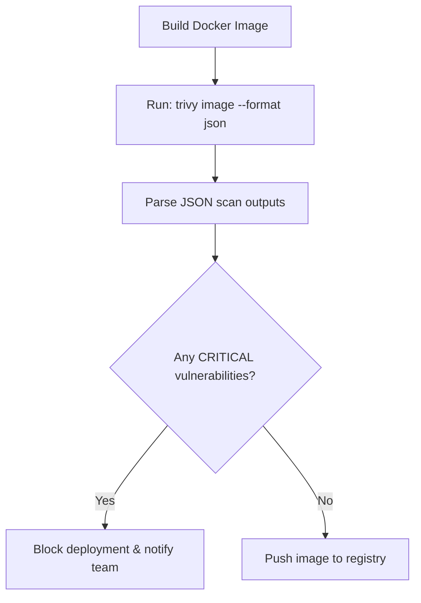

# Scanning Docker Images for Vulnerabilities with Trivy

When deploying containerized applications, securing your code is only the first step. A Docker image contains not only your code, but also a base operating system (e.g. Debian, Alpine), system libraries, and runtime packages.

If your base image contains an outdated system library (such as an insecure version of `openssl` or `glibc`), your container is vulnerable to attack, even if your Python code is secure.

**Trivy** is the industry standard container vulnerability scanner. It scans container images, filesystem directories, and git repositories to identify OS packages and dependency vulnerabilities.

In this guide, we will run Trivy programmatically from Python, parse the JSON results, extract vulnerability metadata, and write a script to enforce security checks on Docker images.

---

## Container Security Pipeline



---

## 1. Installation & CLI Configuration

Before running Trivy from Python, you must install the Trivy binary on your host:
* **macOS**: `brew install aquasecurity/trivy/trivy`
* **Linux**: `apt-get install trivy` (see Trivy docs for repository setup details)
* **Windows**: Download binary zip from Aqua Security's GitHub Releases.

---

## 2. Programmatically Executing Trivy Image Scans

To automate container scans, run Trivy inside a Python script and export the results to a JSON file (`--format json --output result.json`).

```python
import json
import os
import subprocess

class TrivyImageScanner:
    def __init__(self, image_tag):
        self.image_tag = image_tag
        self.output_file = "trivy_report.json"

    def execute_scan(self):
        """
        Runs Trivy image scan and saves output to a JSON file.
        """
        # command: trivy image --format json --output trivy_report.json <image>
        cmd = [
            "trivy", "image",
            "--format", "json",
            "--output", self.output_file,
            self.image_tag
        ]
        
        print(f"Scanning Docker image: {self.image_tag}...")
        try:
            # Trivy downloads vulnerability databases automatically on first run
            result = subprocess.run(cmd, capture_output=True, text=True, check=True)
            
            # Read output file
            if os.path.exists(self.output_file):
                with open(self.output_file, "r", encoding="utf-8") as f:
                    data = json.load(f)
                return data
            return None
        except subprocess.CalledProcessError as e:
            print(f"❌ Trivy command failed: {e.stderr}")
            return None
        except Exception as e:
            print(f"❌ Unexpected scanner error: {e}")
            return None
        finally:
            # Clean up the temporary file
            if os.path.exists(self.output_file):
                os.remove(self.output_file)
```

---

## 3. Auditing Trivy Scan Metrics

Here is a Python script that parses the Trivy report, counts vulnerabilities by severity, and blocks deployments if any **Critical** severity vulnerabilities are found.

```python
import sys

# (Requires the TrivyImageScanner class defined above)

def run_container_security_gate(image_tag):
    scanner = TrivyImageScanner(image_tag)
    report = scanner.execute_scan()
    
    if not report:
        print("Image scanning failed: No scan report generated.")
        sys.exit(1)
        
    critical_issues = []
    high_issues = []
    
    # Trivy JSON format groups findings by target layer inside the 'Results' key
    results = report.get("Results", [])
    
    for result in results:
        vulnerabilities = result.get("Vulnerabilities", [])
        for vuln in vulnerabilities:
            severity = vuln.get("Severity", "").upper()
            cve_id = vuln.get("VulnerabilityID")
            package = vuln.get("PkgName")
            installed = vuln.get("InstalledVersion")
            fixed = vuln.get("FixedVersion", "N/A")
            
            issue_summary = {
                "cve": cve_id,
                "package": package,
                "installed": installed,
                "fixed": fixed,
                "title": vuln.get("Title", "No title available.")
            }
            
            if severity == "CRITICAL":
                critical_issues.append(issue_summary)
            elif severity == "HIGH":
                high_issues.append(issue_summary)

    print("\n==================================================")
    print("🐳 CONTAINER IMAGE SECURITY REPORT")
    print("==================================================")
    print(f"Target Image:     {image_tag}")
    print(f"Critical Issues:  {len(critical_issues)}")
    print(f"High Issues:      {len(high_issues)}")
    print("==================================================")

    if critical_issues:
        print("\n🚨 CRITICAL VULNERABILITIES FOUND:")
        for issue in critical_issues:
            print(f"  - {issue['cve']}: {issue['package']} (Installed: {issue['installed']}) -> Fixed in: {issue['fixed']}")
            print(f"    Description: {issue['title']}")
            
        print("\n❌ Build blocked: Critical container vulnerabilities detected.")
        sys.exit(1)
        
    print("\n✅ Container image checks passed successfully.")
    sys.exit(0)

# Example:
# run_container_security_gate("my-app-web:latest")
```

---

## Summary

Container security scanning helps ensure your base operating system libraries and runtime packages are secure. By running Trivy programmatically and parsing the JSON output, you can identify vulnerabilities and block insecure container deployments. In the next section, we will cover **vulnerability reporting**.
