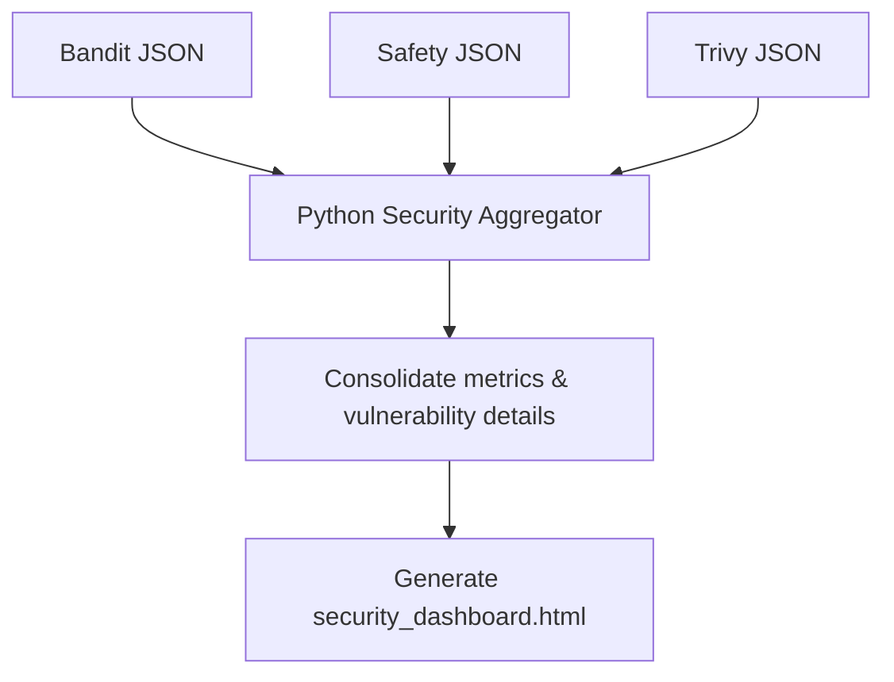

# Vulnerability Reporting: Aggregating Bandit, Safety, and Trivy Scans

Running security scanners (Bandit for static code analysis, Safety for dependency checks, and Trivy for container image audits) is only the first step. If every scanner generates its own raw JSON file in a different directory, reviewing the results is difficult for developers and security auditors.

To address this, write a centralized **Security Aggregator** in Python. The aggregator parses the JSON reports from all scanners, compiles the statistics, and generates a single HTML dashboard page.

In this guide, we will design a Python aggregator class, parse output structures, and write a script to generate HTML reports.

---

## Centralized Reporting Workflow



---

## 1. Structured Aggregator Implementation

Here is a Python class that parses JSON reports from Bandit, Safety, and Trivy, and compiles the metrics into a unified data structure:

```python
import json
import os

class SecurityAggregator:
    def __init__(self):
        self.findings = []
        self.summary = {"bandit": 0, "safety": 0, "trivy": 0}

    def parse_bandit_report(self, filepath):
        if not os.path.exists(filepath):
            return
            
        with open(filepath, "r", encoding="utf-8") as f:
            data = json.load(f)
            
        results = data.get("results", [])
        self.summary["bandit"] = len(results)
        
        for issue in results:
            self.findings.append({
                "source": "SAST (Bandit)",
                "id": issue.get("test_id"),
                "severity": issue.get("issue_severity"),
                "package_or_file": issue.get("filename"),
                "description": issue.get("issue_text")
            })

    def parse_safety_report(self, filepath):
        if not os.path.exists(filepath):
            return
            
        with open(filepath, "r", encoding="utf-8") as f:
            data = json.load(f)
            
        # safety can return a list or dict
        vulns = data.get("vulnerabilities", []) if isinstance(data, dict) else data
        self.summary["safety"] = len(vulns)
        
        for vuln in vulns:
            self.findings.append({
                "source": "Dependencies (Safety)",
                "id": vuln.get("cve") or "N/A",
                "severity": "HIGH", # Safety matches are high severity by default
                "package_or_file": vuln.get("package_name"),
                "description": vuln.get("advisory")
            })

    def parse_trivy_report(self, filepath):
        if not os.path.exists(filepath):
            return
            
        with open(filepath, "r", encoding="utf-8") as f:
            data = json.load(f)
            
        results = data.get("Results", [])
        trivy_count = 0
        
        for res in results:
            vulns = res.get("Vulnerabilities", [])
            trivy_count += len(vulns)
            for vuln in vulns:
                self.findings.append({
                    "source": "Container (Trivy)",
                    "id": vuln.get("VulnerabilityID"),
                    "severity": vuln.get("Severity"),
                    "package_or_file": vuln.get("PkgName"),
                    "description": vuln.get("Title")
                })
        self.summary["trivy"] = trivy_count
```

---

## 2. Generating the HTML Security Dashboard

Here is a Python method to render the compiled findings into an HTML dashboard report.

```python
# (Add this method inside the SecurityAggregator class defined above)

def generate_html_report(self, output_path):
    # Construct rows for the findings table
    rows_html = ""
    for finding in self.findings:
        sev_color = "red" if finding["severity"] in ("HIGH", "CRITICAL") else "orange" if finding["severity"] == "MEDIUM" else "gray"
        
        rows_html += f"""
        <tr>
          <td style="padding: 10px; border-bottom: 1px solid #ddd;">{finding['source']}</td>
          <td style="padding: 10px; border-bottom: 1px solid #ddd; font-weight: bold;">{finding['id']}</td>
          <td style="padding: 10px; border-bottom: 1px solid #ddd; color: {sev_color}; font-weight: bold;">{finding['severity']}</td>
          <td style="padding: 10px; border-bottom: 1px solid #ddd; font-family: monospace;">{finding['package_or_file']}</td>
          <td style="padding: 10px; border-bottom: 1px solid #ddd;">{finding['description']}</td>
        </tr>
        """

    # Build the full HTML page template
    html_content = f"""
    <html>
      <body style="font-family: Arial, sans-serif; color: #333; line-height: 1.6; padding: 20px;">
        <h2 style="color: #2c3e50;">Unified Vulnerability Dashboard</h2>
        <hr style="border: 0; border-top: 1px solid #eee;" />
        
        <h3>Scan Summary</h3>
        <table cellpadding="10" style="border-collapse: collapse; margin-bottom: 20px;">
          <tr style="background-color: #f8f9fa;">
            <th style="border: 1px solid #ddd;">Scanner</th>
            <th style="border: 1px solid #ddd;">Issues Found</th>
          </tr>
          <tr><td>Bandit (SAST)</td><td>{self.summary['bandit']}</td></tr>
          <tr><td>Safety (Dependencies)</td><td>{self.summary['safety']}</td></tr>
          <tr><td>Trivy (Container)</td><td>{self.summary['trivy']}</td></tr>
        </table>
        
        <h3>Detailed Findings ({len(self.findings)})</h3>
        <table border="1" cellpadding="5" cellspacing="0" style="border-collapse: collapse; width: 100%;">
          <tr style="background-color: #f8f9fa; text-align: left;">
            <th>Source</th>
            <th>Identifier</th>
            <th>Severity</th>
            <th>Target Location / Package</th>
            <th>Description</th>
          </tr>
          {rows_html}
        </table>
      </body>
    </html>
    """
    
    with open(output_path, "w", encoding="utf-8") as f:
        f.write(html_content)
    print(f"✅ Unified HTML security report written to: {output_path}")
```

---

## Summary

Consolidating vulnerability data from different scanners makes security reviews easier. By parsing JSON reports from Bandit, Safety, and Trivy into a unified data structure and generating a single HTML dashboard, you can track and remediate issues across your codebase. In the next section, we will integrate these checks into a **Security Automation Pipeline**.
