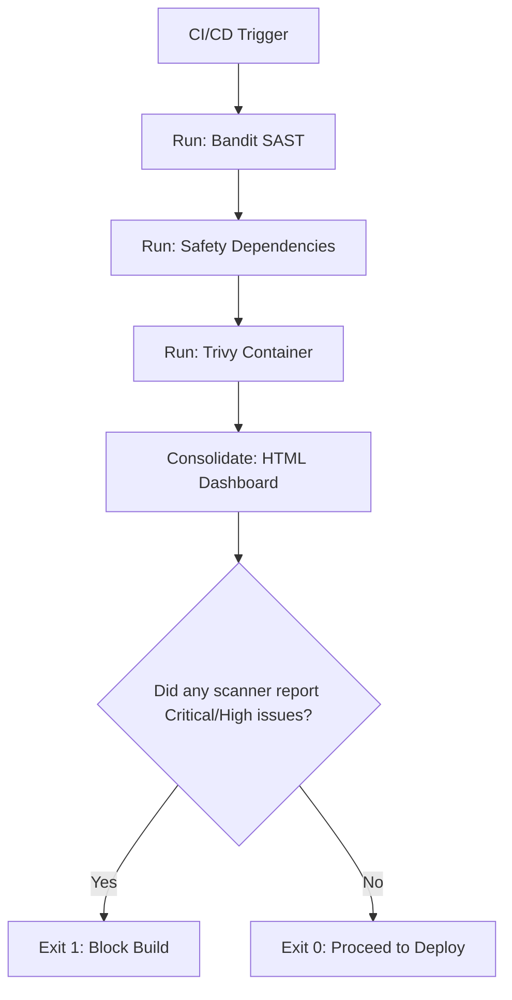

# Security Automation Pipeline: Integrating Scans into CI/CD

Integrating security checks directly into your CI/CD pipeline ensures that code containing critical vulnerabilities never reaches production. Running these scans manually is prone to human error, so they must be automated.

However, a common pipeline design mistake is exiting immediately upon the first scanner failure. For example, if Bandit fails, the build stops, and you miss dependency or container vulnerabilities that Safety and Trivy would have caught.

A better pattern is to design a unified **Security Pipeline Orchestrator** in Python. The orchestrator runs all scanners (SAST, dependency, and container scans) sequentially, logs all errors, compiles a consolidated report, and then checks the final results to determine whether to fail the build.

In this guide, we will implement this security pipeline orchestration script in Python.

---

## The Unified Security Pipeline



---

## 1. Complete Security Pipeline Runner Script

Here is the complete orchestrator script that runs the security scans, compiles the findings, and returns the correct exit status.

Save this file as `run_security_pipeline.py`:

```python
import subprocess
import os
import sys

# Assume we reuse the SecurityAggregator class from Section 04

class SecurityPipelineRunner:
    def __init__(self, src_dir, reqs_file, image_tag):
        self.src_dir = src_dir
        self.reqs_file = reqs_file
        self.image_tag = image_tag
        
        # Temporary report file names
        self.bandit_json = "bandit_out.json"
        self.safety_json = "safety_out.json"
        self.trivy_json = "trivy_out.json"
        self.html_dashboard = "security_dashboard.html"

    def _run_command(self, cmd):
        """
        Executes a shell command. Captures stdout/stderr without throwing exceptions.
        """
        print(f"Executing: {' '.join(cmd)}")
        result = subprocess.run(cmd, capture_output=True, text=True)
        return result.returncode

    def run_all_scans(self):
        print("Starting Security Automation Pipeline...")
        
        # 1. Run Bandit SAST scan
        # bandit -r <src> -f json -o <file>
        self._run_command([
            "bandit", "-r", self.src_dir,
            "-f", "json", "-o", self.bandit_json
        ])

        # 2. Run Safety dependency scan
        # safety check -r <reqs> --json > safety_out.json
        # safety doesn't support -o flag directly, so we redirect output via shell command
        try:
            with open(self.safety_json, "w", encoding="utf-8") as f:
                subprocess.run(
                    ["safety", "check", "-r", self.reqs_file, "--json"],
                    stdout=f,
                    stderr=subprocess.DEVNULL
                )
        except Exception as e:
            print(f"Warning: Safety scan execution encountered errors: {e}")

        # 3. Run Trivy container scan
        # trivy image --format json --output <file> <image>
        self._run_command([
            "trivy", "image",
            "--format", "json",
            "--output", self.trivy_json,
            self.image_tag
        ])

    def consolidate_reports(self):
        # Instantiate the aggregator class defined in Section 04
        from report_aggregator import SecurityAggregator
        
        aggregator = SecurityAggregator()
        aggregator.parse_bandit_report(self.bandit_json)
        aggregator.parse_safety_report(self.safety_json)
        aggregator.parse_trivy_report(self.trivy_json)
        
        aggregator.generate_html_report(self.html_dashboard)
        
        # Clean up temporary JSON files
        for temp_file in [self.bandit_json, self.safety_json, self.trivy_json]:
            if os.path.exists(temp_file):
                os.remove(temp_file)
                
        return aggregator.findings

    def enforce_pipeline_gate(self, findings):
        # Filter findings to check for high-severity issues
        failed_gate = False
        
        print("\n==================================================")
        print("🔍 PIPELINE SECURITY CHECK GATE")
        print("==================================================")
        
        for finding in findings:
            severity = finding["severity"].upper()
            if severity in ("HIGH", "CRITICAL"):
                print(f"❌ {severity} issue in {finding['package_or_file']} ({finding['source']}): {finding['description']}")
                failed_gate = True
                
        if failed_gate:
            print("\n❌ Pipeline failed: Critical or High security issues detected.")
            sys.exit(1)
        else:
            print("\n✅ All security checks passed.")
            sys.exit(0)
```

---

## 2. Orchestration Entry Point

Here is how you execute the pipeline runner:

```python
# Save as scripts/run_pipeline.py
# (Requires the SecurityPipelineRunner class defined above)

def execute_pipeline():
    runner = SecurityPipelineRunner(
        src_dir="./src",
        reqs_file="requirements.txt",
        image_tag="my-app-web:latest"
    )
    
    # 1. Run scans
    runner.run_all_scans()
    
    # 2. Consolidate reports
    findings = runner.consolidate_reports()
    
    # 3. Enforce quality gates
    runner.enforce_pipeline_gate(findings)

# if __name__ == "__main__":
#     execute_pipeline()
```

---

## Summary

Automating your security scans inside a unified pipeline helps ensure that vulnerabilities are caught before deployment. By running scans sequentially, consolidating the results, and checking the final findings, you can build secure, reliable delivery pipelines. This completes **Chapter 46 - Security Scanning**. In the next chapter, we will explore **Cryptography with Python**.
