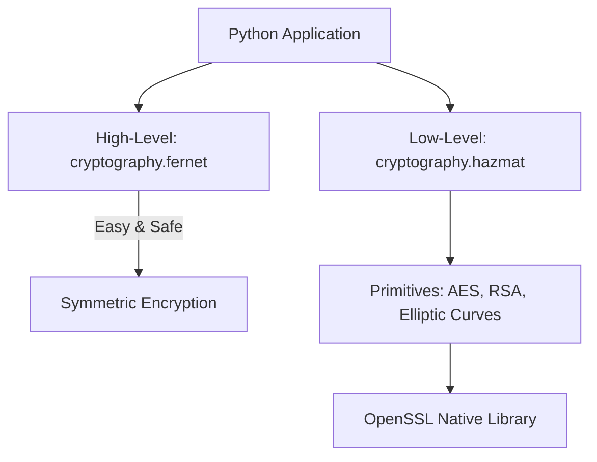

# Cryptography with Python: Library Architecture and Key Management

When developing security automation scripts, you will need to handle cryptographic operations, such as encrypting sensitive payloads, hashing user files to verify integrity, generating SSL/TLS certificates, or verifying signed JSON Web Tokens (JWTs).

While Python includes built-in modules like `hashlib`, complex operations (like symmetric encryption or asymmetric key pair generation) are best handled using the **`cryptography`** library. It is the gold standard for secure cryptographic implementations in the Python ecosystem.

In this guide, we will explore the architecture of the `cryptography` library, compare symmetric and asymmetric models, and write a script to generate and secure encryption keys on disk.

---

## The Cryptography Library Architecture

The library is organized into two primary layers:

1. **`cryptography.fernet`**: A high-level symmetric encryption recipe. It uses AES-128 in CBC mode with PKCS7 padding and HMACS-SHA256 for authentication. This layer is designed to prevent common cryptographic mistakes.
2. **`cryptography.hazmat` (Hazardous Materials)**: Low-level cryptographic primitives (specific algorithms, key wrappers, and padding mechanics). 



> [!WARNING]
> Use the high-level `fernet` module unless you need to support specific algorithms or standards. The low-level `hazmat` layer requires a deep understanding of cryptography, and incorrect configurations can introduce security vulnerabilities.

---

## Symmetric vs. Asymmetric Cryptography

| Cryptographic Model | Key Structure | Performance | Use Case |
| :--- | :--- | :--- | :--- |
| **Symmetric** | Single shared secret key for encryption and decryption. | Fast (low CPU overhead). | Encrypting local files, database cells, or session caches. |
| **Asymmetric** | Public key for encryption, private key for decryption. | Slow (high CPU overhead). | SSL/TLS handshakes, SSH logins, and digital signatures. |

---

## 1. Installation

Install the library using pip:

```bash
pip install cryptography
```

Verify the installation:
```bash
python -c "from cryptography.fernet import Fernet; print('Fernet loaded successfully')"
```

---

## 2. Generating and Securing Keys on Disk

When generating encryption keys, you must store the private key files securely on disk. If a private key file is readable by other users on the system, your encryption is compromised.

Always save key files with **restricted OS file permissions** (chmod `600` on Unix/Linux, which translates to read/write access restricted to the owner only).

Here is a Python script to generate a symmetric key and save it securely:

```python
import os
from cryptography.fernet import Fernet

def generate_and_save_key(filepath):
    """
    Generates a secure Fernet key and writes it to disk with restricted file permissions.
    """
    # 1. Generate key (32 cryptographically secure random bytes, base64 encoded)
    key = Fernet.generate_key()
    
    # 2. Write key to disk
    # We use os.open to set the file creation flags explicitly
    try:
        # O_WRONLY: Write only
        # O_CREAT: Create file if missing
        # O_TRUNC: Overwrite if exists
        # 0o600: Read/Write permissions for the owner only (chmod 600)
        flags = os.O_WRONLY | os.O_CREAT | os.O_TRUNC
        mode = 0o600 
        
        file_descriptor = os.open(filepath, flags, mode)
        with os.fdopen(file_descriptor, "wb") as f:
            f.write(key)
            
        print(f"✅ Secure key generated and written to: {filepath}")
        return True
    except Exception as e:
        print(f"❌ Failed to save key securely: {e}")
        return False

def verify_key_file_permissions(filepath):
    """
    Checks if a file's permissions are restricted to the owner only.
    """
    if os.name == "nt":
        # Windows uses ACLs rather than standard Unix chmod masks
        print("System is running on Windows. Standard chmod check skipped.")
        return True
        
    try:
        # Get octal file mode
        stat_info = os.stat(filepath)
        mode = oct(stat_info.st_mode & 0o777)
        print(f"File mode permissions for '{filepath}': {mode}")
        
        # Check if group or others have read/write/execute permissions (mask should be 0o600 or 0o400)
        if stat_info.st_mode & 0o077:
            print("⚠️ Warning: File permissions are too open! Execute: chmod 600 <file>")
            return False
        return True
    except Exception as e:
        print(f"Failed to check permissions: {e}")
        return False
```

---

## Summary

The Python `cryptography` library provides both high-level wrappers like `Fernet` and low-level primitives in the `hazmat` layer. When generating encryption keys, you must store them securely using restricted file permissions to prevent unauthorized access. In the next section, we will cover **data hashing**.
