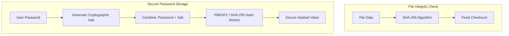

# Hashing Data: Integrity Checks, Salts, and Password Security

A cryptographic **Hash Function** is a one-way mathematical function that takes an input string of any size and compiles it into a fixed-length hexadecimal string (a checksum). 

Unlike encryption, hashing is a **one-way operation**: you cannot decrypt or reverse a hash back to its original input string.

Hashing is used for two main purposes in security:
1. **Integrity Validation**: Verifying that a file has not been modified or corrupted during transfer (e.g., verifying a downloaded zip archive matches its source SHA-256 checksum).
2. **Credential Storage**: Storing passwords securely. By storing hashes instead of plain-text passwords, your users remain protected even if your database is compromised.

In this guide, we will implement file checksum checks using Python's `hashlib` library and write a secure password hashing routine using random **salts** and SHA-256.

---

## Integrity Validation vs. Password Hashing



---

## 1. Calculating File Integrity Checksums

To calculate the checksum of a file, use Python's built-in **`hashlib`** module. When processing large files, do not read the entire file into memory at once. Instead, stream the file in **64 Kilobyte chunks** using the `.update()` method.

Here is a function that calculates the SHA-256 hash of a file:

```python
import hashlib
import os

def calculate_file_sha256(filepath):
    """
    Computes the SHA-256 checksum of a file by reading it in 64KB blocks.
    """
    if not os.path.exists(filepath):
        print(f"Error: File '{filepath}' not found.")
        return None

    # Instantiate the SHA-256 hash engine
    sha256 = hashlib.sha256()
    
    try:
        with open(filepath, "rb") as f:
            # Read in 64KB chunks (65536 bytes)
            for byte_block in iter(lambda: f.read(65536), b""):
                sha256.update(byte_block)
                
        checksum = sha256.hexdigest()
        return checksum
    except Exception as e:
        print(f"Failed to calculate hash: {e}")
        return None
```

---

## 2. Password Security: The Role of Salting

If you hash a password using standard SHA-256 directly:
```python
# AVOID: Vulnerable to rainbow table lookups
hashlib.sha256(b"password123").hexdigest()
```
An attacker who steals your database does not need to reverse the hash. They can search online databases of pre-computed hashes (called **Rainbow Tables**) to find the matching password immediately.

To prevent this, you must **Salt** the password. A salt is a cryptographically secure random string appended to the password before hashing. This ensures that even if two users choose the same password (e.g., `password123`), they will have different hashes in the database.

Here is a password hashing implementation using the PBKDF2 (Password-Based Key Derivation Function 2) algorithm, which is built into Python's `hashlib`:

```python
import hashlib
import secrets

def hash_new_password(plain_password):
    """
    Generates a secure random salt and hashes the password using PBKDF2 with SHA-256.
    """
    # 1. Generate a 16-byte random salt
    salt = secrets.token_bytes(16)
    
    # 2. Hash password using PBKDF2
    # iterations=100000: slows down execution to protect against brute-force attacks
    dk = hashlib.pbkdf2_hmac(
        hash_name='sha256',
        password=plain_password.encode('utf-8'),
        salt=salt,
        iterations=100000
    )
    
    # Return both the salt and the key as hex strings to save in the database
    return salt.hex(), dk.hex()

def verify_password(plain_password, stored_salt_hex, stored_key_hex):
    """
    Verifies a password against the stored salt and key.
    """
    salt = bytes.fromhex(stored_salt_hex)
    stored_key = bytes.fromhex(stored_key_hex)
    
    # Re-calculate the key using the input password and the stored salt
    dk = hashlib.pbkdf2_hmac(
        hash_name='sha256',
        password=plain_password.encode('utf-8'),
        salt=salt,
        iterations=100000
    )
    
    # Compare keys securely using a constant-time comparison
    # secrets.compare_digest prevents side-channel timing attacks
    return secrets.compare_digest(dk, stored_key)
```

---

## 3. Directory Integrity Manifest Generator

Here is a script that walks a directory recursively, calculates the SHA-256 hash for every file, and writes a manifest file:

```python
# Save this file as scripts/integrity_audit.py
# (Requires the calculate_file_sha256 function defined above)

def generate_directory_manifest(directory_path, output_manifest_file):
    print(f"Scanning integrity footprint of: {directory_path}...")
    manifest = {}
    
    for root, dirs, files in os.walk(directory_path):
        for filename in files:
            filepath = os.path.join(root, filename)
            # Normalize path representation
            relative_path = os.path.relpath(filepath, directory_path).replace('\\', '/')
            
            # Compute hash
            file_hash = calculate_file_sha256(filepath)
            if file_hash:
                manifest[relative_path] = file_hash

    # Write manifest details to JSON file
    import json
    with open(output_manifest_file, "w", encoding="utf-8") as f:
        json.dump(manifest, f, indent=4)
        
    print(f"✅ Directory integrity manifest written to: {output_manifest_file}")

# Example:
# generate_directory_manifest("./src", "src_manifest.json")
```

---

## Summary

Hashing is a one-way operation used for integrity checks and secure credential storage. By streaming large files in chunks and salting passwords before hashing, you can verify file states and secure credentials programmatically. In the next section, we will cover **Encryption and Decryption**.
