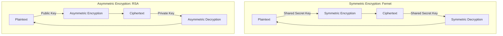

# Encryption and Decryption: Symmetric and Asymmetric Implementation

Encryption transforms readable plain-text data into unreadable cipher-text, ensuring that only users with the correct cryptographic key can read it. 

We categorize encryption into two primary models:
1. **Symmetric Encryption (Fernet/AES)**: The same secret key is used for both encryption and decryption. This is fast and efficient for encrypting local file payloads.
2. **Asymmetric Encryption (RSA)**: Uses a public key to encrypt data and a private key to decrypt it. This is used for securely transmitting data or credentials over public networks.

In this guide, we will implement symmetric file encryption using the high-level `Fernet` module, and configure asymmetric RSA key generation, message encryption, and decryption using Python's `cryptography` library.

---

## Symmetric vs. Asymmetric Operations



---

## 1. Symmetric File Encryption using Fernet

`Fernet` provides a secure symmetric encryption wrapper. It uses AES-128 in CBC mode with PKCS7 padding and HMAC-SHA256 authentication to ensure the encrypted file has not been modified.

```python
import os
from cryptography.fernet import Fernet

class FileEncryptor:
    def __init__(self, key_path):
        self.key_path = key_path
        self.key = self._load_key()

    def _load_key(self):
        """Loads key from path or generates one if missing."""
        if os.path.exists(self.key_path):
            with open(self.key_path, "rb") as f:
                return f.read()
        else:
            print("Generating new symmetric key...")
            key = Fernet.generate_key()
            with open(self.key_path, "wb") as f:
                f.write(key)
            return key

    def encrypt_file(self, target_file, output_file):
        """Encrypts a file's content and writes the cipher-text to disk."""
        fernet = Fernet(self.key)
        
        with open(target_file, "rb") as f:
            raw_data = f.read()
            
        encrypted_data = fernet.encrypt(raw_data)
        
        with open(output_file, "wb") as f:
            f.write(encrypted_data)
        print(f"✅ File encrypted: {output_file}")

    def decrypt_file(self, encrypted_file, output_file):
        """Decrypts a file's content and writes the plain-text to disk."""
        fernet = Fernet(self.key)
        
        with open(encrypted_file, "rb") as f:
            encrypted_data = f.read()
            
        try:
            decrypted_data = fernet.decrypt(encrypted_data)
            with open(output_file, "wb") as f:
                f.write(decrypted_data)
            print(f"✅ File decrypted: {output_file}")
            return True
        except Exception as e:
            print(f"❌ Decryption failed: {e}")
            return False
```

---

## 2. Asymmetric RSA Key Generation and Message Processing

For asymmetric encryption, we use the low-level `cryptography.hazmat` primitives to generate an RSA public-private key pair.

```python
from cryptography.hazmat.primitives.asymmetric import rsa, padding
from cryptography.hazmat.primitives import hashes, serialization

def generate_rsa_key_pair():
    """
    Generates a 2048-bit RSA key pair.
    """
    print("Generating RSA key pair...")
    private_key = rsa.generate_private_key(
        public_exponent=65537,
        key_size=2048
    )
    public_key = private_key.public_key()
    return private_key, public_key

def encrypt_message_with_public_key(plain_text, public_key):
    """
    Encrypts a string message using the receiver's RSA public key.
    """
    # 1. Convert text to bytes
    message_bytes = plain_text.encode("utf-8")
    
    # 2. Encrypt using OAEP padding with SHA-256
    cipher_text = public_key.encrypt(
        message_bytes,
        padding.OAEP(
            mgf=padding.MGF1(algorithm=hashes.SHA256()),
            algorithm=hashes.SHA256(),
            label=None
        )
    )
    return cipher_text

def decrypt_message_with_private_key(cipher_text, private_key):
    """
    Decrypts the cipher-text using the receiver's RSA private key.
    """
    try:
        # Decrypt using matching OAEP padding parameters
        decrypted_bytes = private_key.decrypt(
            cipher_text,
            padding.OAEP(
                mgf=padding.MGF1(algorithm=hashes.SHA256()),
                algorithm=hashes.SHA256(),
                label=None
            )
        )
        return decrypted_bytes.decode("utf-8")
    except Exception as e:
        print(f"❌ Decryption failed: {e}")
        return None
```

---

## 3. Asymmetric Pipeline Execution

Here is how you use the RSA functions to encrypt and decrypt a message:

```python
# Save this file as scripts/rsa_pipeline.py
# (Requires the RSA functions defined above)

def execute_rsa_demo():
    # 1. Generate keys
    private_key, public_key = generate_rsa_key_pair()
    
    secret_payload = "DatabasePasswordSecret1404"
    
    # 2. Encrypt using Public Key
    encrypted_payload = encrypt_message_with_public_key(secret_payload, public_key)
    print(f"Encrypted Ciphertext (length: {len(encrypted_payload)}): {encrypted_payload.hex()[:30]}...")
    
    # 3. Decrypt using Private Key
    decrypted_payload = decrypt_message_with_private_key(encrypted_payload, private_key)
    print(f"Decrypted Plaintext: {decrypted_payload}")

# if __name__ == "__main__":
#     execute_rsa_demo()
```

---

## Summary

Symmetric encryption is suited for local file storage, while asymmetric encryption is suited for secure data transmission. By implementing Fernet and RSA key processing, you can protect sensitive data programmatically. In the next section, we will cover **generating SSL certificates**.
