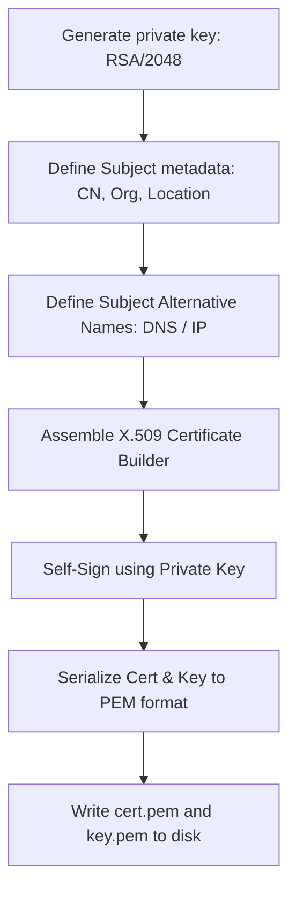

# Generating Self-Signed X.509 SSL/TLS Certificates Programmatically

In production, SSL/TLS certificates are issued by trusted Certificate Authorities (CAs) like Let's Encrypt. However, for local development, sandbox testing, or internal service-to-service communication (mTLS), you often need to generate **Self-Signed X.509 Certificates** dynamically.

Modern web browsers enforce strict security rules for certificates. For example, they will reject certificates that do not include the **Subject Alternative Name (SAN)** extension, even if the Common Name (CN) is set correctly.

In this guide, we will cover the structure of an X.509 certificate, configure subject metadata and SAN parameters, sign the certificate using a generated private key, and write the keys to disk in standard PEM format.

---

## Certificate Signing Workflow



---

## 1. Implementing Self-Signed Certificate Generation

We use the `cryptography.x509` module to build the certificate properties and sign the payload.

```python
import datetime
from cryptography import x509
from cryptography.x509.oid import NameOID
from cryptography.hazmat.primitives import hashes, serialization
from cryptography.hazmat.primitives.asymmetric import rsa

def generate_self_signed_cert(common_name, output_cert_path, output_key_path):
    # 1. Generate a 2048-bit RSA Private Key
    print("Generating RSA private key...")
    private_key = rsa.generate_private_key(
        public_exponent=65537,
        key_size=2048
    )

    # 2. Build Subject and Issuer metadata (both are identical for self-signed certs)
    subject = issuer = x509.Name([
        x509.NameAttribute(NameOID.COUNTRY_NAME, "US"),
        x509.NameAttribute(NameOID.STATE_OR_PROVINCE_NAME, "California"),
        x509.NameAttribute(NameOID.LOCALITY_NAME, "San Francisco"),
        x509.NameAttribute(NameOID.ORGANIZATION_NAME, "DevOps Lab"),
        x509.NameAttribute(NameOID.COMMON_NAME, common_name),
    ])

    # 3. Define validity period (start now, expire in 365 days)
    now = datetime.datetime.utcnow()
    valid_from = now
    valid_to = now + datetime.timedelta(days=365)

    # 4. Initialize Certificate Builder
    builder = x509.CertificateBuilder()
    builder = builder.subject_name(subject)
    builder = builder.issuer_name(issuer)
    builder = builder.public_key(private_key.public_key())
    # Generate a cryptographically secure serial number
    builder = builder.serial_number(x509.random_serial_number())
    builder = builder.not_valid_before(valid_from)
    builder = builder.not_valid_after(valid_to)

    # 5. Add Subject Alternative Name (SAN) extension
    # Crucial for modern browser compatibility
    san_extension = x509.SubjectAlternativeName([
        x509.DNSName(common_name),
        x509.DNSName("localhost"),
        x509.IPAddress(ipaddress.IPv4Address("127.0.0.1"))
    ])
    builder = builder.add_extension(san_extension, critical=False)

    # 6. Sign the certificate with our private key using SHA-256
    print("Signing X.509 certificate...")
    certificate = builder.sign(
        private_key=private_key,
        algorithm=hashes.SHA256()
    )

    # 7. Serialize Private Key to PEM format
    private_key_pem = private_key.private_bytes(
        encoding=serialization.Encoding.PEM,
        format=serialization.PrivateFormat.TraditionalOpenSSL,
        encryption_algorithm=serialization.NoEncryption() # Unencrypted for automated services
    )

    # 8. Serialize Certificate to PEM format
    cert_pem = certificate.public_bytes(
        encoding=serialization.Encoding.PEM
    )

    # 9. Write files to disk
    with open(output_key_path, "wb") as f:
        f.write(private_key_pem)
    with open(output_cert_path, "wb") as f:
        f.write(cert_pem)
        
    print(f"✅ Certificate written to: {output_cert_path}")
    print(f"✅ Private Key written to: {output_key_path}")
```

*Note: Ensure you import the `ipaddress` library before executing the script.*

---

## 2. Dynamic Certificate Generator Script

Here is an orchestration script that runs the certificate generator class for local domains:

```python
# Save this file as scripts/generate_local_certs.py
import ipaddress

# (Requires the generate_self_signed_cert function defined above)

def configure_local_ssl():
    target_domain = "dev.company.local"
    cert_file = "certs/dev_cert.pem"
    key_file = "certs/dev_key.pem"
    
    # Ensure directory exists
    import os
    os.makedirs("certs", exist_ok=True)
    
    generate_self_signed_cert(
        common_name=target_domain,
        output_cert_path=cert_file,
        output_key_path=key_file
    )
    
    print("\nLocal SSL setup completed successfully. Configuration details:")
    print(f" - SSL Certificate: {os.path.abspath(cert_file)}")
    print(f" - Private Key:     {os.path.abspath(key_file)}")

# if __name__ == "__main__":
#     configure_local_ssl()
```

---

## Summary

Generating self-signed SSL/TLS certificates programmatically is useful for local development and secure service-to-service communication. By building X.509 attributes, adding Subject Alternative Names (SANs) for browser compatibility, and signing payloads, you can automate SSL setups. In the next section, we will cover **JWT handling**.
