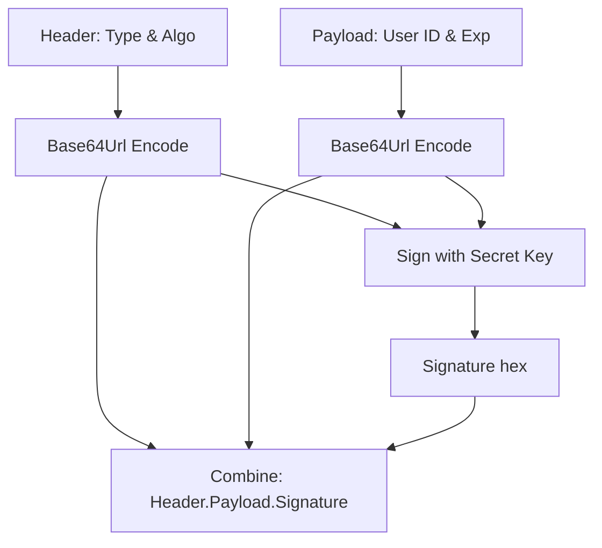

# JWT Handling in Python: Generation, Decoding, and Validation

In modern web APIs and microservices architectures, authentication is managed using **JSON Web Tokens (JWT)**. A JWT is an open standard (RFC 7519) that defines a compact, self-contained way for securely transmitting information between parties as a JSON object.

Because JWTs are digitally signed (using a symmetric secret key or an asymmetric private/public key pair), you can verify that the token claims have not been tampered with.

In this guide, we will examine the structure of a JWT, install the standard **`PyJWT`** library, generate tokens with expiration claims, decode incoming tokens, and handle signature validation errors programmatically.

---

## JWT Structure: Header, Payload, and Signature

A JWT is composed of three parts separated by dots (`.`):

```text
xxxxx.yyyyy.zzzzz
```

1. **Header (`xxxxx`)**: Defines the token type (JWT) and the hashing algorithm used (e.g. HMAC-SHA256, abbreviated as `HS256`).
2. **Payload (`yyyyy`)**: Contains the **claims** (such as user ID, role, and expiration timestamp).
3. **Signature (`zzzzz`)**: Calculated by taking the encoded header, the encoded payload, a secret key, and signing them using the specified algorithm.



---

## 1. Installation

Install the PyJWT library:

```bash
pip install pyjwt
```

Confirm the module is available:
```bash
python -c "import jwt; print('PyJWT loaded successfully')"
```

---

## 2. Token Manager Helper Class

Here is a Python utility class that generates short-lived JWT tokens, decodes incoming payloads, and handles token validation errors:

```python
import datetime
import jwt

class TokenManager:
    def __init__(self, secret_key, algorithm="HS256"):
        self.secret_key = secret_key
        self.algorithm = algorithm

    def generate_auth_token(self, user_id, role, expiry_minutes=15):
        """
        Generates a signed JWT token containing claims.
        """
        now = datetime.datetime.utcnow()
        expiration_time = now + datetime.timedelta(minutes=expiry_minutes)
        
        # Define token payload claims
        payload = {
            "sub": user_id,                     # Subject (User ID)
            "role": role,                       # Custom authorization role
            "iat": now,                         # Issued At time
            "exp": expiration_time             # Expiration time
        }
        
        # Generate and sign the token
        try:
            token = jwt.encode(payload, self.secret_key, algorithm=self.algorithm)
            return token
        except Exception as e:
            print(f"❌ Failed to generate token: {e}")
            return None

    def validate_auth_token(self, token):
        """
        Decodes and validates a token. Parses expiration automatically.
        """
        try:
            # Decode token. This verifies the signature and checks 'exp' claim
            decoded_payload = jwt.decode(
                token,
                self.secret_key,
                algorithms=[self.algorithm]
            )
            return True, decoded_payload
        except jwt.ExpiredSignatureError:
            print("❌ Validation failed: Token has expired!")
            return False, {"error": "token_expired"}
        except jwt.InvalidTokenError as e:
            print(f"❌ Validation failed: Invalid token signature! Error: {e}")
            return False, {"error": "invalid_token"}
```

---

## 3. JWT Verification Script

Here is an integration script showing how to issue a token and verify it, including handling validation error conditions:

```python
# Save this file as scripts/jwt_demo.py
import time

# (Requires the TokenManager class defined above)

def run_jwt_test():
    secret = "my_internal_signing_key_404"
    manager = TokenManager(secret)
    
    # 1. Issue a token with 1-second validity (for test rollover)
    print("Generating short-lived authorization token...")
    token = manager.generate_auth_token(
        user_id="user_987",
        role="administrator",
        expiry_minutes=1/60 # 1 second
    )
    print(f"Token: {token}\n")

    # 2. Validate token immediately
    success, data = manager.validate_auth_token(token)
    if success:
        print(f"✅ Immediate Validation: Authorized for User: {data['sub']} (Role: {data['role']})")
    
    # 3. Wait 2 seconds for the token to expire
    print("\nWaiting for token expiration...")
    time.sleep(2)
    
    # 4. Attempt validation on the expired token
    success, data = manager.validate_auth_token(token)
    if not success:
        print(f"✅ Expired Validation caught: {data['error']}")

# if __name__ == "__main__":
#     run_jwt_test()
```

---

## Summary

JSON Web Tokens (JWT) are a secure way to transmit authentication and authorization claims. By using PyJWT to generate and decode tokens programmatically, and validating standard claims like expiration (`exp`), you can implement secure authentication workflows. This completes **Module 12: Security Automation with Python**. In the next module, we will explore **Testing for DevOps with Python**.
