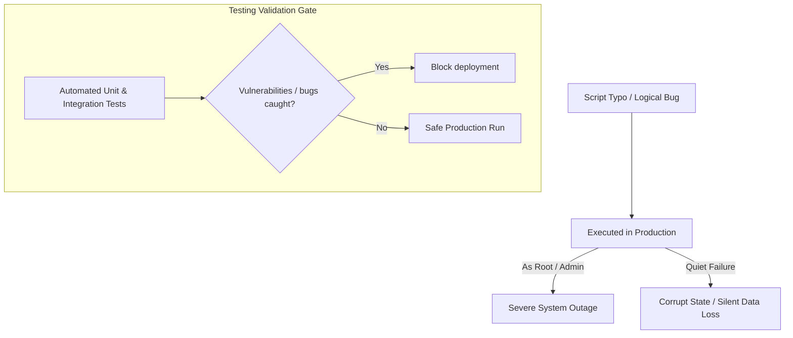

# Testing DevOps Code: Why Testing Automation Scripts is Critical

A common misconception in DevOps is that automated testing is only for application code (like frontend apps or backend web APIs). DevOps scripts—such as system checkers, backup orchestrators, deployment handlers, and cloud-init runners—are often written, committed, and run in production without any automated verification.

This is a high-risk practice. Because DevOps scripts execute with elevated system privileges (e.g., as `root` or using IAM Admin credentials) and run unattended in headless environments, bugs in your automation can cause severe issues:
* A logical error in a directory cleaner script could execute `rm -rf /` instead of deleting a subfolder.
* A malfunctioning backup script could return a success code without writing any backup data to S3.
* A typo in a configuration loader could cause API instances to crash when they are restarted.

In this guide, we will analyze the risks of untested automation code, compare manual verification with automated testing, and define the testing pyramid for DevOps scripts.

---

## The Risk Hierarchy of Untested Code



---

## Manual Verification vs. Automated Testing

| Comparison Metric | Manual Verification | Automated Testing (Unit/Integration) |
| :--- | :--- | :--- |
| **Risk Level** | High (Human oversight can miss critical edge cases). | Low (Code execution is consistent and repeatable). |
| **Execution Cost** | High (Requires engineer time to spin up and check). | Low (Runs in seconds on CI runners). |
| **Feedback Loop** | Slow (Minutes to hours). | Fast (Milliseconds to minutes). |
| **Coverage** | Limited (Testing error conditions manually is difficult). | High (Easy to mock exceptions, network drops, and timeouts). |

---

## The DevOps Testing Pyramid

To verify your automation code efficiently, structure your test suite using these three layers:

```text
       ▲
      / \
     /   \      End-to-End (E2E) - Execute full pipeline scripts in cloud sandboxes.
    / E2E \
   /-------\
  /  Inte-  \   Integration - Verify AWS API calls, DB drivers (using mocks like Moto).
 /  gration  \
/-------------\
/   Unit      \  Unit - Test pure Python functions (data parsing, validation logic).
/---------------\
```

### 1. Unit Testing
Tests individual functions in isolation, with all external dependencies (disk access, network requests, databases) blocked or mocked. 
* *Example*: Verifying that a parser helper correctly extracts the IP address from a raw Nginx access log string.

### 2. Integration Testing
Verifies that multiple components of your script work together correctly. This layer checks integrations with local resources or simulated external APIs.
* *Example*: Verifying that a script can query a database, process the results, and write a summary file.

### 3. End-to-End (E2E) Testing
Executes the complete script from start to finish in a test environment that mirrors production.
* *Example*: Triggering a pipeline run that provisions a test VPC in AWS, deploys a web server, runs health checks, and destroys the resources.

---

## Best Practices for DevOps Testing

1. **Treat Automation Code Like Application Code**: Ensure your DevOps scripts are version controlled, run through code reviews, and tested automatically in CI/CD pipelines.
2. **Never Test on Production**: Avoid testing scripts on production servers. Use virtual environments, local mocks, or isolated sandbox accounts for development and verification.
3. **Mock External APIs**: When writing unit and integration tests, mock external APIs (like AWS or Slack) to prevent tests from failing due to external network issues or rate limits.

---

## Summary

Testing DevOps scripts is critical for maintaining system stability and preventing outages. By structuring your test suites into unit, integration, and end-to-end tests, you can identify issues in your automation code before it runs in production. In the next section, we will cover Python's built-in **unittest** module.
