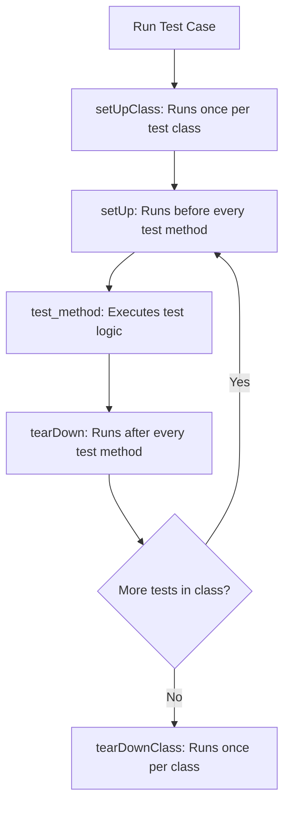

# Unittest Module: Python's Built-In Testing Framework

To write tests for your automation scripts, Python includes a built-in testing framework: **`unittest`** (sometimes called PyUnit). Inspired by Java's JUnit, `unittest` is an object-oriented framework that uses classes to organize and structure your tests.

Using a standardized framework provides several benefits:
* **Structured Test Suites**: Group related tests inside classes that inherit from `unittest.TestCase`.
* **Standard Assertions**: Use built-in assertion methods (like `assertEqual` or `assertRaises`) to verify results.
* **Test Lifecycle Hooks**: Run setup and teardown tasks (like creating temporary test files or opening database connections) automatically before and after tests.

In this guide, we will examine the structure of `unittest`, cover the test lifecycle hooks, and write a test case to verify a configuration parser script.

---

## The Unittest Lifecycle Flow



---

## 1. Core Concepts and Assertion Primitives

To write a test suite using `unittest`, create a class that inherits from **`unittest.TestCase`**. Individual test methods within this class must start with the prefix **`test_`** to be detected by the test runner.

Common assertion methods include:
* **`self.assertEqual(a, b)`**: Verifies that `a == b`.
* **`self.assertTrue(x)`**: Verifies that `bool(x) is True`.
* **`self.assertFalse(x)`**: Verifies that `bool(x) is False`.
* **`self.assertRaises(ExceptionType)`**: Verifies that the code block raises the specified exception.

---

## 2. Test Lifecycle Hooks: Setup and Teardown

* **`setUp()`**: Runs before *every* test method. Use this to prepare clean test objects.
* **`tearDown()`**: Runs after *every* test method. Use this to clean up temporary resources (like deleting temp files).
* **`setUpClass()`**: A class method (`@classmethod`) that runs once before any tests in the class start. Use this for resource-intensive tasks (like initializing a database connection).
* **`tearDownClass()`**: A class method that runs once after all tests in the class complete.

---

## 3. Practical Example: Testing a Configuration Parser

Here is a Python configuration parser class, followed by a complete `unittest` suite that validates its functionality using temporary test files and lifecycle hooks:

```python
# Save this file as config_parser.py
import os

class ConfigurationParser:
    def __init__(self, filepath):
        self.filepath = filepath

    def parse(self):
        """
        Parses a custom key=value configuration file.
        """
        if not os.path.exists(self.filepath):
            raise FileNotFoundError(f"Config file not found: {self.filepath}")
            
        config = {}
        with open(self.filepath, "r", encoding="utf-8") as f:
            for line_num, line in enumerate(f, 1):
                line = line.strip()
                if not line or line.startswith("#"):
                    continue # Skip empty lines and comments
                if "=" not in line:
                    raise ValueError(f"Syntax error on line {line_num}: missing '=' separator.")
                    
                key, val = line.split("=", 1)
                config[key.strip()] = val.strip()
        return config
```

### The Unittest Test Suite:
```python
# Save this file as test_config_parser.py
import os
import unittest
from config_parser import ConfigurationParser

class TestConfigurationParser(unittest.TestCase):
    
    @classmethod
    def setUpClass(cls):
        print("\n[setUpClass] Preparing test environment...")
        cls.test_filename = "temp_test_config.conf"

    @classmethod
    def tearDownClass(cls):
        print("\n[tearDownClass] Cleaning up test environment...")
        # Ensure temporary files are deleted if they exist
        if os.path.exists(cls.test_filename):
            os.remove(cls.test_filename)

    def setUp(self):
        # Create a clean configuration file before every test run
        with open(self.test_filename, "w", encoding="utf-8") as f:
            f.write("# Default configuration for test\n")
            f.write("port = 8080\n")
            f.write("host = 127.0.0.1\n")

    def tearDown(self):
        # Delete file after test execution to keep directory clean
        if os.path.exists(self.test_filename):
            os.remove(self.test_filename)

    def test_successful_parsing(self):
        """Verify that a valid configuration file is parsed correctly."""
        parser = ConfigurationParser(self.test_filename)
        data = parser.parse()
        
        self.assertEqual(data.get("port"), "8080")
        self.assertEqual(data.get("host"), "127.0.0.1")
        self.assertNotIn("port", data.get("# Default", ""))

    def test_missing_file_throws_error(self):
        """Verify that passing a missing filepath raises FileNotFoundError."""
        parser = ConfigurationParser("missing_file.conf")
        # assertRaises verifies the exception is raised inside the context block
        with self.assertRaises(FileNotFoundError):
            parser.parse()

    def test_invalid_syntax_throws_error(self):
        """Verify that a config file with invalid syntax raises ValueError."""
        # Overwrite file with invalid format
        with open(self.test_filename, "w", encoding="utf-8") as f:
            f.write("invalid_line_without_equals_sign\n")
            
        parser = ConfigurationParser(self.test_filename)
        with self.assertRaises(ValueError):
            parser.parse()
```

---

## 4. Running the Tests

To execute the tests using the command-line interface, run:

```bash
python -m unittest test_config_parser.py
```

To run all tests in a directory automatically, use test discovery:
```bash
python -m unittest discover -s . -p "test_*.py"
```

---

## Summary

The built-in `unittest` module provides a structured framework for testing Python scripts. By organizing tests inside classes and using setup and teardown lifecycle hooks, you can verify configuration parsers and handle errors programmatically. In the next section, we will cover **pytest**.
