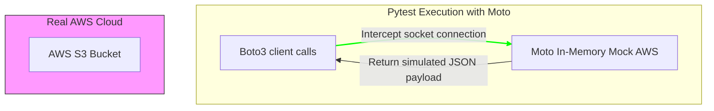

# Mocking AWS with Moto: Safe and Fast Cloud Testing

When writing automation scripts that interact with Amazon Web Services (AWS), testing your code presents a challenge. If your tests make real API calls to AWS using `boto3`:
* **Cost**: Creating, modifying, and destroying resources dynamically can incur significant cloud costs.
* **Speed**: Waiting for AWS to provision virtual servers or databases makes test suites slow.
* **Risk**: A bug in a test script could accidentally modify or delete resources in your production AWS account.

To solve this, use **Moto**. Moto is a Python library that mocks AWS services. It intercepts Boto3 socket calls and routes them to an in-memory, simulated AWS environment, allowing you to test your AWS code locally without touching the real cloud.

In this guide, we will cover how Moto works, configure mock credentials to prevent accidental production calls, and write a test case to verify an S3 file manager script.

---

## AWS Mocking Architecture



---

## 1. Installation

Install Moto and boto3 using pip:

```bash
pip install moto boto3
```

---

## 2. Preventing Accidental AWS Connection Leaks

> [!IMPORTANT]
> To ensure your tests never connect to your real AWS account (even if a Moto decorator is misconfigured), always configure **mock credentials** in your environment variables before running tests.

You can enforce this in your `conftest.py` file:

```python
# conftest.py
import os
import pytest

@pytest.fixture(autouse=True)
def aws_credentials():
    """Mocked AWS Credentials for Boto3."""
    os.environ["AWS_ACCESS_KEY_ID"] = "testing"
    os.environ["AWS_SECRET_ACCESS_KEY"] = "testing"
    os.environ["AWS_SECURITY_TOKEN"] = "testing"
    os.environ["AWS_SESSION_TOKEN"] = "testing"
    os.environ["AWS_DEFAULT_REGION"] = "us-west-2"
```

---

## 3. Practical Example: Testing an S3 File Manager

Here is an S3 manager utility class, followed by a Pytest test suite that uses Moto's `@mock_aws` decorator to verify its behavior:

```python
# Save this file as s3_manager.py
import boto3
from botocore.exceptions import ClientError

class S3BucketManager:
    def __init__(self, bucket_name):
        self.bucket_name = bucket_name
        self.s3 = boto3.client("s3")

    def upload_file(self, local_path, s3_key):
        """Uploads a local file to the configured S3 bucket."""
        try:
            self.s3.upload_file(local_path, self.bucket_name, s3_key)
            return True
        except ClientError as e:
            print(f"Failed to upload: {e}")
            return False

    def list_objects(self):
        """Returns a list of keys currently stored in the S3 bucket."""
        try:
            response = self.s3.list_objects_v2(Bucket=self.bucket_name)
            contents = response.get("Contents", [])
            return [obj["Key"] for obj in contents]
        except ClientError as e:
            print(f"Failed to list: {e}")
            return []
```

### The Pytest Test Suite:
```python
# Save this file as test_s3_manager.py
import pytest
import boto3
from moto import mock_aws
from s3_manager import S3BucketManager

# Apply the mock_aws decorator to mock all AWS API calls within the test functions
@mock_aws
def test_successful_s3_upload(tmp_path):
    # 1. Prepare simulated AWS environment
    s3_client = boto3.client("s3", region_name="us-west-2")
    bucket_name = "test-company-assets"
    
    # Create the target bucket in our in-memory mock environment
    s3_client.create_bucket(
        Bucket=bucket_name,
        CreateBucketConfiguration={"LocationConstraint": "us-west-2"}
    )

    # 2. Create a temporary local file to upload
    temp_file = tmp_path / "data.txt"
    temp_file.write_text("Hello, S3!")

    # 3. Execute the S3 manager logic
    manager = S3BucketManager(bucket_name)
    success = manager.upload_file(str(temp_file), "uploads/data.txt")

    # 4. Verify results
    assert success is True
    
    # Query the mock bucket directly to verify the file exists
    stored_keys = manager.list_objects()
    assert "uploads/data.txt" in stored_keys
```

---

## Summary

Mocking AWS services with Moto allows you to test your cloud automation scripts safely and efficiently. By configuring mock credentials in your environment variables and using the `@mock_aws` decorator, you can run tests locally without incurring cloud costs or modifying production resources. In the next section, we will cover **mocking HTTP requests**.
