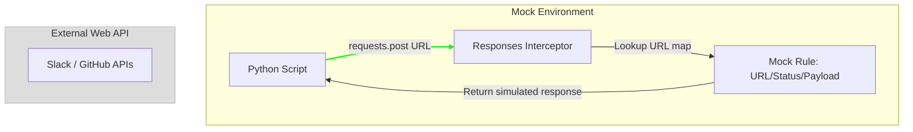

# Mocking HTTP Requests: Intercepting APIs with Responses

DevOps automation scripts frequently communicate with external web services and REST APIs—such as posting alert cards to Slack webhooks, triggering incident escalations in PagerDuty, querying metrics from Datadog, or fetching code details from GitHub.

Making real HTTP requests during testing is an anti-pattern:
* **API Rate Limits**: Running test suites frequently can exhaust your API quotas.
* **Network Flakiness**: Tests can fail due to local network drops or external service outages.
* **Side-Effects**: Triggering a test run should not create duplicate incident tickets or spam production communication channels.

To address this, use the **`responses`** library. It mocks Python's `requests` module by intercepting outgoing HTTP calls and returning custom mock payloads without touching the network.

In this guide, we will cover how to intercept REST API requests, write test decorators using `responses`, and verify outbound request parameters.

---

## HTTP Request Mocking Flow



---

## 1. Installation

Install the library using pip:

```bash
pip install responses requests
```

---

## 2. Setting Up Interceptor Rules with `@responses.activate`

To mock requests, apply the `@responses.activate` decorator to your test function, and register mock endpoints using `responses.add()`.

```python
import responses
import requests

@responses.activate
def test_mock_api_call():
    # 1. Register a mock URL rule
    responses.add(
        method=responses.GET,
        url="https://api.github.com/repos/company/repo",
        json={"name": "repo", "stars": 42},
        status=200
    )
    
    # 2. Execute the request
    # Python requests intercepts this call and reads from our mock rule
    response = requests.get("https://api.github.com/repos/company/repo")
    
    # 3. Assert results
    assert response.status_code == 200
    assert response.json()["stars"] == 42
```

---

## 3. Practical Example: Testing a Slack Alert Notification Client

Here is a Slack notification class, followed by a Pytest test suite that uses `responses` to mock webhook calls and verify outbound payloads:

```python
# Save this file as slack_notifier.py
import requests

class SlackNotifier:
    def __init__(self, webhook_url):
        self.webhook_url = webhook_url

    def send_alert(self, title, message, severity="INFO"):
        """
        Sends a formatted alert message to Slack.
        """
        payload = {
            "text": f"[{severity.upper()}] *{title}*\n{message}"
        }
        
        try:
            response = requests.post(self.webhook_url, json=payload, timeout=5)
            if response.status_code == 200:
                return True
            return False
        except requests.RequestException:
            return False
```

### The Pytest Test Suite:
```python
# Save this file as test_slack_notifier.py
import json
import pytest
import responses
from slack_notifier import SlackNotifier

# Define a mock URL target
MOCK_WEBHOOK_URL = "https://hooks.slack.com/services/T00/B00/X00"

@responses.activate
def test_successful_slack_alert():
    # 1. Register the mock endpoint rule
    responses.add(
        method=responses.POST,
        url=MOCK_WEBHOOK_URL,
        body="ok",
        status=200
    )

    # 2. Execute the notifier logic
    notifier = SlackNotifier(MOCK_WEBHOOK_URL)
    success = notifier.send_alert(
        title="Server Spiked",
        message="CPU is at 98% capacity.",
        severity="WARNING"
    )

    # 3. Assert results
    assert success is True
    
    # Verify that exactly 1 request was sent to the endpoint
    assert len(responses.calls) == 1
    
    # 4. Audit outbound request parameters
    # This verifies our code formatted the JSON payload correctly
    sent_request = responses.calls[0].request
    sent_payload = json.loads(sent_request.body)
    
    assert "[WARNING]" in sent_payload["text"]
    assert "CPU is at 98% capacity." in sent_payload["text"]

@responses.activate
def test_slack_network_failure():
    # Register an error status rule (HTTP 500)
    responses.add(
        method=responses.POST,
        url=MOCK_WEBHOOK_URL,
        body="Internal Server Error",
        status=500
    )
    
    notifier = SlackNotifier(MOCK_WEBHOOK_URL)
    success = notifier.send_alert("Disk Full", "Storage partition depleted.")
    
    assert success is False
```

---

## Summary

Mocking HTTP requests with the `responses` library allows you to test your integration scripts safely and consistently. By intercepting outgoing calls and verifying payload structures, you can validate your API client code without touching the network. In the next section, we will cover **testing subprocess calls**.
