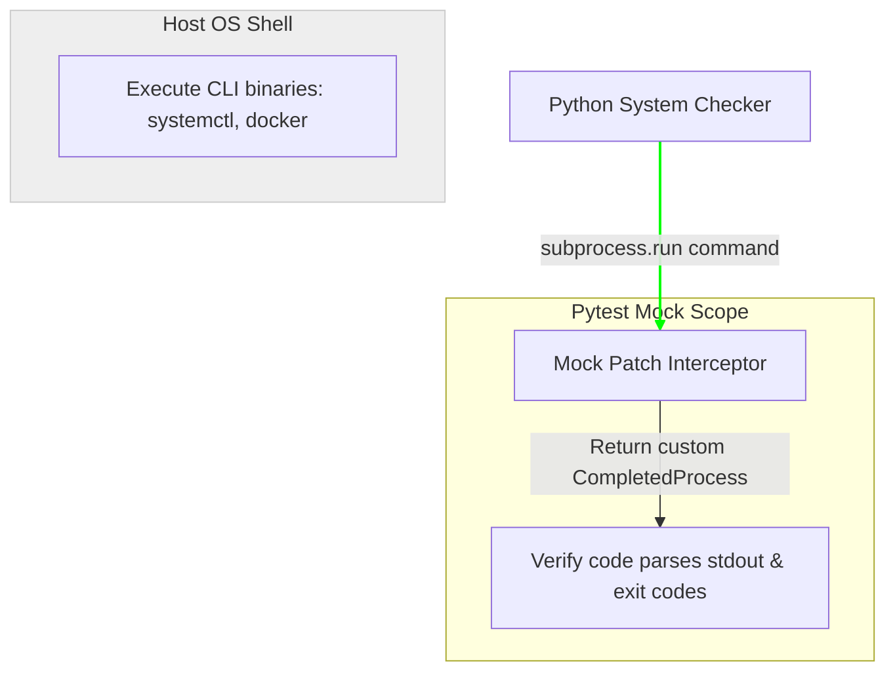

# Testing Subprocess Calls: Mocking Shell Commands in Pytest

DevOps automation scripts frequently execute command-line utilities (like `systemctl`, `docker`, `git`, or `terraform`) using Python's `subprocess` module.

Running these CLI commands during unit tests is a common cause of failure:
* **Missing Binaries**: Tests will fail on CI runners if the runner does not have the target CLI tool installed.
* **Environment Side-Effects**: Running commands like `systemctl restart nginx` during local tests can disrupt your local development environment.
* **Privileges constraints**: Many system commands require root privileges, which standard test runners do not have.

To solve this, use Python's **`unittest.mock.patch`** to intercept `subprocess.run` calls, return mock stdout payloads, and simulate command exit codes.

In this guide, we will implement custom mock returns and write a Pytest test suite for a system service checker.

---

## Subprocess Mocking Workflow



---

## 1. Structure of a Mock `CompletedProcess`

When your code executes `subprocess.run()`, Python returns a `subprocess.CompletedProcess` object containing these attributes:
* **`returncode`**: The command exit code (0 for success, non-zero for failure).
* **`stdout`**: Standard output string.
* **`stderr`**: Standard error string.

To mock this call, configure a mock object to return these attributes when executed.

---

## 2. Practical Example: Testing an OS Service Status Auditor

Here is a system service check utility, followed by a Pytest test suite that uses `unittest.mock.patch` to mock `subprocess.run` calls:

```python
# Save this file as service_checker.py
import subprocess

class ServiceStatusAuditor:
    def __init__(self, service_name):
        self.service_name = service_name

    def is_service_active(self):
        """
        Queries systemctl to verify if the configured service is running.
        Returns: 'ACTIVE', 'INACTIVE', or 'ERROR'
        """
        cmd = ["systemctl", "is-active", self.service_name]
        try:
            # Execute command
            result = subprocess.run(
                cmd,
                capture_output=True,
                text=True,
                timeout=5
            )
            
            # Clean output
            status = result.stdout.strip().lower()
            
            if result.returncode == 0 and status == "active":
                return "ACTIVE"
            elif status == "inactive" or status == "unknown":
                return "INACTIVE"
            else:
                return "ERROR"
        except subprocess.TimeoutExpired:
            return "ERROR"
        except Exception:
            return "ERROR"
```

### The Pytest Test Suite:
```python
# Save this file as test_service_checker.py
import subprocess
from unittest.mock import patch, MagicMock
import pytest
from service_checker import ServiceStatusAuditor

def test_service_active_state():
    """Verify that is_service_active returns 'ACTIVE' when systemctl returns active status."""
    # 1. Create a mock CompletedProcess object
    mock_process = MagicMock(spec=subprocess.CompletedProcess)
    mock_process.returncode = 0
    mock_process.stdout = "active\n"
    mock_process.stderr = ""

    # 2. Patch subprocess.run to return the mock object
    with patch("subprocess.run", return_value=mock_process) as mock_run:
        auditor = ServiceStatusAuditor("nginx")
        status = auditor.is_service_active()
        
        # Verify the auditor returns 'ACTIVE'
        assert status == "ACTIVE"
        
        # Verify that subprocess.run was called with the correct arguments
        mock_run.assert_called_once_with(
            ["systemctl", "is-active", "nginx"],
            capture_output=True,
            text=True,
            timeout=5
        )

def test_service_inactive_state():
    """Verify that is_service_active returns 'INACTIVE' when systemctl returns inactive status."""
    mock_process = MagicMock(spec=subprocess.CompletedProcess)
    mock_process.returncode = 3 # Non-zero code for inactive services
    mock_process.stdout = "inactive\n"
    mock_process.stderr = ""

    with patch("subprocess.run", return_value=mock_process):
        auditor = ServiceStatusAuditor("nginx")
        status = auditor.is_service_active()
        assert status == "INACTIVE"

def test_subprocess_timeout_error():
    """Verify that a TimeoutExpired exception returns 'ERROR'."""
    # Force subprocess.run to raise a TimeoutExpired exception when called
    with patch("subprocess.run", side_effect=subprocess.TimeoutExpired(cmd=["systemctl"], timeout=5)):
        auditor = ServiceStatusAuditor("nginx")
        status = auditor.is_service_active()
        assert status == "ERROR"
```

---

## Summary

Mocking subprocess calls with Python's mock tools allows you to test your system automation scripts safely and consistently. By patching `subprocess.run` and returning mock completed process objects, you can verify your CLI integration code without executing commands on the host OS. In the next section, we will cover **testing file operations**.
