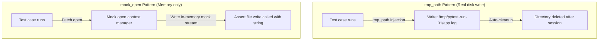

# Testing File Operations: Mock Files and Tmp_path in Pytest

DevOps scripts are built around file operations—reading configurations, parsing server logs, writing lock files, and compiling backup archives. 

Running tests that perform file operations against the real host filesystem presents several issues:
* **Clutter**: Tests can leave temporary files behind, cluttering the workspace.
* **Permission Constraints**: Tests running in restricted CI containers may fail to write files to system paths like `/var/log`.
* **State Pollution**: Tests can overwrite or delete files used by other processes.

To address this, Pytest provides the built-in **`tmp_path`** fixture, which generates a unique, temporary directory for each test run. Alternatively, you can use **`mock_open`** to mock file reads and writes entirely in memory.

In this guide, we will implement file test wrappers using `tmp_path` and `mock_open`, and write a test case to verify a log rotator utility.

---

## File System Testing Patterns



---

## 1. Using the Built-in `tmp_path` Fixture

The `tmp_path` fixture provides a `pathlib.Path` object pointing to a unique directory. This directory is automatically cleaned up after the test session.

```python
def test_temp_file_write(tmp_path):
    # 1. Resolve path to temporary file
    temp_file = tmp_path / "config.txt"
    
    # 2. Write content
    temp_file.write_text("port = 80")
    
    # 3. Assert content exists
    assert temp_file.exists()
    assert temp_file.read_text() == "port = 80"
```

---

## 2. In-Memory Mocking using `mock_open`

For unit tests where you want to verify that a file is read or written without actually hitting the disk, use the `mock_open` helper from `unittest.mock`.

```python
from unittest.mock import patch, mock_open

def test_file_read_in_memory():
    mock_file_content = "username=admin\npassword=secret"
    
    # Patch the open function with mock_open containing predefined data
    with patch("builtins.open", mock_open(read_data=mock_file_content)) as mock_file:
        with open("fake_config.properties", "r") as f:
            content = f.read()
            
        assert "username=admin" in content
        mock_file.assert_called_once_with("fake_config.properties", "r")
```

---

## 3. Practical Example: Testing a Log Rotator Utility

Here is a log rotation utility class, followed by a Pytest test suite that uses `tmp_path` to verify its file operations:

```python
# Save this file as log_rotator.py
import os
import shutil

class LogRotator:
    def __init__(self, log_path, backup_dir):
        self.log_path = log_path
        self.backup_dir = backup_dir

    def rotate(self):
        """
        Rotates the log file: moves the active log to the backup directory
        and creates a new, empty log file.
        """
        if not os.path.exists(self.log_path):
            raise FileNotFoundError(f"Active log file not found: {self.log_path}")
            
        # Ensure backup directory exists
        os.makedirs(self.backup_dir, exist_ok=True)
        
        # Define destination path
        filename = os.path.basename(self.log_path)
        backup_path = os.path.join(self.backup_dir, f"{filename}.1")
        
        # 1. Copy active log contents to backup location
        shutil.copy2(self.log_path, backup_path)
        
        # 2. Clear contents of active log file to rotate it
        with open(self.log_path, "w", encoding="utf-8") as f:
            f.truncate(0)
            
        print(f"Log rotated successfully. Backup saved to: {backup_path}")
        return backup_path
```

### The Pytest Test Suite:
```python
# Save this file as test_log_rotator.py
import os
import pytest
from log_rotator import LogRotator

def test_successful_log_rotation(tmp_path):
    # 1. Set up temporary directory structure using tmp_path
    log_dir = tmp_path / "logs"
    log_dir.mkdir()
    
    backup_dir = tmp_path / "backup"
    
    # 2. Create active log file and write dummy lines
    active_log_file = log_dir / "app.log"
    active_log_file.write_text("INFO: Server started.\nWARNING: Disk capacity high.\n")

    # 3. Instantiate the rotator using absolute path strings
    rotator = LogRotator(
        log_path=str(active_log_file),
        backup_dir=str(backup_dir)
    )
    
    # 4. Run rotation logic
    backup_file_path = rotator.rotate()

    # 5. Assert results
    # Active log file should still exist but be empty
    assert os.path.exists(str(active_log_file))
    assert active_log_file.read_text() == ""
    
    # Verify backup file contains original log lines
    assert os.path.exists(backup_file_path)
    with open(backup_file_path, "r", encoding="utf-8") as f:
        backup_content = f.read()
    assert "WARNING: Disk capacity high." in backup_content
```

---

## Summary

Testing file operations in a virtual sandbox prevents environment pollution and permission errors. By leveraging Pytest's `tmp_path` fixture or mocking file accesses in memory using `mock_open`, you can verify file read, write, and rotation logic programmatically. In the next section, we will cover **fixtures in pytest**.
