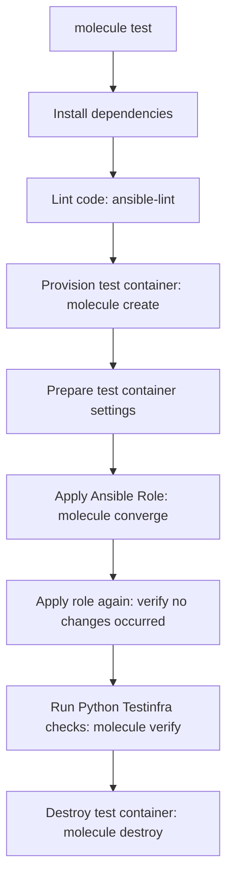

# Testing Ansible with Molecule and Testinfra in Python

Writing Ansible playbooks and roles without testing is a common cause of configuration errors. An engineering team might commit changes to a role that installs database packages, only to find that it fails on specific target OS versions due to missing package repositories.

**Molecule** is the standard testing framework for Ansible. It allows you to provision temporary test containers or VMs, apply your Ansible configurations, verify the state of the host using Python test frameworks, and destroy the test infrastructure automatically.

By combining Molecule with **Testinfra** (a Python library designed to verify server states), you can write unit and integration tests to check host packages, users, ports, and files.

In this guide, we will examine the Molecule lifecycle, install the required packages, and write a Testinfra verification script.

---

## The Molecule Testing Lifecycle



---

## 1. Installation

Install Molecule, the Docker driver, and Testinfra:

```bash
pip install molecule "molecule-plugins[docker]" pytest-testinfra
```

Ensure the CLI tool is available:
```bash
molecule --version
```

---

## 2. Molecule Project Configuration

A typical Molecule setup is structured inside an Ansible role folder under the `molecule/` directory:

```text
my-ansible-role/
├── defaults/
├── tasks/
│   └── main.yml
└── molecule/
    └── default/              # Scenario name
        ├── molecule.yml      # Molecule configuration file
        ├── converge.yml      # Playbook used to apply the role
        └── verify.pm         # Verification script
```

### The Molecule Configuration File (`molecule.yml`)
Defines the driver (Docker), test platforms (CentOS or Ubuntu), and the verifier (Pytest with Testinfra):

```yaml
dependency:
  name: galaxy
driver:
  name: docker
platforms:
  - name: test-ubuntu-host
    image: ubuntu:22.04
    pre_build_image: true
provisioner:
  name: ansible
verifier:
  name: pytest
```

---

## 3. Writing Python Testinfra Verifications

Testinfra provides Python helper classes to inspect target servers. 

Here is a Python verification script that checks a web server container setup:

```python
# Save this file as molecule/default/verify.py
import pytest

def test_nginx_is_installed(host):
    """
    Verify Nginx package is installed on the host.
    """
    nginx_package = host.package("nginx")
    assert nginx_package.is_installed

def test_nginx_service_running(host):
    """
    Verify Nginx daemon is running and enabled.
    """
    nginx_service = host.service("nginx")
    assert nginx_service.is_running
    assert nginx_service.is_enabled

def test_web_port_listening(host):
    """
    Verify port 80 is listening for incoming HTTP requests.
    """
    socket = host.socket("tcp://0.0.0.0:80")
    assert socket.is_listening

def test_config_file_permissions(host):
    """
    Verify configuration file permissions and ownership settings.
    """
    config_file = host.file("/etc/nginx/nginx.conf")
    assert config_file.exists
    assert config_file.is_file
    assert config_file.user == "root"
    assert config_file.group == "root"
    assert config_file.mode == 0o644 # Read-only for non-owners
```

---

## 4. Running the Tests

To run the full Molecule testing lifecycle (provisioning, linting, converging, verifying, and destroying):

```bash
molecule test
```

If you are developing and want to apply configuration changes quickly without recreating the container:
```bash
# 1. Apply playbooks
molecule converge
# 2. Run Testinfra checks
molecule verify
```

---

## Summary

Molecule and Testinfra allow you to test Ansible roles programmatically. By provisioning test containers and using Python's Testinfra library to verify package installations, service states, and file permissions, you can ensure configuration playbooks are correct. In the next section, we will cover **testing Terraform with Python**.
