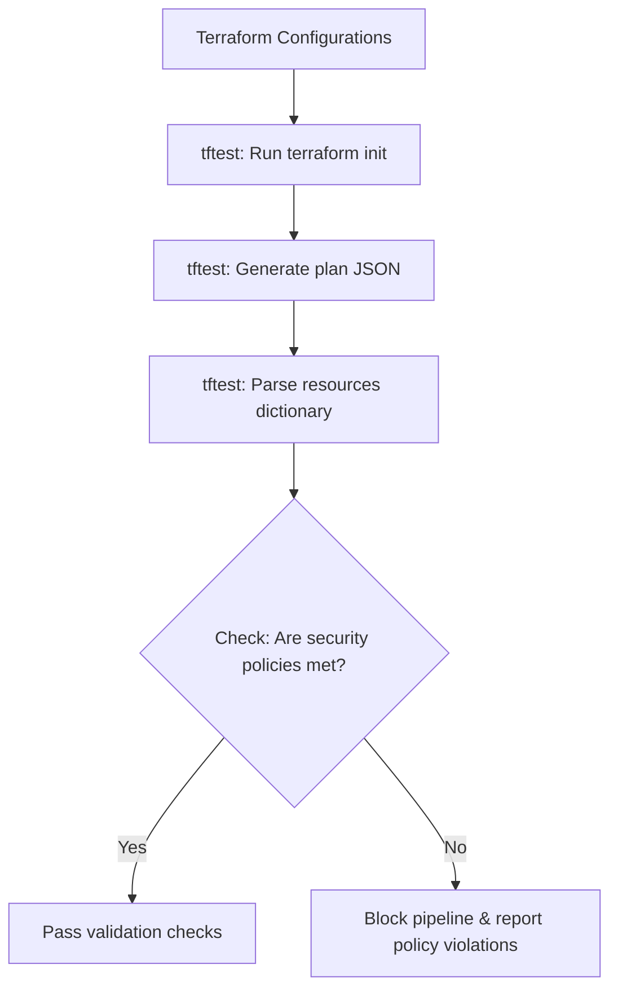

# Testing Terraform with Python: TFTest and Policy Assertions

Before deploying Terraform code to cloud environments, you should verify its configuration. While Terraform's built-in `validate` and `fmt` checks scan file syntax, they do not verify logical properties (such as checking if created S3 buckets have server-side encryption enabled, or confirming that the instance count is correctly scaled).

To test Terraform configurations programmatically in Python, Google maintains **`tftest`**. 

`tftest` is a Python library that wraps the Terraform CLI, allowing you to generate execution plans, parse the resulting plan state into Python dictionaries, and write assertions to enforce security policies.

In this guide, we will install the library, configure Pytest integration wrappers, parse Terraform execution plans, and write assertions to enforce security policies.

---

## The Policy Verification Workflow



---

## 1. Installation

Install `tftest` using pip:

```bash
pip install tftest pytest
```

Verify that the local Terraform binary is installed on your host system:
```bash
terraform version
```

---

## 2. Using `tftest` in Pytest Fixtures

Here is a Python test suite that uses `tftest` to initialize a Terraform folder, generate an execution plan, and assert that the resources meet company compliance rules.

```python
# Save this file as test_terraform_compliance.py
import os
import pytest
import tftest

@pytest.fixture(scope="module")
def plan_output():
    """
    Initializes and plans the Terraform configuration, 
    returning the planned resource state.
    """
    tf_dir = "./terraform_module"
    
    # Instantiate the tftest Terraform class
    tf = tftest.TerraformTest(tf_dir)
    
    # 1. Execute Setup (terraform init)
    tf.setup()
    
    # 2. Execute Plan (terraform plan -out)
    # The client automatically parses the output binary into a python dictionary representation
    plan = tf.plan(output=True)
    return plan

def test_s3_bucket_encryption(plan_output):
    """
    Policy: Verify that all created S3 buckets have server-side encryption enabled.
    """
    # plan_output.resources maps resource names (like 'aws_s3_bucket.my_bucket') to values
    s3_buckets = [
        res for res in plan_output.resources.values() 
        if res["type"] == "aws_s3_bucket"
    ]
    
    assert len(s3_buckets) > 0, "No S3 bucket resources defined in plan."
    
    # Verify encryption configuration is present in the plan resource dictionary
    for bucket in s3_buckets:
        properties = bucket.get("values", {})
        
        # Check for server-side encryption rule
        encryption = properties.get("server_side_encryption_configuration")
        assert encryption is not None, f"Bucket '{bucket['name']}' is missing server-side encryption!"

def test_enforce_resource_tags(plan_output):
    """
    Policy: Verify that all created resources have an 'Environment' tag defined.
    """
    for resource in plan_output.resources.values():
        # Check resources that support tagging
        if "tags" in resource.get("values", {}):
            tags = resource["values"]["tags"]
            assert "Environment" in tags, f"Resource '{resource['name']}' is missing the 'Environment' tag."
```

---

## 3. Running Compliance Audits

To run the compliance checks:

```bash
pytest test_terraform_compliance.py
```

If a developer defines an insecure S3 bucket without encryption settings, Pytest will catch the policy violation and return a non-zero exit code:

```text
At index 0 diff: None != server_side_encryption_configuration
E AssertionError: Bucket 'dev_bucket' is missing server-side encryption!
```

---

## Summary

Testing Terraform configurations with Python allows you to enforce security policies and validation checks before resource deployment. By using `tftest` to parse execution plans, you can automate infrastructure compliance checks. In the next section, we will cover **integration testing**.
