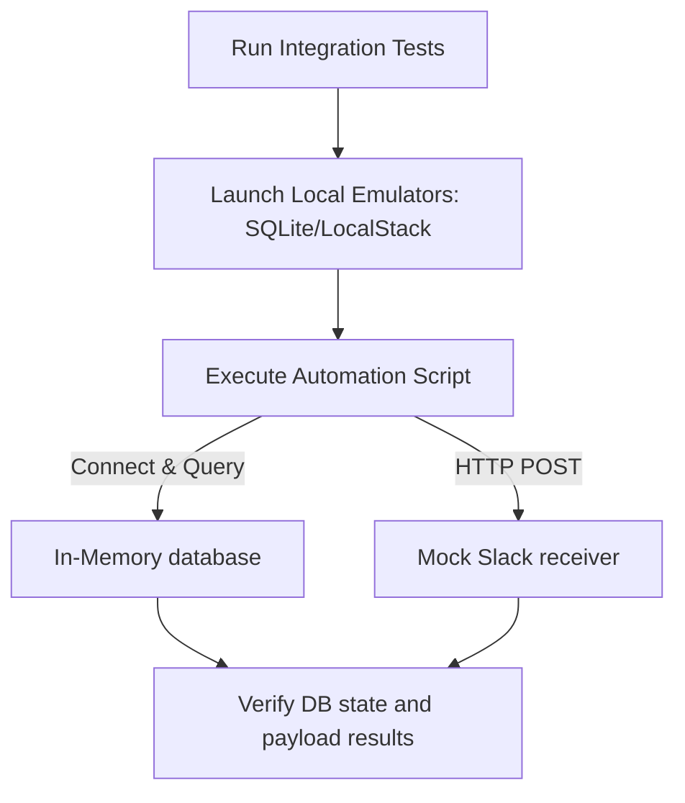

# Integration Testing for DevOps: Verifying Multi-Component Workflows

In software testing, **Integration Testing** verifies that multiple components of your system work together correctly. For DevOps scripts, this means verifying that your automation code can communicate with external databases, call API endpoints, or write state metadata correctly.

Unlike unit tests, where all external connections are blocked or mocked, integration tests run against real or simulated dependencies. 

For example, to test an S3 backup script, an integration test can run against **LocalStack** (an in-memory emulator for AWS services) to verify that the script establishes a socket connection, handles transfer failures, and writes the correct files to S3.

In this guide, we will cover integration testing concepts, connect to emulators, and write an integration test suite for a database-backed checker script.

---

## Integration Testing Pipeline



---

## 1. Local Testing Emulators: SQLite and LocalStack

To run integration tests safely, use local emulators:
* **Databases**: Use **SQLite** as an in-memory database to test SQL query syntax and connection pools without requiring a full PostgreSQL or MySQL server.
* **AWS Services**: Use **LocalStack** to emulate services like S3, SQS, and Lambda on your local machine using Docker:
  ```bash
  docker run --rm -it -p 4566:4566 localstack/localstack
  ```

---

## 2. Dynamic Connection Configurations

To support integration testing, structure your code to accept connection override parameters dynamically:

```python
import os
import boto3

def get_s3_client():
    """
    Returns an S3 client. Connects to LocalStack if running in test environment.
    """
    is_test = os.environ.get("EXECUTION_ENV") == "INTEGRATION_TEST"
    
    if is_test:
        print("Connecting to LocalStack S3 emulator...")
        return boto3.client(
            "s3",
            endpoint_url="http://localhost:4566", # Redirect to local docker container
            aws_access_key_id="mock",
            aws_secret_access_key="mock",
            region_name="us-east-1"
        )
    else:
        # Connect to real AWS S3 using standard credentials
        return boto3.client("s3")
```

---

## 3. Practical Example: Testing a DB-Backed Health Checker

Here is a system status logger script, followed by an integration test suite that uses SQLite to verify the database interactions:

```python
# Save this file as status_logger.py
import sqlite3
import time

class SystemStatusLogger:
    def __init__(self, db_path):
        self.db_path = db_path
        self.conn = None

    def connect(self):
        self.conn = sqlite3.connect(self.db_path)
        self.conn.execute(
            "CREATE TABLE IF NOT EXISTS health_logs "
            "(timestamp TEXT, host TEXT, status TEXT, response_time REAL)"
        )
        self.conn.commit()

    def record_ping(self, host, status, latency):
        """Records a host health status ping to the database."""
        timestamp = time.strftime("%Y-%m-%d %H:%M:%S")
        self.conn.execute(
            "INSERT INTO health_logs VALUES (?, ?, ?, ?)",
            (timestamp, host, status, latency)
        )
        self.conn.commit()

    def get_recent_failures(self, host):
        """Returns the failure count for a specific host."""
        cursor = self.conn.cursor()
        cursor.execute(
            "SELECT COUNT(*) FROM health_logs WHERE host = ? AND status = 'DOWN'",
            (host,)
        )
        return cursor.fetchone()[0]

    def close(self):
        if self.conn:
            self.conn.close()
```

### The Pytest Integration Test Suite:
```python
# Save this file as test_status_integration.py
import pytest
from status_logger import SystemStatusLogger

@pytest.fixture
def database_connection(tmp_path):
    """
    Provides a database logger client pointing to a temporary test file.
    """
    db_file = str(tmp_path / "test_health.db")
    logger = SystemStatusLogger(db_file)
    logger.connect()
    
    yield logger
    
    logger.close()

def test_recording_and_failure_lookup(database_connection):
    # 1. Record healthy check
    database_connection.record_ping("web-host-01", "UP", 0.045)
    
    # 2. Record failure checks
    database_connection.record_ping("web-host-01", "DOWN", 0.0)
    database_connection.record_ping("web-host-01", "DOWN", 0.0)
    
    # 3. Record healthy check for a different host
    database_connection.record_ping("db-host-01", "DOWN", 0.0)

    # 4. Verify failure counts are isolated per host
    failures_web = database_connection.get_recent_failures("web-host-01")
    failures_db = database_connection.get_recent_failures("db-host-01")

    assert failures_web == 2, "Failure count for web-host-01 is incorrect."
    assert failures_db == 1, "Failure count for db-host-01 is incorrect."
```

---

## Summary

Integration testing verifies that the components of your system work together correctly. By running tests against local databases and emulators like LocalStack, you can test database queries and API calls safely. In the next section, we will cover **end-to-end testing**.
