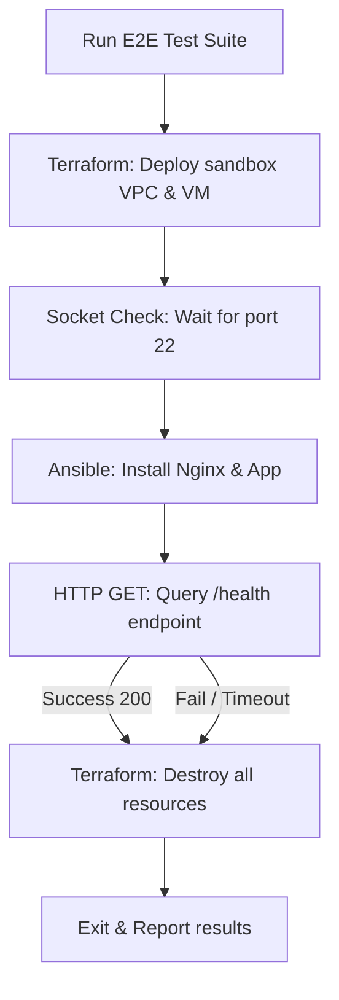

# End-to-End (E2E) Testing: Orchestrating Full Pipeline Audits

Unit and integration tests verify code in isolation. However, to guarantee that your provisioning (Terraform), configuration management (Ansible), and application code work together, you must run **End-to-End (E2E) Testing**.

In an E2E test, a Python script:
1. Deploys real infrastructure (VPCs, virtual machines, firewalls) in a sandbox environment.
2. Configures the operating systems and installs the application stack.
3. Performs validation tests (e.g., sending HTTP requests to the public IP).
4. Cleans up all resources to prevent cost leaks.

In this guide, we will examine the lifecycle of E2E tests, implement validation checks, and write a Pytest suite to manage the full deployment lifecycle.

---

## E2E Testing Lifecycle



> [!CAUTION]
> E2E tests deploy real cloud resources. To prevent cost leaks, you must wrap all setup steps in a `try...finally` block or use Pytest fixtures with teardown guarantees to ensure resources are destroyed even if tests fail.

---

## 1. Implementing the E2E Pipeline in Pytest

We will write a Pytest test suite that uses a module-scoped fixture to handle setup and teardown tasks.

```python
# Save this file as test_pipeline_e2e.py
import json
import os
import socket
import subprocess
import time
import pytest
import requests

TF_DIR = "./terraform_e2e"

def wait_for_port(ip, port=22, timeout=180):
    """Pings port 22 until the port is reachable."""
    start = time.time()
    while time.time() - start < timeout:
        try:
            with socket.create_connection((ip, port), timeout=3):
                return True
        except (socket.timeout, ConnectionRefusedError, OSError):
            time.sleep(5)
    return False

@pytest.fixture(scope="module")
def provisioned_infrastructure():
    """
    Module-scoped fixture that deploys resources via Terraform,
    returns the public IP, and destroys the resources after tests complete.
    """
    print("\n[E2E Setup] Initializing Terraform deploy...")
    
    # 1. Run init and apply
    subprocess.run(["terraform", "init"], cwd=TF_DIR, check=True)
    apply_res = subprocess.run(["terraform", "apply", "-auto-approve"], cwd=TF_DIR)
    
    if apply_res.returncode != 0:
        # Run destroy immediately if apply failed midway to prevent orphaned resources
        subprocess.run(["terraform", "destroy", "-auto-approve"], cwd=TF_DIR)
        raise RuntimeError("Terraform Apply failed during E2E setup.")

    # 2. Extract public IP output
    output_res = subprocess.run(["terraform", "output", "-json"], cwd=TF_DIR, capture_output=True, text=True, check=True)
    outputs = json.loads(output_res.stdout)
    server_ip = outputs.get("public_ip", {}).get("value")
    
    print(f"[E2E Setup] Infrastructure deployed. Public IP: {server_ip}")
    
    # Yield the IP address to the test functions
    yield server_ip
    
    # 3. Teardown: Destroy resources
    print(f"\n[E2E Teardown] Initiating infrastructure cleanup for {server_ip}...")
    subprocess.run(["terraform", "destroy", "-auto-approve"], cwd=TF_DIR)
    print("[E2E Teardown] Cleanup completed.")

def test_full_application_deployment(provisioned_infrastructure):
    server_ip = provisioned_infrastructure
    
    # Step 1: Wait for SSH to initialize
    print("\n[Test Step 1/3] Verifying SSH daemon state...")
    assert wait_for_port(server_ip, port=22), "SSH port did not become reachable."

    # Step 2: Run Ansible Playbook to configure Nginx
    print("\n[Test Step 2/3] Triggering Ansible configuration playbooks...")
    ansible_cmd = [
        "ansible-playbook",
        "./ansible/playbooks/deploy.yml",
        "-i", f"{server_ip},",
        "--extra-vars", "ansible_user=ubuntu"
    ]
    ansible_res = subprocess.run(ansible_cmd, capture_output=True, text=True)
    assert ansible_res.returncode == 0, f"Ansible run failed:\n{ansible_res.stderr}"

    # Step 3: Verify the application is healthy
    print("\n[Test Step 3/3] Running health checks...")
    health_url = f"http://{server_ip}/health"
    
    # Poll the endpoint to give the service time to start
    app_running = False
    for _ in range(5):
        try:
            response = requests.get(health_url, timeout=5)
            if response.status_code == 200:
                data = response.json()
                if data.get("status") == "healthy":
                    app_running = True
                    break
        except requests.RequestException:
            pass
        time.sleep(5)
        
    assert app_running, f"Application health check failed on: {health_url}"
```

---

## Summary

End-to-End (E2E) testing verifies that your provisioning, configuration management, and application code work together in a real environment. By wrapping setup and teardown tasks in module-scoped fixtures, you can run tests safely and clean up resources automatically. In the next section, we will cover **test coverage**.
