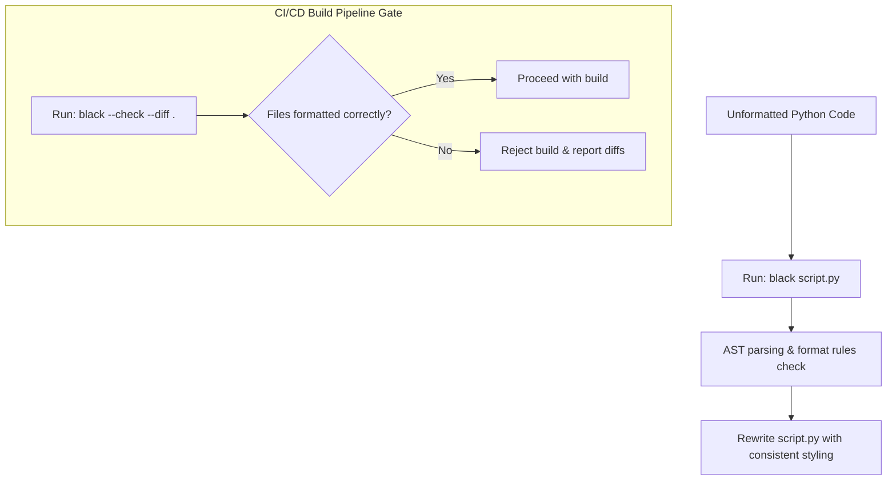

# Black Formatter: Automating PEP 8 Compliance

While the PEP 8 style guide defines formatting rules, enforcing them manually is tedious. Developers spend valuable code review time commenting on line spacing, quote styles, and bracket alignments.

**Black** is an automatic, "uncompromising" code formatter for Python. By design, Black has few configuration options. It parses your code files, removes manual formatting, and outputs a consistent layout that adheres to PEP 8 standards.

In this guide, we will cover how Black formats code, install the package, configure settings in a `pyproject.toml` file, and run formatting checks in your build pipelines.

---

## The Automated Formatting Workflow



---

## How Black Formats Code

Black applies strict rules to normalize code style:
1. **Double Quotes**: Normalizes all string literals to use double quotes (`"string"`), unless the string contains double quotes, in which case it preserves single quotes to avoid escape characters.
2. **Line Wrapping**: Wraps code lines at **88 characters** (slightly longer than PEP 8's 79 characters, optimized for modern wide-screen monitors).
3. **Trailing Commas**: Adds trailing commas to function calls and lists when they span multiple lines, making git diffs cleaner.

---

## 1. Installation

Install Black using pip:

```bash
pip install black
```

Verify the CLI tool is available:
```bash
black --version
```

---

## 2. Formatting Files via the CLI

To format a specific Python file in place:
```bash
black app.py
```

To format all Python files recursively in the current directory:
```bash
black .
```

### Checking Formats in CI/CD Pipelines
In a build pipeline, you do not want to format files dynamically (which would modify code silently). Instead, check if the committed code is formatted correctly using the `--check` and `--diff` flags:

```bash
black --check --diff .
```
If any file is unformatted, Black will print the styling differences and return a non-zero exit code (1) to fail the build.

---

## 3. Configuring Settings in `pyproject.toml`

For projects that require custom formatting rules (such as matching a 79-character line limit or excluding specific folders), define settings in a **`pyproject.toml`** file in the project root:

```toml
[tool.black]
line-length = 79
target-version = ['py310']
include = '\.pyi?$'
exclude = '''
/(
    \.git
  | \.hg
  | \.mypy_cache
  | \.tox
  | \.venv
  | _build
  | buck-out
  | build
  | dist
)/
'''
```

---

## 4. Code Formatting Example

Let's look at how Black formats code:

### Before Running Black:
```python
# Badly formatted list and dictionary formatting
my_list = [
    1, 2,
    3,
         4,
]
my_dict = {'key': 'value', 'secret': "unmasked", 'info': 'value2', 'port': 8080}
```

### After Running Black:
```python
# Normalized quotes, indentation, and list layout
my_list = [
    1,
    2,
    3,
    4,
]
my_dict = {
    "key": "value",
    "secret": "unmasked",
    "info": "value2",
    "port": 8080,
}
```

---

## Summary

The Black formatter automates style consistency in Python projects. By using it in your local environment and running checks in your CI/CD pipelines, you can ensure your codebase remains clean and readable without manual formatting effort. In the next section, we will cover the **Flake8 linter**.
