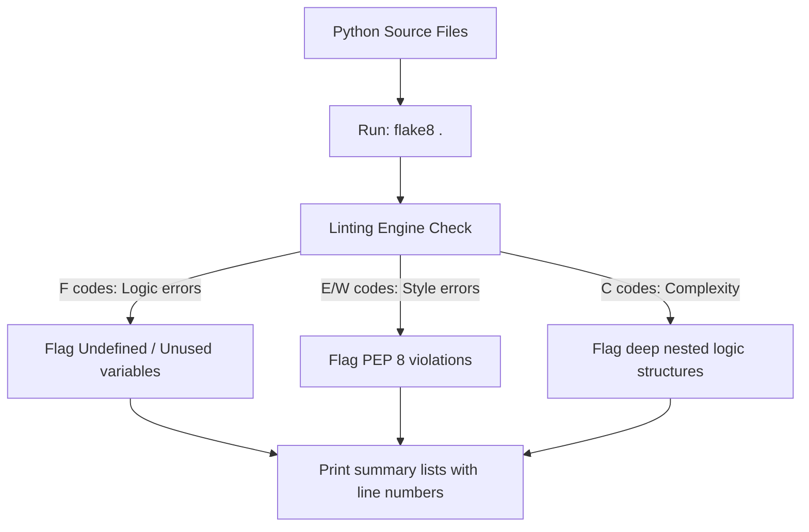

# Flake8 Linter: Code Analysis and Logic Checks

While code formatters (like Black) handle layout, style alone does not make your code correct. A beautifully formatted file can still contain logical bugs, such as importing a library but never using it, referencing an undefined variable, or nesting too many conditional statements.

**Flake8** is a wrapper library that combines three code checking engines:
1. **PyFlakes**: Analyzes code for logical errors (like undefined names or unused variables).
2. **pycodestyle**: Checks code for style violations defined in PEP 8.
3. **McCabe**: Measures code complexity (the cyclomatic complexity score) to identify functions that are too complex.

In this guide, we will examine Flake8 error codes, configure settings in a `.flake8` file, and write a script containing common errors to show how Flake8 flags them.

---

## The Linting Workflow



---

## Flake8 Warning and Error Codes

Flake8 prefixes its warning messages with a code indicating the source:

| Prefix Code | Source Checker | Example Warnings |
| :--- | :--- | :--- |
| **`F`** | **PyFlakes** | `F401`: Module imported but unused.<br/>`F821`: Undefined variable name. |
| **`E`** | **pycodestyle** | `E225`: Missing whitespace around operator.<br/>`E501`: Line length exceeds limit. |
| **`W`** | **pycodestyle** | `W291`: Trailing whitespace found.<br/>`W391`: Blank line found at end of file. |
| **`C`** | **McCabe** | `C901`: Function is too complex (high cyclomatic score). |

---

## 1. Installation

Install Flake8 using pip:

```bash
pip install flake8
```

Verify the command-line interface:
```bash
flake8 --version
```

---

## 2. Running Flake8 via the CLI

To scan all files in your project recursively:
```bash
flake8 .
```

To limit scanning to a single file:
```bash
flake8 app.py
```

### Format and Line Number Outputs
When Flake8 finds violations, it prints details including the line and column number:
```text
./app.py:1:1: F401 'sys' imported but unused
./app.py:5:10: F821 undefined name 'config_file'
./app.py:12:80: E501 line too long (82 > 79 characters)
```

---

## 3. Configuring Exclusions in a `.flake8` File

To align Flake8 with formatting tools like Black (which uses an 88-character line limit instead of 79), configure exclusions in a `.flake8` file in the project root:

```ini
[flake8]
# Ignore specific warning codes
# E501: Ignore default 79 line limit (handled by Black's 88 limit)
# W503: Line break occurred before binary operator
ignore = E501, W503

# Exclude specific directories from scanning
exclude =
    .git,
    __pycache__,
    .venv,
    build,
    dist

# Configure maximum McCabe cyclomatic complexity limit
# If a function requires more than 10 decisions, flag it
max-complexity = 10
```

---

## 4. Code Violation Example

Let's look at how Flake8 flags errors:

### Non-Compliant Code (`src_error.py`):
```python
# Unused import (F401)
import sys
import os

def calculate_system_metrics(a, b):
    # Undefined variable reference (F821)
    # Spacing violations around operators (E225)
    total=a+b+c
    return total
```

### Flake8 Output:
```text
src_error.py:2:1: F401 'sys' imported but unused
src_error.py:8:10: E225 missing whitespace around operator
src_error.py:8:15: F821 undefined name 'c'
```

---

## Summary

The Flake8 linter helps you identify style violations and logical bugs in your Python code. By configuring settings in a `.flake8` file to align with formatters like Black, you can enforce code quality checks in your project. In the next section, we will cover **Pylint**.
