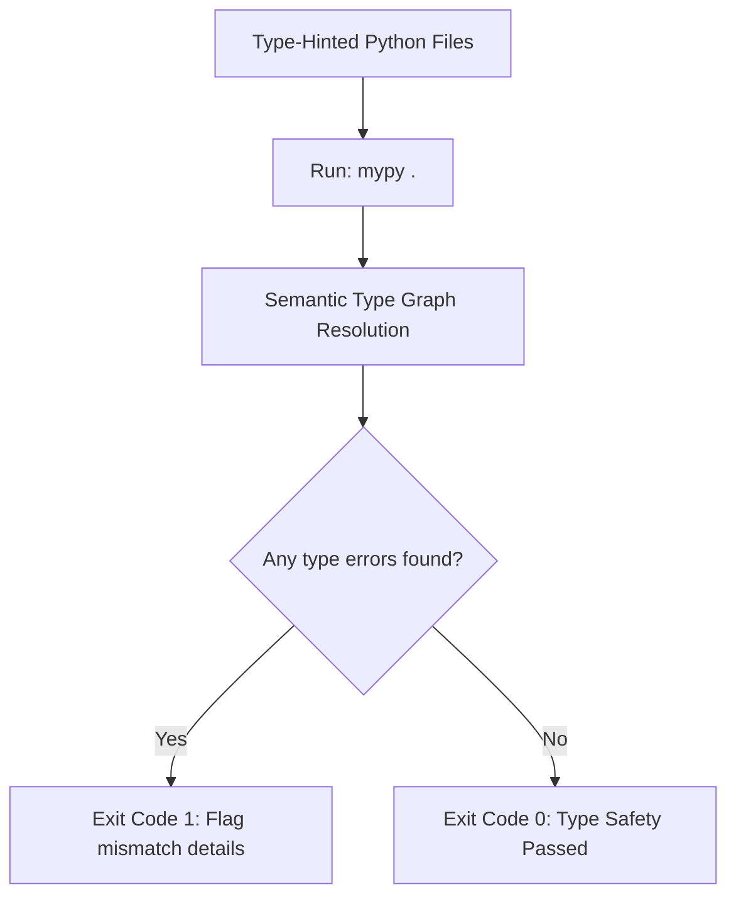

# Mypy Type Checking: Enforcing Static Type Safety

While adding type hints (like `port: int`) improves code readability, Python ignores these annotations at runtime. To enforce type safety and catch errors before execution, you need a **static type checker**.

**`mypy`** is the standard static type checker for Python. It analyzes your type-hinted code files, tracks variables assignments and function calls, and identifies type mismatches without executing the scripts.

In this guide, we will install the library, configure checking rules in a `mypy.ini` file, and write a script containing type errors to show how mypy flags them.

---

## Static Type Checking Pipeline



---

## 1. Installation

Install mypy using pip:

```bash
pip install mypy
```

Verify that the CLI command is available:
```bash
mypy --version
```

---

## 2. Running mypy via the CLI

To scan all files in your project:
```bash
mypy .
```

To scan a specific file:
```bash
mypy app.py
```

### Type Error Output Example
If mypy finds type mismatches, it prints details including the line number and error description:

```text
app.py:10: error: Argument 1 to "connect" has incompatible type "str"; expected "int"
app.py:15: error: Incompatible return value type (got "None", expected "bool")
```

---

## 3. Configuring Settings in `mypy.ini`

To customize checking rules (such as requiring all functions to be typed or ignoring missing library imports), create a **`mypy.ini`** file in your project root:

```ini
[mypy]
# Enforce strict type checking settings
warn_return_any = True
warn_unused_configs = True

# Require type annotations for all functions
disallow_untyped_defs = True
disallow_incomplete_defs = True

# Ignore missing type annotations for third-party libraries
# (e.g. libraries that do not have type declarations)
ignore_missing_imports = True

# Exclude specific directories from scanning
exclude = (venv|\.venv|build|dist)
```

---

## 4. Type Error Detection Example

Let's write a script containing type mismatches to analyze mypy's output:

### Code with Type Errors (`type_errors.py`):
```python
# type_errors.py

def configure_port(port: int) -> bool:
    """Configures system port settings."""
    if port < 1024:
        return False
    return True

# 1. Type Error: Passing a string argument instead of an integer
configure_port("8080")

# 2. Type Error: Assigning return value to an incompatible variable type
is_configured: int = configure_port(80)
```

### Mypy Output:
```text
type_errors.py:10: error: Argument 1 to "configure_port" has incompatible type "str"; expected "int"
type_errors.py:13: error: Incompatible types in assignment (expression has type "bool", variable has type "int")
```

---

## Summary

The `mypy` static type checker helps you identify type mismatches in your code before execution. By configuring settings in a `mypy.ini` file and running checks in your CI/CD pipelines, you can enforce type safety and write more reliable Python scripts. This completes **Chapter 51 - Code Quality**. In the next chapter, we will explore **Script Design**.
