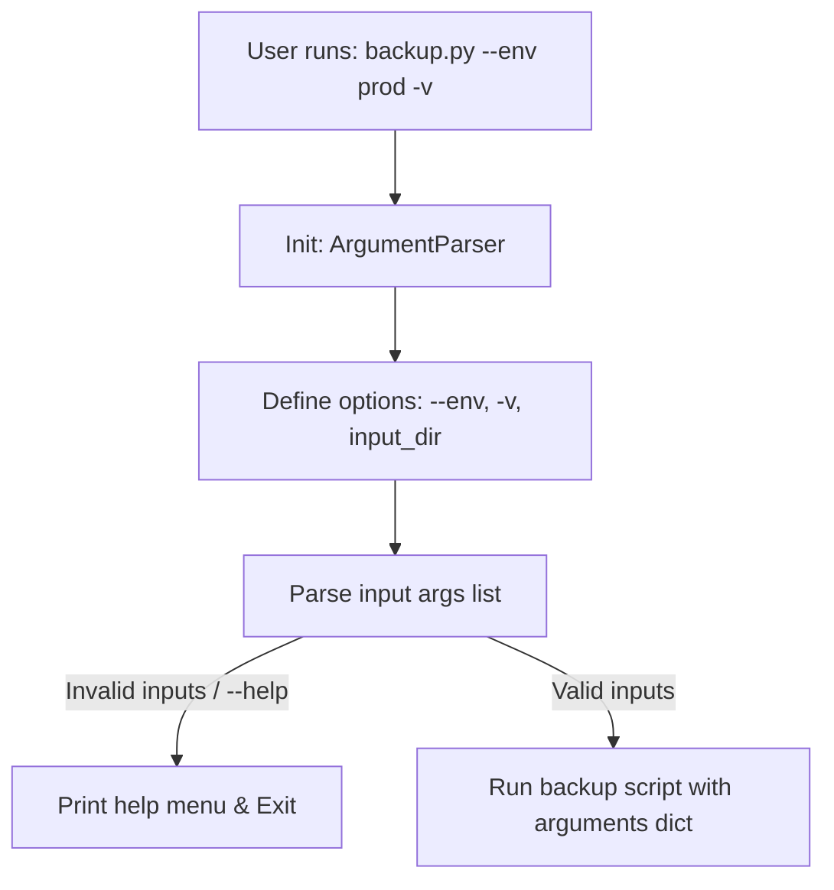

# Argument Parsing with Argparse: Professional CLI Design

DevOps automation scripts frequently run as Command Line Interface (CLI) tools. A clean CLI must support configuration arguments, flags, custom options, and auto-generated help menus to guide users.

A common scripting mistake is using **`sys.argv`** to parse command-line arguments:
```python
# AVOID: sys.argv parsing is fragile and error-prone
input_dir = sys.argv[1]
```
If a user runs the script without arguments, `sys.argv[1]` raises an `IndexError` and crashes. `sys.argv` also lacks type validation, choices enforcement, and help menus.

A better approach is to use Python's built-in **`argparse`** module. It parses arguments, converts values to the correct types, and automatically generates help menus.

In this guide, we will compare `sys.argv` and `argparse`, configure argument parsers with types and choices, and write a backup CLI utility.

---

## Argparse Command Processing Flow



---

## 1. Defining Arguments: Positional vs. Optional

`argparse` defines two categories of inputs:
* **Positional Arguments**: Required inputs that must be provided in order (e.g. `input_dir`). They do not start with a prefix dash.
* **Optional Arguments**: Key-value options (e.g. `--port 8080`) or boolean flags (e.g. `--verbose`) that default to preset values if omitted. They start with a prefix dash (`-` or `--`).

---

## 2. Advanced: Custom Types and Enforcing Choices

Beyond standard strings, `argparse` allows you to enforce validation:
* **`type=int`**: Automatically converts inputs to integers.
* **`choices=['dev', 'prod']`**: restrains inputs to a specific set of strings.
* **`action='store_true'`**: Sets the option to a boolean flag (evaluates to `True` if passed, `False` if omitted).

---

## 3. Practical Example: A Professional Backup CLI Utility

Here is a backup CLI utility that uses `argparse` to validate inputs and generate help menus:

```python
# Save this file as backup_cli.py
import argparse
import sys

def execute_backup(source_dir, destination_dir, environment, verbose=False):
    """
    Simulates executing the backup process.
    """
    print(f"\n🚀 Initiating backup in {environment.upper()} environment...")
    print(f"Source:      {source_dir}")
    print(f"Destination: {destination_dir}")
    if verbose:
        print("Log level: Verbose details active.")
    print("✅ Backup completed successfully.")
    return True

def main():
    # 1. Create the top-level parser
    parser = argparse.ArgumentParser(
        description="Backup CLI Utility for Server Directory Packaging.",
        epilog="Example: python backup_cli.py /var/log /backup/dest --env production --verbose"
    )

    # 2. Add Positional (Required) Arguments
    parser.add_argument(
        "source",
        type=str,
        help="Path to the source directory to backup."
    )
    parser.add_argument(
        "destination",
        type=str,
        help="Path to the destination directory where backup is written."
    )

    # 3. Add Optional Arguments
    parser.add_argument(
        "-e", "--env",
        type=str,
        default="development",
        choices=["development", "staging", "production"],
        help="Target runtime environment (default: development)."
    )
    
    # 4. Add Boolean Flags
    parser.add_argument(
        "-v", "--verbose",
        action="store_true",
        help="Enable verbose output logging."
    )

    # 5. Parse command-line inputs
    # If parsing fails or --help is passed, argparse prints help and exits
    args = parser.parse_args()

    # 6. Execute logic
    execute_backup(
        source_dir=args.source,
        destination_dir=args.destination,
        environment=args.env,
        verbose=args.verbose
    )

if __name__ == "__main__":
    main()
```

---

## 4. Testing the Help Menu

To view the auto-generated help menu, run the script with the `-h` or `--help` flag:

```bash
python backup_cli.py --help
```

### Output:
```text
usage: backup_cli.py [-h] [-e {development,staging,production}] [-v] source destination

Backup CLI Utility for Server Directory Packaging.

positional arguments:
  source                Path to the source directory to backup.
  destination           Path to the destination directory where backup is written.

options:
  -h, --help            show this help message and exit
  -e {development,staging,production}, --env {development,staging,production}
                        Target runtime environment (default: development).
  -v, --verbose         Enable verbose output logging.
```

---

## Summary

The built-in `argparse` module allows you to write professional command-line tools in Python. By defining positional and optional arguments, validating data types, and restricting values using choices, you can build clean, reliable CLI scripts. In the next section, we will cover the **Click** library.
