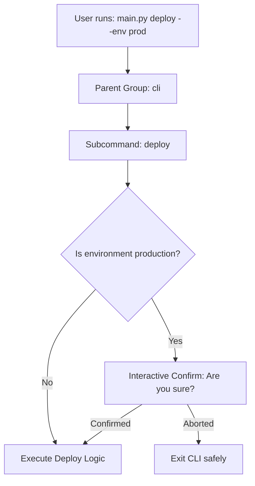

# Click Library: Building Interactive Subcommand CLIs

While Python's built-in `argparse` module is powerful, its configuration can be verbose when building complex command-line interfaces. For CLIs with nested subcommands (like `git clone` or `docker run`), `argparse` requires complex configurations.

**Click** (Command Line Interface Creation Kit) is a popular third-party package for building CLIs in Python. It uses a clean, decorator-based syntax to declare arguments, options, and subcommand groups.

Click also includes built-in helpers for interactive CLIs, such as:
* **Subcommand Groups**: Nest commands hierarchically under a parent CLI group.
* **Console Colors**: Print formatted text using standard ANSI escape codes.
* **Interactive Prompts**: Prompt users for missing inputs or request confirmations (e.g. asking "Are you sure?" before destroying resources).

In this guide, we will cover Click decorators, build nested subcommands, configure interactive validation prompts, and write a deployment management script.

---

## Nested Subcommands Workflow



---

## 1. Installation

Install the Click library using pip:

```bash
pip install click
```

---

## 2. click CLI Basics: Arguments, Options, and Groups

Click uses three primary decorators:
1. **`@click.group()`**: Declares a parent group that can contain subcommands.
2. **`@click.option()`**: Configures optional parameters with values or boolean flags.
3. **`@click.argument()`**: Configures required positional inputs.

---

## 3. Practical Example: Infrastructure Subcommand Manager

Here is an infrastructure manager script that implements a subcommand CLI group containing `deploy` and `destroy` commands:

```python
# Save this file as infra_cli.py
import click

# 1. Define the parent CLI group
@click.group()
def cli():
    """
    Infrastructure Management Console CLI.
    """
    pass

# 2. Define the 'deploy' subcommand
@click.command()
@click.option(
    "--env",
    type=click.Choice(["dev", "staging", "prod"]),
    default="dev",
    help="Target environment."
)
@click.option(
    "--verbose",
    is_flag=True,
    help="Enable verbose logs."
)
def deploy(env, verbose):
    """
    Deploy cloud infrastructure configurations.
    """
    # click.secho prints colored text to console using ANSI codes
    click.secho(f"🚀 Initializing deployment to '{env.upper()}'...", fg="green", bold=True)
    if verbose:
        click.echo("Logs: Verbose tracing active.")
    click.echo("✅ Deployment completed successfully.")

# 3. Define the 'destroy' subcommand
@click.command()
@click.option(
    "--env",
    required=True,
    type=click.Choice(["dev", "staging", "prod"]),
    help="Environment target to destroy."
)
def destroy(env):
    """
    Destroy cloud infrastructure resources.
    """
    # Enforce confirmation prompt for production environments
    if env == "prod":
        # click.confirm prompts the user [y/N] and aborts if they enter N
        click.confirm(
            "🚨 WARNING: You are about to destroy production resources! Are you sure?",
            abort=True
        )
        
    click.secho(f"🗑️ Initiating resource destruction in '{env.upper()}'...", fg="red")
    click.echo("✅ Resources successfully removed.")

# 4. Attach subcommands to the parent CLI group
cli.add_command(deploy)
cli.add_command(destroy)

if __name__ == "__main__":
    cli()
```

---

## 4. Testing the click CLI

To view the parent group help menu, run:
```bash
python infra_cli.py --help
```

### Output:
```text
Usage: infra_cli.py [OPTIONS] COMMAND [ARGS]...

  Infrastructure Management Console CLI.

Options:
  --help  Show this message and exit.

Commands:
  deploy   Deploy cloud infrastructure configurations.
  destroy  Destroy cloud infrastructure resources.
```

To run the `destroy` command on production and trigger the confirmation prompt:
```bash
python infra_cli.py destroy --env prod
```

---

## Summary

The `click` library simplifies the process of building interactive command-line interfaces. By leveraging decorator-based declarations, console colors, and confirmation prompts, you can design clean, reliable CLI scripts. In the next section, we will cover **configuration management**.
