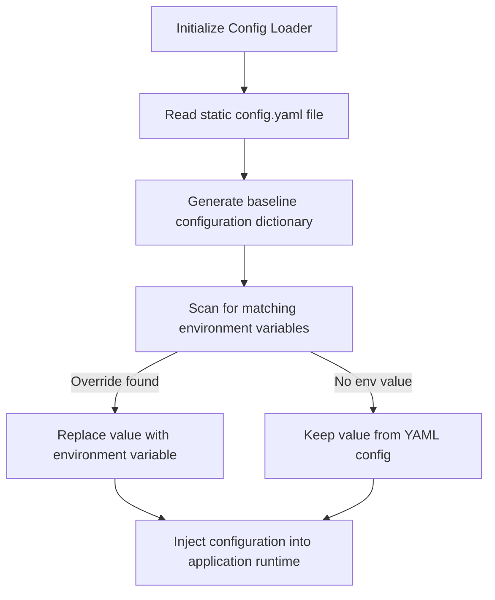

# Configuration Management: YAML, JSON, and TOML Parsers

As automation scripts scale, they require dynamic parameters, such as database ports, target domains, and alert email lists. Hardcoding these values directly in your code is a major anti-pattern. 

A better approach is to manage configurations in external, structured files (like JSON, YAML, or TOML) and load them into your scripts at runtime. 

To support deployment flexibility, your configuration loader should follow an **override hierarchy**: load static defaults from a configuration file, and override them with environment variables at runtime if they are defined.

In this guide, we will compare configuration formats (JSON, YAML, TOML), design a configuration loader class in Python, and write a script to merge file-based parameters with environment overrides.

---

## Configuration Override Flow



---

## Configuration Formats Comparison

### 1. JSON (`config.json`)
* *Pros*: Built-in support in the Python standard library; universally supported by web APIs.
* *Cons*: Does not support comments, making it difficult to document configuration settings.

### 2. YAML (`config.yaml`)
* *Pros*: Supports comments, nested block hierarchies, and is highly readable.
* *Cons*: Requires a third-party dependency (`pyyaml`); parsing can be slow.

### 3. TOML (`config.toml`)
* *Pros*: Standard configuration format for Python tools (e.g. `pyproject.toml`); supported natively in Python 3.11+ via `tomllib`.
* *Cons*: Less intuitive for deep nested hierarchies compared to YAML.

---

## 1. Creating the Configuration File (`config.yaml`)

We will use YAML for our static configuration file to support comments:

```yaml
# configuration values for billing service
app:
  port: 8080
  environment: "development"

database:
  host: "db.local"
  port: 5432
  username: "db_user"
  # Password is omitted here; should be loaded from environment variables
```

---

## 2. Implementing a Configuration Loader with Environment Overrides

Install the required PyYAML package:
```bash
pip install pyyaml
```

Here is a Python class that loads a YAML configuration file and overrides its values with environment variables if present:

```python
# Save this file as config_loader.py
import os
import yaml

class ConfigurationManager:
    def __init__(self, yaml_filepath):
        self.yaml_filepath = yaml_filepath
        self.config = self._load_yaml()

    def _load_yaml(self):
        """Loads and parses the YAML configuration file."""
        if not os.path.exists(self.yaml_filepath):
            raise FileNotFoundError(f"Configuration file missing: {self.yaml_filepath}")
            
        with open(self.yaml_filepath, "r", encoding="utf-8") as f:
            # Always use safe_load to prevent arbitrary code execution vulnerabilities
            return yaml.safe_load(f)

    def get_value(self, key_path, env_override_key=None, default=None):
        """
        Retrieves a configuration value from the nested key path (e.g., 'database.host').
        Overrides the value with an environment variable if env_override_key is defined.
        """
        # 1. Check for environment override first
        if env_override_key:
            env_val = os.environ.get(env_override_key)
            if env_val:
                return env_val

        # 2. Navigate nested dictionary path
        keys = key_path.split(".")
        current_level = self.config
        
        for k in keys:
            if isinstance(current_level, dict) and k in current_level:
                current_level = current_level[k]
            else:
                return default
                
        return current_level
```

---

## 3. Configuration Loader Execution Script

Here is an integration script showing how to resolve static parameters and override the database password dynamically at runtime:

```python
# Save this file as scripts/run_app.py
# (Requires the ConfigurationManager class defined above)

def start_application():
    # 1. Initialize manager
    config_file = "config.yaml"
    cfg = ConfigurationManager(config_file)
    
    # 2. Extract values
    app_port = cfg.get_value("app.port")
    db_host = cfg.get_value("database.host", env_override_key="DATABASE_HOST")
    
    # Password must be loaded from environment variables for security
    db_pass = cfg.get_value("database.password", env_override_key="DATABASE_PASSWORD")
    
    print("\n--- Configuration Loaded ---")
    print(f"App Port: {app_port}")
    print(f"DB Host:  {db_host}")
    print(f"DB Pass:  {'***' if db_pass else 'Not Set'}")
    
    if not db_pass:
        print("❌ Initialization error: DATABASE_PASSWORD is not set in environment.")
        return False
        
    print("✅ Configuration validated. Starting application service...")
    return True

# if __name__ == "__main__":
#     # Simulate setting environment password
#     os.environ["DATABASE_PASSWORD"] = "VaultSecretPass"
#     start_application()
```

---

## Summary

Managing configurations in external structured files is a best practice for Python scripts. By using YAML for readability, implementing safe loading with `yaml.safe_load()`, and overriding values with environment variables, you can build flexible, secure configuration pipelines. In the next section, we will cover **idempotent scripts**.
