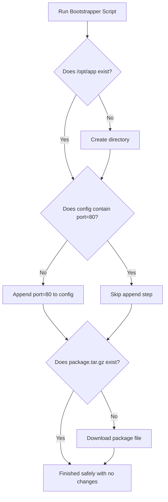

# Idempotent Scripts: Designing Safe, Repeatable Automations

In DevOps, **Idempotency** is the property where executing a script multiple times yields the same system state, without generating duplicate resources, throwing errors, or corrupting data.

If a script is not idempotent, running it repeatedly can cause issues:
* A script that configures a config file might append the same line (e.g. `port=80`) on every execution, resulting in duplicate settings.
* A folder creation script could crash on its second run with a `FileExistsError`.
* A file transfer script might download a large package repeatedly, wasting bandwidth and disk space.

To prevent this, you should design your scripts to check the system state before making changes. In this guide, we will examine idempotency check patterns and write a script to bootstrap a server directory structure.

---

## Idempotency Logic Flow



---

## 1. Idempotency Check Patterns

### File Line Inclusion Checks
Before appending a line to a configuration file, parse the file to check if the target line is already present:

```python
def append_to_file_idempotent(filepath, config_line):
    """
    Appends a line to a file only if the line is not already present.
    """
    if not os.path.exists(filepath):
        # If file is missing, create it and write the line
        with open(filepath, "w", encoding="utf-8") as f:
            f.write(config_line + "\n")
        return True

    # Read file and verify if line exists
    with open(filepath, "r", encoding="utf-8") as f:
        content = f.read().splitlines()

    if config_line in content:
        # Line already exists, skip write
        return False
        
    # Append line
    with open(filepath, "a", encoding="utf-8") as f:
        f.write(config_line + "\n")
    return True
```

---

## 2. Practical Example: Safe Server Bootstrapper Script

Here is a bootstrap script that creates directories, configures configuration settings, and downloads files in an idempotent manner:

```python
# Save this file as bootstrap.py
import os
import urllib.request
import hashlib

class ServerBootstrapper:
    def __init__(self, target_dir):
        self.target_dir = target_dir
        self.config_file = os.path.join(target_dir, "app.conf")
        self.dependency_file = os.path.join(target_dir, "dependency.zip")

    def bootstrap(self):
        print("Starting idempotent system bootstrapping...")
        
        # 1. Create target directories safely
        # 'exist_ok=True' prevents FileExistsError if the directory already exists
        os.makedirs(self.target_dir, exist_ok=True)
        print("✅ Directory structure verified.")

        # 2. Append settings line safely
        target_setting = "max_connections=500"
        with open(self.config_file, "a+", encoding="utf-8") as f:
            # Move cursor to start of file to read content
            f.seek(0)
            content = f.read()
            if target_setting not in content:
                f.write(f"\n{target_setting}\n")
                print(f"✅ Added setting: '{target_setting}'")
            else:
                print(f"ℹ️ Setting '{target_setting}' already configured. Skipping.")

        # 3. Download dependency file conditionally
        dependency_url = "https://example.com/assets/dependency.zip"
        expected_hash = "e3b0c44298fc1c149afbf4c8996fb92427ae41e4649b934ca495991b7852b855" # Mock Hash
        
        if self._should_download_dependency(expected_hash):
            print(f"Downloading dependency from {dependency_url}...")
            # In a real environment, download the file:
            # urllib.request.urlretrieve(dependency_url, self.dependency_file)
            # For demonstration, we create a mock file:
            with open(self.dependency_file, "w", encoding="utf-8") as f:
                f.write("mock_content")
            print("✅ Dependency downloaded successfully.")
        else:
            print("ℹ️ Valid dependency file already exists. Skipping download.")

    def _should_download_dependency(self, expected_hash):
        """
        Returns True if the dependency file is missing or corrupted (hash mismatch).
        """
        if not os.path.exists(self.dependency_file):
            return True
            
        # Calculate file hash to verify integrity
        sha256 = hashlib.sha256()
        with open(self.dependency_file, "rb") as f:
            for chunk in iter(lambda: f.read(65536), b""):
                sha256.update(chunk)
                
        # If the hash does not match, return True to trigger a re-download
        return sha256.hexdigest() != expected_hash
```

---

## Summary

Designing your scripts to be idempotent prevents configuration drift and runtime crashes. By checking directory states, reading configuration files before modifying them, and validating file hashes before downloading, you can write safe, repeatable automation workflows. In the next section, we will cover **script documentation**.
