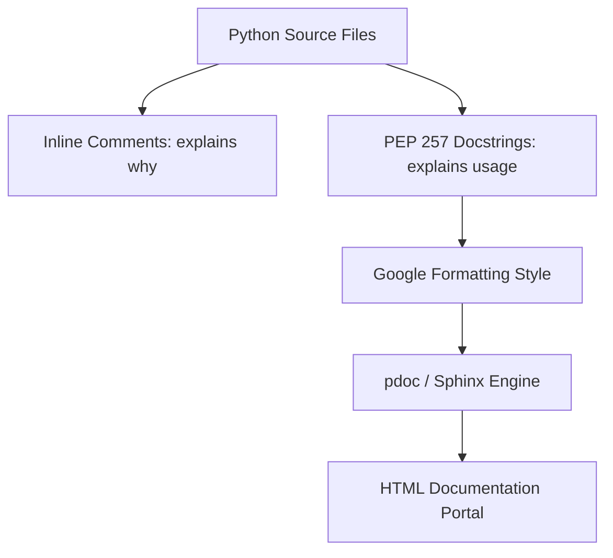

# Script Documentation: Docstrings, Comments, and API References

When writing automation scripts, documentation is as important as the code itself. DevOps scripts are often updated by different team members over time. If a script lacks comments explaining its purpose, has no docstrings detailing function arguments, and lacks help menus, maintaining it becomes difficult.

In Python, documentation is organized at three levels:
1. **Inline Comments**: Explain *why* a specific block of code was written (rather than restating what the code does).
2. **Docstrings (PEP 257)**: Structured strings declared directly under modules, classes, and functions to document APIs.
3. **Auto-Generated Documentation**: Tools (like `pdoc` or `Sphinx`) that parse your docstrings and compile them into HTML documentation pages.

In this guide, we will cover inline comment guidelines, compare docstring formatting styles, write Google-style docstrings, and generate HTML API documentation.

---

## The Documentation Stack



---

## 1. Docstring Formatting Styles (Google Style)

While Sphinx uses reStructuredText syntax, the **Google Docstring Style** is widely used in the Python community due to its readability.

A Google-style docstring includes sections for:
* **`Args`**: Parameters list with data types and descriptions.
* **`Returns`**: The type and description of the return value.
* **`Raises`**: Exceptions that the function can throw.

```python
def fetch_logs(host: str, limit: int = 100) -> list[str]:
    """
    Retrieves system log lines from a remote server.

    Args:
        host: The IP address or DNS hostname of the remote server.
        limit: The maximum number of log lines to retrieve (default: 100).

    Returns:
        A list of raw log strings fetched from the server.

    Raises:
        ConnectionRefusedError: If the remote host port is unreachable.
    """
    pass
```

---

## 2. Practical Example: A Fully Documented Python Module

Here is a module that contains module-level docstrings, class docstrings, and Google-style function annotations:

```python
# Save this file as log_exporter.py
"""
Log Exporter Module
===================
Provides utilities to process and ship local file logs to remote syslog servers.
"""

import os
import socket

class SyslogExporter:
    """
    Handles network sockets to export log files to a centralized Syslog daemon.
    
    Attributes:
        syslog_host (str): Target hostname.
        syslog_port (int): Target UDP port.
    """

    def __init__(self, syslog_host: str, syslog_port: int = 514) -> None:
        """
        Initializes the syslog connection details.
        """
        self.syslog_host = syslog_host
        self.syslog_port = syslog_port

    def ship_log_file(self, filepath: str) -> int:
        """
        Reads a local file line-by-line and streams it to the remote syslog UDP port.

        Args:
            filepath: The absolute path to the local log file on disk.

        Returns:
            The total number of log lines successfully sent.

        Raises:
            FileNotFoundError: If the local log file is missing.
            socket.error: If a network socket connection failure occurs.
        """
        # Inline Comment: We use os.path.exists before opening to raise a
        # clean exception instead of letting open() fail deep in the execution.
        if not os.path.exists(filepath):
            raise FileNotFoundError(f"Log file not found: {filepath}")

        sent_lines_count = 0
        sock = socket.socket(socket.AF_INET, socket.SOCK_DGRAM) # UDP
        
        try:
            with open(filepath, "r", encoding="utf-8") as f:
                for line in f:
                    message = line.strip()
                    if message:
                        # Stream line over UDP
                        sock.sendto(message.encode("utf-8"), (self.syslog_host, self.syslog_port))
                        sent_lines_count += 1
            return sent_lines_count
        finally:
            sock.close()
```

---

## 3. Auto-Generating Documentation with `pdoc`

The fastest way to generate documentation from your docstrings is using the **`pdoc`** package. It generates a single-page HTML documentation site for your module.

Install the package:
```bash
pip install pdoc
```

To compile and launch the HTML documentation server locally:
```bash
pdoc log_exporter.py
```
This runs a local web server (typically `http://localhost:8080`) containing your formatted docstrings and API references.

To build the HTML files to disk for hosting on static servers (like GitHub Pages):
```bash
pdoc -o ./docs log_exporter.py
```

---

## Summary

Documenting your Python scripts with structured docstrings and comments improves code maintainability. By using the Google formatting style and tools like `pdoc` to generate HTML API references, you can help your team configure and run your automation workflows. In the next section, we will cover the **DRY principle**.
