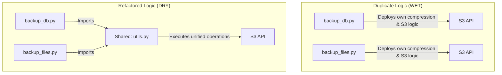

# DRY Principles in Python: Refactoring Duplicate Script Code

**DRY** stands for **Don't Repeat Yourself**. This core software engineering principle states that every piece of knowledge or logic must have a single, unambiguous representation within a system.

In DevOps, scripting is often done quickly to solve immediate problems. This can lead to code duplication (sometimes called **WET** coding: "Write Everything Twice"). For example, a developer might copy-paste an S3 connection routine or log configuration block across five different script files.

This duplication makes the codebase difficult to maintain: if you change your S3 connection settings (e.g., adding an API timeout), you have to find and update all five files. Any missed file introduces a bug.

In this guide, we will examine code duplication in DevOps scripts, extract shared logic into a reusable utility module (`utils.py`), and refactor our scripts to adhere to DRY principles.

---

## Refactoring to DRY Architecture



---

## 1. Before Refactoring: Analyzing Duplication

Consider these two scripts, both of which implement their own compression routines and S3 client creation:

### Database Backup Script (`backup_db.py`):
```python
# AVOID: Contains duplicated compression and S3 upload logic
import os
import tarfile
import boto3

def run_db_backup():
    db_file = "prod_db.sql"
    archive = "db.tar.gz"
    
    # Duplicated Compression logic
    with tarfile.open(archive, "w:gz") as tar:
        tar.add(db_file)
        
    # Duplicated S3 client creation
    s3 = boto3.client(
        "s3",
        aws_access_key_id=os.environ.get("AWS_KEY"),
        aws_secret_access_key=os.environ.get("AWS_SECRET")
    )
    s3.upload_file(archive, "my-bucket", "db.tar.gz")
```

### Files Backup Script (`backup_files.py`):
```python
# AVOID: Contains identical duplicated logic blocks
import os
import tarfile
import boto3

def run_files_backup():
    files_dir = "./uploads"
    archive = "uploads.tar.gz"
    
    # Duplicated Compression logic
    with tarfile.open(archive, "w:gz") as tar:
        tar.add(files_dir)
        
    # Duplicated S3 client creation
    s3 = boto3.client(
        "s3",
        aws_access_key_id=os.environ.get("AWS_KEY"),
        aws_secret_access_key=os.environ.get("AWS_SECRET")
    )
    s3.upload_file(archive, "my-bucket", "uploads.tar.gz")
```

---

## 2. Refactoring: Creating the Reusable Utility Module

We will extract the shared S3 connection and directory archiving logic into a unified utility module:

```python
# Save this file as utils.py
import os
import tarfile
import boto3

def create_tarball(source_path, output_archive):
    """Creates a compressed tar.gz archive from a file or directory."""
    if not os.path.exists(source_path):
        raise FileNotFoundError(f"Source path missing: {source_path}")
        
    print(f"Creating archive '{output_archive}' from '{source_path}'...")
    with tarfile.open(output_archive, "w:gz") as tar:
        tar.add(source_path, arcname=os.path.basename(source_path))
    return output_archive

def get_s3_client():
    """Initializes and returns an S3 client using environment variables."""
    key = os.environ.get("AWS_KEY")
    secret = os.environ.get("AWS_SECRET")
    if not key or not secret:
        raise ValueError("AWS credentials are missing from environment.")
        
    return boto3.client(
        "s3",
        aws_access_key_id=key,
        aws_secret_access_key=secret
    )
```

---

## 3. After Refactoring: Clean DRY Scripts

By importing `utils.py`, the backup scripts become shorter, easier to read, and simpler to configure:

### Refactored Database Backup Script:
```python
# Save this file as backup_db_dry.py
from utils import create_tarball, get_s3_client

def run_db_backup():
    try:
        archive = create_tarball("prod_db.sql", "db.tar.gz")
        s3 = get_s3_client()
        s3.upload_file(archive, "my-bucket", "db.tar.gz")
        print("✅ DB Backup complete.")
    except Exception as e:
        print(f"❌ DB Backup failed: {e}")
```

### Refactored Files Backup Script:
```python
# Save this file as backup_files_dry.py
from utils import create_tarball, get_s3_client

def run_files_backup():
    try:
        archive = create_tarball("./uploads", "uploads.tar.gz")
        s3 = get_s3_client()
        s3.upload_file(archive, "my-bucket", "uploads.tar.gz")
        print("✅ Files Backup complete.")
    except Exception as e:
        print(f"❌ Files Backup failed: {e}")
```

---

## Summary

Applying the DRY principle simplifies your codebase and reduces maintenance overhead. By extracting duplicated logic into reusable utility modules, you can update connection settings or compression algorithms in a single file and ensure the changes apply across all scripts. This completes **Chapter 52 - Script Design**. In the next chapter, we will explore **Performance and Optimization**.
