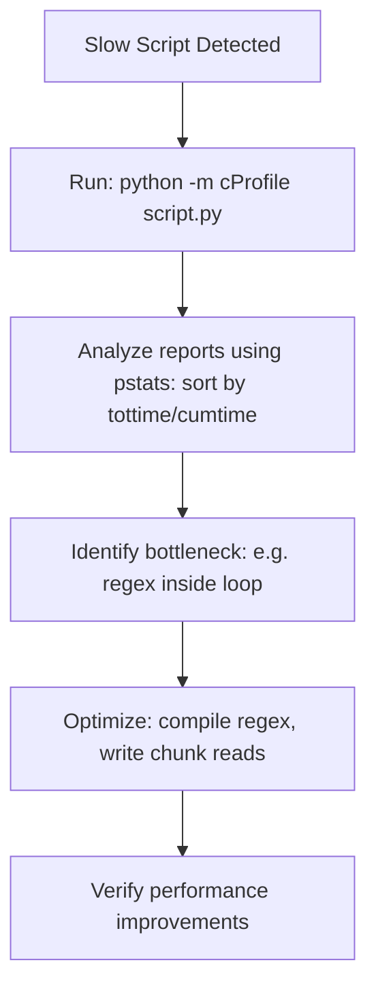

# Profiling Python Code: Identifying Performance Bottlenecks

DevOps automation scripts often process large volumes of data, such as parsing gigabytes of system log files, scanning network ports, or downloading millions of files. When a script runs slowly, guessing which block of code is the bottleneck is inefficient.

Instead, you should use **Profiling**. Profiling analyzes execution times, function calls, and CPU cycles to help you identify performance bottlenecks.

In this guide, we will cover how to measure execution times, run deterministic profiling using Python's built-in **`cProfile`** module, parse results with `pstats`, and optimize a slow log parser.

---

## Profiling and Optimization Workflow



---

## 1. Timing Code Blocks with `time`

For quick checks, use Python's built-in `time` module to measure execution duration:

```python
import time

start_time = time.perf_counter()

# Code block to measure
time.sleep(1.2)

duration = time.perf_counter() - start_time
print(f"Execution took: {duration:.4f} seconds")
```

---

## 2. Deterministic Profiling with `cProfile`

For detailed analysis, **`cProfile`** records every function call, counting how many times it was invoked and how long it took to execute.

You can run `cProfile` from the command line:
```bash
python -m cProfile -s tottime my_script.py
```
*Note: The `-s tottime` option sorts the output table by the total time spent inside each function, highlighting performance bottlenecks.*

---

## 3. Practical Example: Profiling a Log Parser

Here is an inefficient log parsing script, followed by a profiling execution script that displays performance metrics:

### Inefficient Implementation (`slow_parser.py`):
```python
# slow_parser.py
import re
import time

def parse_log_line_slow(line):
    # AVOID: Compiling the regex pattern inside the function on every call
    pattern = r"(\d{4}-\d{2}-\d{2}) \[(\w+)\] (.*)"
    match = re.match(pattern, line)
    if match:
        return match.groups()
    return None

def run_parser_job():
    # Simulate reading a large log file
    log_lines = ["2026-06-27 [ERROR] Database timeout error."] * 100000
    parsed_results = []
    
    for line in log_lines:
        res = parse_log_line_slow(line)
        if res:
            parsed_results.append(res)
            
    return len(parsed_results)
```

### The Profiling Script:
```python
# Save this file as profile_runner.py
import cProfile
import pstats
from slow_parser import run_parser_job

def profile_parser():
    # 1. Initialize Profile engine
    profiler = cProfile.Profile()
    
    # 2. Run the code inside the profiler
    profiler.enable()
    run_parser_job()
    profiler.disable()
    
    # 3. Format and print statistics
    stats = pstats.Stats(profiler)
    # Sort by total time spent inside the function (excludes subcalls)
    stats.sort_stats(pstats.SortKey.TIME)
    stats.print_stats(10) # Print top 10 bottlenecks

if __name__ == "__main__":
    profile_parser()
```

### Profiler Output Analysis:
Running `profile_runner.py` outputs a table showing where CPU cycles are consumed:

```text
         300007 function calls in 0.450 seconds

   Ordered by: internal time

   ncalls  tottime  percall  cumtime  percall filename:lineno(function)
   100000    0.210    0.000    0.380    0.000 slow_parser.py:5(parse_log_line_slow)
   100000    0.110    0.000    0.140    0.000 re.py:188(match)
   100000    0.060    0.000    0.060    0.000 re.py:289(_compile)
```
*The report reveals that `re.compile` was called 100,000 times, consuming significant execution time. Moving `re.compile()` outside the loop reduces execution time to ~0.08 seconds.*

---

## Summary

Profiling helps you identify and resolve performance bottlenecks in your Python scripts. By using `cProfile` and `pstats` to analyze execution times and function calls, you can optimize your automation code efficiently. In the next section, we will cover **concurrency overview**.
