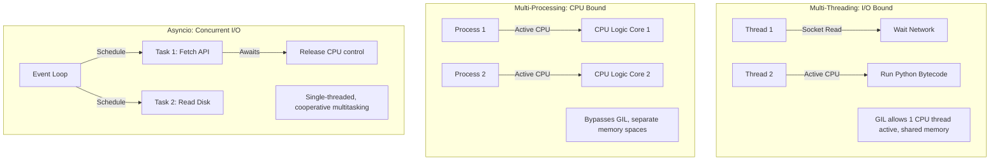

# Concurrency in Python: Threading, Multiprocessing, and Asyncio

DevOps automation scripts frequently run tasks concurrently, such as checking ports across a subnet, querying cloud APIs, or downloading backup files.

Executing these tasks sequentially can be slow. If checking one server takes 1 second, checking 100 servers sequentially takes 100 seconds. By running tasks concurrently, you can complete the work in a fraction of the time.

However, Python uses a specific concurrency model due to the **Global Interpreter Lock (GIL)**. In this guide, we will compare threading, multiprocessing, and asyncio, examine how the GIL impacts performance, and choose the right model for different task profiles.

---

## Concurrency Execution Models

---

## The Global Interpreter Lock (GIL)

The **Global Interpreter Lock (GIL)** is a mutex that prevents multiple native threads from executing Python bytecodes at the same time. This lock is necessary because Python's memory management is not thread-safe.

The GIL impacts performance differently depending on the task profile:
* **I/O-Bound Tasks**: (e.g. fetching web APIs, reading files, querying databases). Python threads release the GIL while waiting for network or disk I/O, allowing other threads to run. For these tasks, **Threading** is efficient.
* **CPU-Bound Tasks**: (e.g. data compression, cryptography, log parsing). Since the threads are constantly executing CPU instructions, they fight for the GIL, resulting in sequential execution. For these tasks, use **Multiprocessing** to bypass the GIL.

---

## Concurrency Models Comparison

| Concurrency Model | Execution Model | GIL Impact | Memory Model | Best Use Case |
| :--- | :--- | :--- | :--- | :--- |
| **`threading`** | Multi-threaded OS threads. | Blocked for CPU, released for I/O. | Shared memory space. | Basic I/O tasks, API queries. |
| **`multiprocessing`**| Spawns separate OS processes. | Bypasses GIL (multiple interpreters). | Isolated memory spaces. | CPU-intensive tasks, data parsing. |
| **`asyncio`** | Single-threaded cooperative multitasking. | No impact (single thread). | Single memory space. | High-concurrency network tasks. |

---

## Choosing the Right Concurrency Model

### Threading Workflow (I/O Bound)
If you need to query 50 virtual servers to check if port 80 is listening, the script spends 99% of its time waiting for network responses. Running these queries in parallel threads is efficient and uses minimal memory.

### Multiprocessing Workflow (CPU Bound)
If you need to parse a 10GB log file and run complex regular expressions, the script is CPU-bound. Spawning multiple processes allows you to distribute the work across multiple CPU cores, bypassing the GIL.

### Asyncio Workflow (High-Concurrency I/O)
If you are building a monitoring server that maintains 1,000 active web connections, spawning 1,000 OS threads is inefficient due to system overhead. Asyncio coordinates these tasks within a single thread, using cooperative multitasking to handle high volumes of concurrent connections.

---

## Summary

Selecting the correct concurrency model in Python requires matching your task profile to the behaviors of threading, multiprocessing, and asyncio. Understanding the Global Interpreter Lock (GIL) helps you avoid performance bottlenecks in your automation scripts. In the next section, we will cover the **threading module** in detail.
