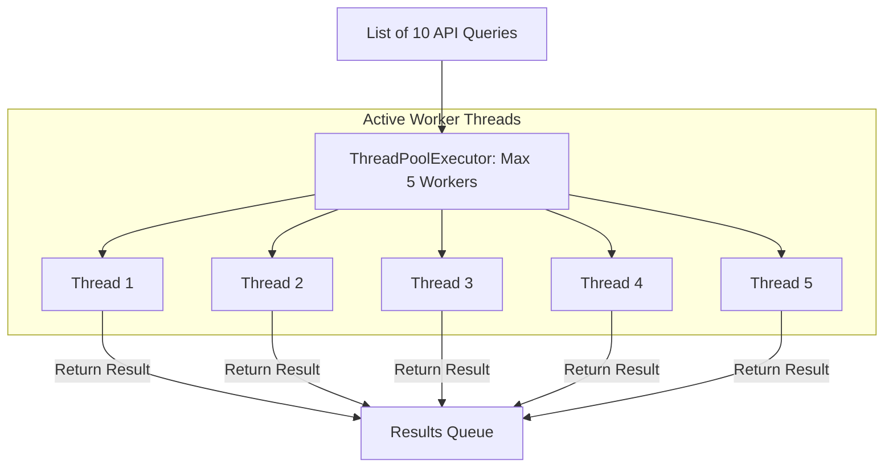

# Threading Module: Concurrency for I/O Bound Tasks

For I/O-bound tasks—such as checking port availability across a network range or querying multiple REST APIs—using Python's built-in **`threading`** module is an efficient way to execute tasks concurrently.

However, because threads share the same memory space, multithreaded code is susceptible to **Race Conditions**. A race condition occurs when multiple threads attempt to read and write to the same shared variable concurrently, leading to data corruption. To prevent this, you must coordinate thread access using **Locks**.

In this guide, we will cover how to spawn threads, coordinate access using synchronization locks, and implement high-performance thread pools using `concurrent.futures`.

---

## The Thread Pool Execution Model



---

## 1. Thread Safety: Preventing Race Conditions with Locks

If multiple threads modify a shared counter without synchronization:
```python
# Thread 1 reads value (5) -> context switch -> Thread 2 reads value (5)
# Thread 1 increments to 6 -> Thread 2 increments to 6 (we lost an increment!)
```

To prevent this, use a **`threading.Lock()`**. When a thread acquires a lock, all other threads are blocked from entering the protected code block until the active thread releases it.

Here is a thread-safe counter class:

```python
import threading

class ThreadSafeCounter:
    def __init__(self):
        self.value = 0
        self.lock = threading.Lock()

    def increment(self):
        # We use a context manager to acquire and release the lock automatically
        with self.lock:
            current = self.value
            # Artificially delay execution to simulate processing latency
            # and force potential race conditions
            import time
            time.sleep(0.001)
            self.value = current + 1
```

---

## 2. Using `concurrent.futures.ThreadPoolExecutor`

Managing individual threads manually (e.g. creating lists of `Thread` objects and calling `.join()` in a loop) is verbose. A better pattern is to use **`ThreadPoolExecutor`**, which manages a queue of tasks and a pool of worker threads automatically.

Here is a concurrent host ping checker script:

```python
# Save this file as port_checker.py
import socket
from concurrent.futures import ThreadPoolExecutor, as_completed

def check_host_port(host, port=80, timeout=3):
    """
    Checks if a port is open on the target host.
    Returns (host, status) tuple.
    """
    try:
        # socket.create_connection returns a socket object on success
        with socket.create_connection((host, port), timeout=timeout):
            return host, "OPEN"
    except (socket.timeout, ConnectionRefusedError, OSError):
        return host, "CLOSED"

def run_network_audit():
    target_hosts = [
        "8.8.8.8", "8.8.4.4", "1.1.1.1", "1.0.0.1", 
        "192.168.1.1", "192.168.1.50", "10.0.0.1"
    ]
    
    print(f"Auditing {len(target_hosts)} hosts concurrently...")
    
    # Initialize the thread pool executor
    # max_workers limits the number of concurrent threads
    with ThreadPoolExecutor(max_workers=5) as executor:
        # submit() schedules the function for execution and returns a Future object
        futures = {
            executor.submit(check_host_port, host, port=80): host 
            for host in target_hosts
        }
        
        # as_completed() yields futures as they complete execution
        for future in as_completed(futures):
            host = futures[future]
            try:
                host, status = future.result()
                print(f" - Host: {host:<15} | Status: {status}")
            except Exception as e:
                print(f"❌ Error checking host '{host}': {e}")
```

---

## Summary

The `threading` module and `ThreadPoolExecutor` provide concurrency for I/O-bound tasks like network port checks. By using synchronization locks to coordinate access to shared variables, you can prevent data corruption and race conditions. In the next section, we will cover **multiprocessing**.
